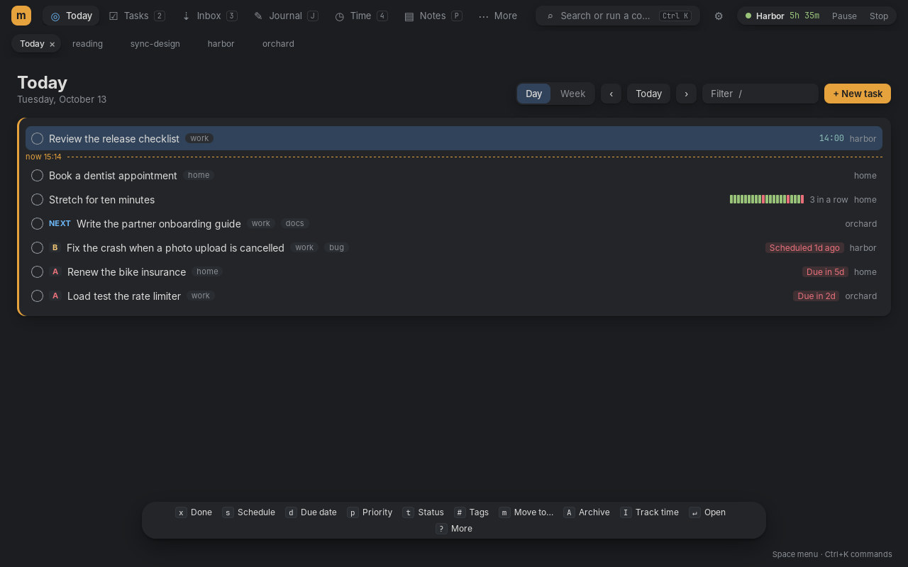
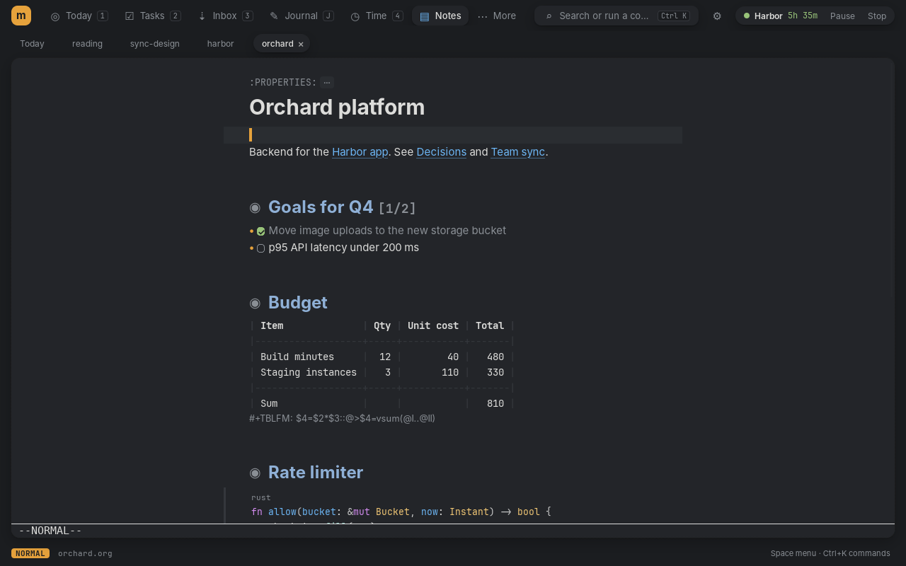
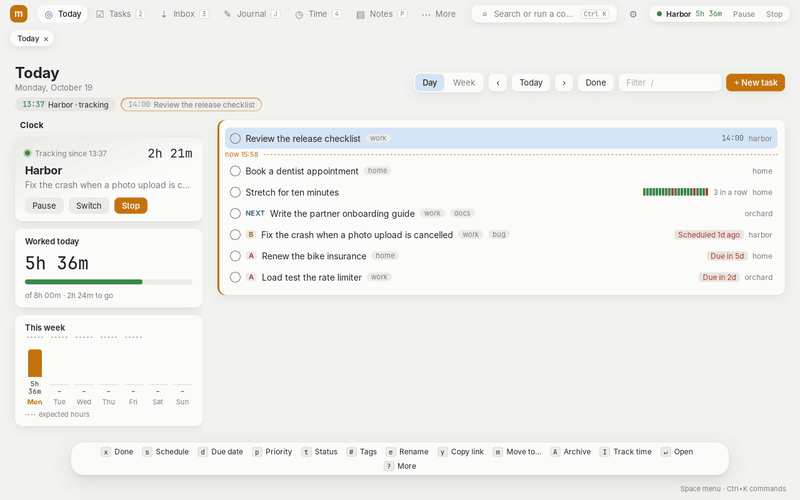
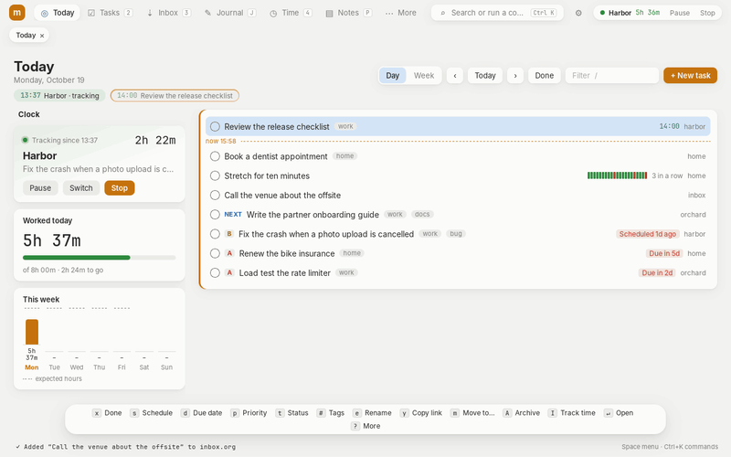
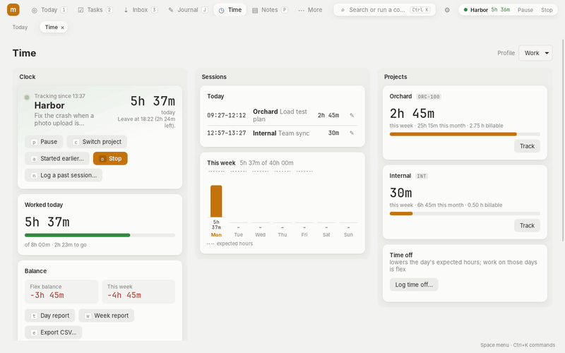
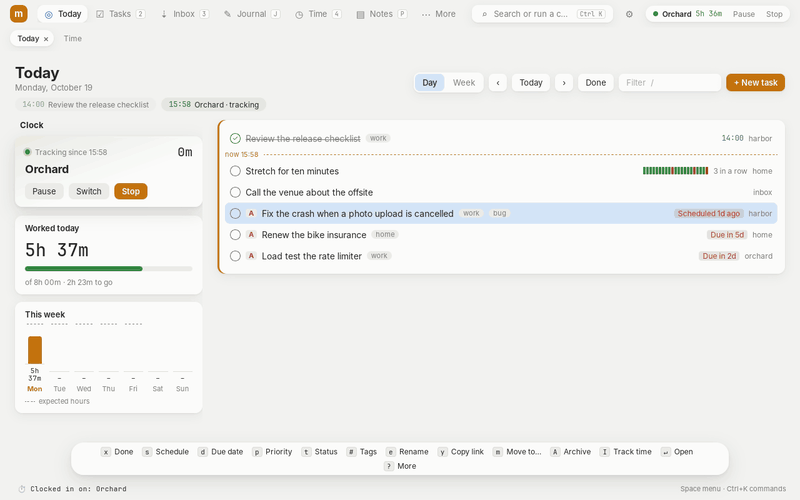
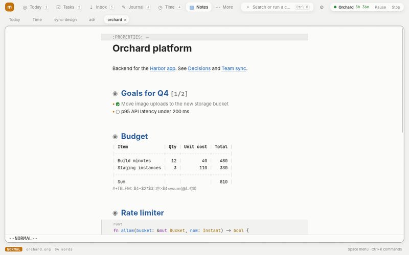
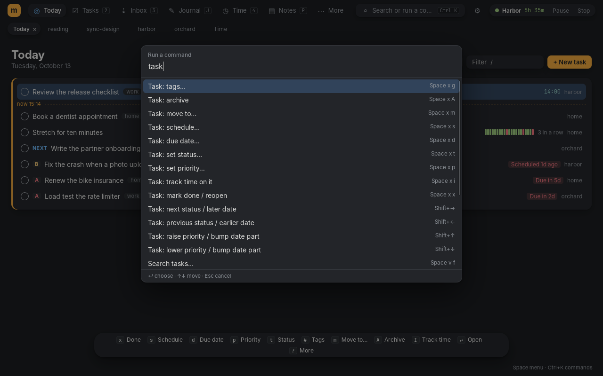
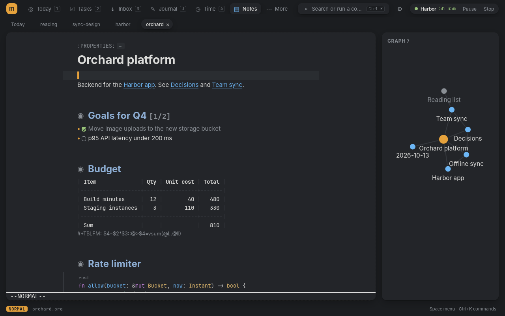
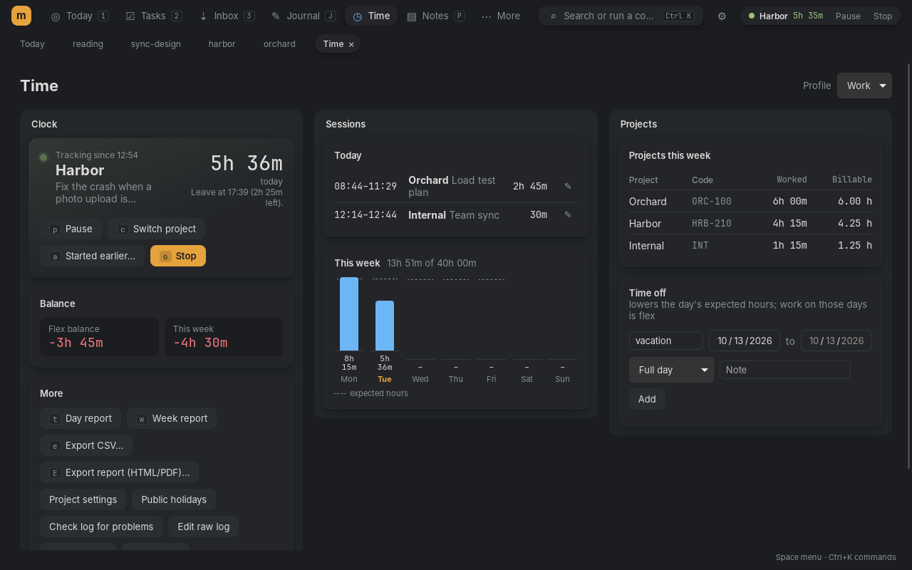

# Margin

Notes, tasks, a journal and time tracking in one fast desktop app (Linux,
macOS, Windows). Notes are plain org files, so they stay readable anywhere;
the editor has vim keys.

- **Notes** — org documents that render like a page: links, backlinks,
  unlinked mentions and a local note graph, tables with formulas, code blocks, inline images, folding.
- **Tasks** — Today and All tasks views, schedules, deadlines, priorities,
  tags, repeaters; capture from anywhere with a global shortcut.
- **Journal** — a daily note, one keypress away; `Space n [` / `Space n ]`
  step to the previous / next existing entry, `Space n t` lists
  entries from this day in earlier years and months. Set a `journal_template`
  (Settings) to give each new entry a skeleton, e.g. `* Plan`; `%t` expands
  to that day's date (prompts and `%?` are ignored). `Space n k` carries
  over the previous entry's open items: unchecked `- [ ]` items and TODO
  subtrees (not done or `:ARCHIVE:`) move under `* Carried over from <date>`
  in today's entry; `Space n u` puts them back. `Space t R` writes a
  `* Weekly review <2026-W43>` into today's entry: Inbox count, tasks closed
  this week (with `Estimates: 120% of plan` when they had an `:EFFORT:` and
  clocked time), hours per project, `:GOAL:` progress (when you have goals), overdue tasks and what's scheduled next week,
  then empty `** Went well` / `** To change` headings. Running it again
  replaces only the generated lines between `# review-begin` and
  `# review-end` (edits there are overwritten; the rest is kept), also on a
  later day of the same week, in the entry that already holds the block.
  `Space n j` logs a daily metric (Settings > Daily metrics: mood, energy,
  sleep…) as `:MOOD: 4` in the entry's top property drawer; `Space n M` shows
  them over the last 30 / 90 / 365 days (`r` switches): a sparkline per metric
  with latest, mean, range and days logged, its mean on workdays with at least
  the expected hours clocked vs shorter ones (days off left out), and a day
  table with hours clocked, where `Enter` opens that day's entry.
- **Time** — a timeclock with breaks, projects, flex balance and reports, in
  the window or the tray.
  `Space t T` shows one day's timeline: clocked sessions, tasks closed and
  notes edited, in time order. Enter opens a task or note (or edits a
  session); the first row copies the day as a Markdown list.
  `Space t A` (or *Estimates vs actuals…* in the Time view) compares
  `:EFFORT:` with clocked time on tasks closed in the last 7, 30 or 90 days:
  per project and in total, the 5 largest overruns (Enter opens one) and a
  planning factor (clocked / estimated) to apply to new estimates. Tasks with
  an estimate but no clocked time are left out of the ratio.
  `Space t H` (or *When do I work?* in the Time view) is a weekday x hour
  heatmap of clocked time over the last 4 or 12 weeks or this month (`r`
  switches), optionally for one project: each cell is the average minutes
  clocked in that hour on that weekday (breaks left out, sessions over midnight
  split), with the peak hour, the share after 17:00 and the total. `h/j/k/l`
  move between cells, and the sessions behind the selected cell are listed below.
- **Window title** shows the active tab (`• note — Margin` when unsaved), so
  the taskbar and window switcher tell Margin windows apart.
- **Stays in sync** with Emacs, git or any sync tool editing the same files,
  and updates itself from GitHub releases.
  The running version shows in Settings under About ("About Margin" in the palette opens it there).





## Features

**Capture a task** — `Ctrl+N` (or "New task" in the `Ctrl+K` palette) asks for a title and
a date; from anywhere, the global quick-capture shortcut does the same. In the dialog a date,
`#tags` and `!A`/`!B`/`!C` typed at the end of the title are picked up (`Call Anna fri 14:00 #work !A`)
and shown as chips; the fields below win when you fill them in too.



**Triage Today** — select a task and press `+` for a higher priority, `x` for done, `>` to
push it a day, or `s` to schedule it. `Y` copies the shown list as Markdown checkboxes
(grouped by day in the week view), handy for a standup or message.



**Time clock** — pause, resume and switch projects; the note you type goes into the work diary.



**Links and backlinks** — `Space n b` shows the notes linking here, `Space n g` the local
graph, and `Enter` on a link follows it. `Space n O` lists notes with no links in or out
(journal and inbox left out), most recently changed first. `Space n L` lists broken links: `[[id:]]` links to an
unknown ID, `[[file:]]` links to a missing file or to a `::*Heading` / `::#custom-id` the file lacks,
and same-file `[[*Heading]]` / `[[#custom-id]]` links; `Enter` opens the note at the link. `Space n T` browses notes by tag:
pick a tag from `#+FILETAGS:` or a non-task heading's own tags (with counts, any case), then
the note or heading to open. `Space n C` lists recently changed notes (journal included), newest
first, with how long ago each changed. `Space n Z` lists notes untouched for a year (oldest first);
`Space n *` opens a random note, older ones likelier (journal, inbox, trash and archives are skipped;
sync tools that touch files make notes look fresh).

**People** — tag a heading or task `:@anna:` or write `@anna` in a note. `Space n @` picks a
person (from the `@` tags, or type any name) and lists their open tasks (tagged, inheriting the
tag, or naming `@anna` in the title) and then every other line mentioning `@anna` (any case;
email addresses don't count, journal included); `Enter` jumps there.



**Flashcards** — tag a heading `:drill:` and it becomes a card: the title is the question, its
own text (below any planning line and drawers, subheadings excluded) the answer. `Space n d`
reviews the due cards across all notes: `Space`/`Enter` shows the answer, then `1`–`4` grades it
(again / hard / good / easy; "again" comes back later in the session). Scheduling is a simple
SM-2 variant stored in the card's drawer (`:DRILL_DUE:`, `:DRILL_INTERVAL:` in days,
`:DRILL_EASE:`), so it stays plain text; cards under `:ARCHIVE:` are skipped and `Space n u`
undoes the last grade.

**Vim editing** — the editor has vim keys: search, `ciw`, `o`, `dd`, `u`, `:w`.



## Install

Download the latest build from
[Releases](https://github.com/albin02forsberg/margin/releases/latest):

- **Linux** — `.AppImage` (updates itself; `chmod +x` and run), or `.deb` / `.rpm`
- **Arch Linux** — `margin-bin-<version>-1-x86_64.pkg.tar.zst`:
  `sudo pacman -U margin-bin-*.pkg.tar.zst`. Margin tells you when a release is out but
  doesn't install it itself; install the new package the same way. The release's `PKGBUILD`
  builds the same package with `makepkg -si` (it repackages the `.deb`). Not on the AUR yet.
- **macOS** (10.15+) — `.dmg` (universal). Ad-hoc signed, not notarized: the first time,
  right-click Margin → Open. If macOS still refuses, run
  `xattr -dr com.apple.quarantine /Applications/Margin.app`.
- **Windows** — `-setup.exe`. Not signed yet: SmartScreen → More info → Run anyway.

**Nightly:** the [`nightly`](https://github.com/albin02forsberg/margin/releases/tag/nightly)
prerelease is rebuilt from `main` once a day when it has changed (AppImage/.deb, .dmg,
`-setup.exe`). Untested. Tick **Settings → Nightly updates** to have an installed copy update
to them; unticking waits for the next stable release newer than your nightly.

**What changed:** every release lists its features and fixes since the previous release in its
notes; the nightly lists what is new since the previous nightly.

## Code signing policy

Release installers are built only by this repository's GitHub Actions
([release.yml](.github/workflows/release.yml)) from a tagged commit on `main`;
nothing is built or signed on a personal machine. Releases are drafted by CI
and published either by the maintainer, Albin Forsberg, or by the repository's
release agent under a gate he set: CI green, the nightly built clean for the
same commit, at most one release per 3 days, and a `no-release` label that
stops it ([releaser.md](.claude/agents/releaser.md)).

Opt-in nightly builds ([nightly.yml](.github/workflows/nightly.yml)) are built
and published by CI from `main` without that per-build approval.
Update bundles are signed with the project's updater key so installed copies
only accept builds from this pipeline. macOS builds are ad-hoc signed. Windows
signing via [SignPath Foundation](https://signpath.org) is planned (#13); once
enabled, free code signing will be provided by SignPath.io, certificate by
SignPath Foundation.

Margin sends nothing anywhere except update checks to GitHub Releases (and,
if your time-data folder is a git repo with a remote, backup pushes to it).

## Build from source

Needs Node 22.18 or newer (`.nvmrc` pins 24, as CI does; `npm test` runs
TypeScript tests through Node's built-in type stripping) and a Rust toolchain.

```bash
npm install
npm run tauri dev      # run
npm run tauri build    # release bundle for the current OS
cd src-tauri && cargo test
```

## Tests

`npm test` and `cargo test` cover the parsers and engines. `npm run test:e2e`
builds a debug binary (identifier `dev.albin.margin.e2e`, so it never touches
your running copy or settings) and drives the real app through
[tauri-driver](https://v2.tauri.app/develop/tests/webdriver/) against fixture
notes in a temp dir. It needs Linux with `tauri-driver` (`cargo install
tauri-driver --locked`) and `WebKitWebDriver` (`webkit2gtk-driver` on
Debian/Ubuntu); use `xvfb-run -a npm run test:e2e` without a display. CI runs it
in the `e2e` job.

Coverage: `npm run coverage` prints a per-file table for `src/lib` (unit tests
only; Svelte components are covered by e2e), and `cargo llvm-cov` (`cargo
install cargo-llvm-cov`, `rustup component add llvm-tools-preview`) does the
same for the Rust crate. CI's `coverage` job writes both tables to the job
summary and uploads the lcov files as the `coverage-lcov` artifact.

The same job runs a ratchet (`npm run coverage:ratchet`): it fails when total or
per-file line coverage (and TS branch coverage) drops more than 0.5 points below
`coverage-baseline.json`. Code with nothing to unit-test (tray, Wayland idle,
entry point, editor DOM setup) is listed with a reason in
`coverage-exclude.json`. To check locally, run `npm run coverage` and, in
`src-tauri`, `cargo llvm-cov --lcov --output-path ../lcov-rust.info`; after
adding tests, raise the baseline with `npm run coverage:ratchet -- --write`
(or from the CI artifact, since the numbers differ slightly per OS).

The README screenshots and GIFs come from the same setup: `npm run screenshots`
(same requirements, plus `ffmpeg`) starts the app on a made-up demo dataset and
writes `docs/screenshots/*.png` (dark) and `docs/gifs/*.gif` (light); or run the
**Screenshots** workflow (Actions → Run workflow) and download its artifact,
already shrunk. Shrink local PNGs before committing, e.g.
`magick mogrify -dither None -colors 256 -strip docs/screenshots/*.png`.
`node scripts/media-size.ts` checks the cap (each file under 1.5 MB, all of them
under 10 MB); replace the files rather than adding new ones, and keep GIFs out of
feature PRs.

CI runs the checks and tests on every push and PR. To release, bump the
version in `src-tauri/tauri.conf.json`, then push a tag (`git tag v0.2.0 &&
git push --tags`): installers for all three OSes land in a draft GitHub release.
Publishing it makes installed copies offer the update on their next start
(or `Space f u`). Release builds are signed for the updater with the
`TAURI_SIGNING_PRIVATE_KEY` and `TAURI_SIGNING_PRIVATE_KEY_PASSWORD` repo secrets.
`/autopilot` also releases on its own through the `releaser` agent when its gate
passes (see above); add the `no-release` label to any open issue to pause that.

## Staying in sync

Everything stays in sync on its own: notes save shortly after you stop typing,
and any change to the notes or time folders — from the app, Emacs or a sync
tool — refreshes open tabs, task lists, links, reports and the timer. If a file
changes underneath unsaved edits, non-overlapping changes are merged; real
conflicts are flagged (`:w` keeps yours, `Space f r` reloads). A save never
overwrites a change made elsewhere that the app hasn't seen yet: it is merged
or flagged the same way first. Closing a flagged tab asks whether to keep
editing, save yours over the disk version, or discard yours. Quitting (tray Quit,
Cmd+Q on macOS, or closing the window when it doesn't hide to the tray) and
installing an update save everything first and ask the same for each flagged tab;
keep editing cancels. A note deleted or
moved away outside the app keeps its text in the open tab, flagged "deleted on
disk" and not autosaved (`:w` recreates it), and drops out of the recent notes.

Backups commit the time-data folder (and the notes folder, if it is a git
repo) after each change; `Space n V` browses and restores a note's earlier versions from those commits. With a remote, the time-data repo also pulls
(`git fetch` + rebase) before it pushes, every 5 minutes and when the window
gets focus, so two machines sharing one remote see each other's time. The
time log, time off and the per-day activity files merge by keeping both machines'
lines (`merge=union` lines in the time-data repo's `.gitattributes`, added if
missing). The active profile (`active-profile.txt`) is per machine: it is
git-ignored and never synced. After a
pull the time log is put back in time order and both files drop exact duplicate
lines. If both machines were clocked in at once, both clock-ins are kept and
Time → Check log (`Space t D`) flags the overlapping sessions so you can fix one. A
conflict elsewhere (e.g. `projects.toml`) is never left half-merged (local changes are committed before the
pull, never stashed): the rebase is aborted, your local commits
stay unpushed, and the top bar's backup warning names the conflicting files.
The notes repo is only pushed, never pulled. The top bar's backup warning tracks each repo
separately, so one repo succeeding never hides the other's failure.

## Getting around

New here? The first start asks for your notes folder, time-tracking folder and
hands-on tutorial note (`Space ?` reopens it). Changing folders or dropping the current
profile clocks out first, and warns where old files stay (nothing is moved).

- **Ctrl+K** — command palette: every action, with its shortcut.
- **Space** (vim normal mode, or in any list view) — the same actions as a menu.
- **Ctrl+=** / **Ctrl+-** (**Cmd** on macOS), or **Ctrl+mouse wheel** / touchpad pinch — zoom the whole UI
  in / out; reset with **Ctrl/Cmd+0** or `Space v 0`. The zoom level is remembered across restarts.
- Top bar: **Today** (Ctrl+1), **Tasks** (Ctrl+2), **Inbox** (Ctrl+3, with a badge counting
  its open top-level entries; done and archived ones don't count),
  **Journal** (Ctrl+J), **Time** (Ctrl+4), **Notes** (Ctrl+P, pinned notes (`Space n p`) then recent ones first), your saved
  searches, the Ctrl+K search, Settings and the running clock (Pause / Stop / Start).
  Toggle it with Ctrl+\\ or `Space v s`. In a narrow window it keeps only the icons (under 760 px)
  and the links/graph panel opens over the note (under 1000 px; Esc or a click on the note closes it).
  Switching views fades the new one in and slides the bar's highlight; the system's
  "reduce motion" setting turns both off.
- On startup Margin reopens the tabs you had open last time (after Today), each note at the
  line you left, with the same tab active; notes that are gone are skipped. Only paths and
  lines are remembered, never note content. Turn it off with `restore_tabs = false` in settings.

| | |
|---|---|
| Ctrl+N | New task (title, when, due, priority, tags, file) |
| Super+Shift+N | Quick capture from anywhere, even with the window hidden (`capture_shortcut` in settings) |
| Ctrl+P | Open a note — or type a title to create one |
| Ctrl+Shift+N | New note |
| Space s o | Occur: list the lines of this note matching a search (same syntax, or `/regex/`) with their heading path; Enter jumps to one |
| Ctrl+Shift+F | Search all notes as you type (lines with every word, in any order; `"quote"` a phrase, `-word` or `-"phrase"` to exclude, `in:folder` or `in:parent/child` to search one folder) |
| Ctrl+L | Insert a link to another note or to any heading (a heading without an `:ID:` links as `[[file:note.org::*Heading]]`, or `[[*Heading]]` in the same note; a one-line selection becomes the link text; pasting a URL over a selection links it too) |
| `Space m m` / `Space '` / `Space m d` | Bookmark the cursor under a name / jump to a bookmark / delete one. A bookmark remembers the heading above the cursor, so it still lands right after edits above it; when the heading is gone it falls back to the saved line and shows dimmed as stale (it is kept, also when the note is gone). Kept on this machine only, and follow a renamed or moved note or a renamed heading (undoing the rename puts the bookmark back) |
| Ctrl+S / `:w` | Save (also saves automatically) |
| Ctrl+Shift+T / `Space b u` | Reopen the last closed tab, at the line you left (up to 20) |
| Middle-click a tab / `Space b o` / `Space b D` | Close that tab / close the other tabs / close all tabs (each goes on the reopen stack, which keeps the last 20; tabs with unresolved conflicts stay open). Hover a tab for its file path |
| Drag a tab / `Space b <` / `Space b >` | Reorder tabs (the active tab stays active; the order is restored with the session) |
| Palette → Show what's new | After Margin updates itself it opens the release notes once; this re-opens the notes of the last update (read-only tab) |
| Palette → Report a bug | Opens a new GitHub issue in your browser, prefilled with Margin's version, your OS, the update channel and the last error message (no note content or settings); edit it and submit there |



If the shortcut doesn't fire (common on Wayland), bind `margin --capture` to a
key in your desktop's settings instead: it opens the same form in the running app.

## Tasks (Today / Tasks views)

`j`/`k` move, `x` done, `s` schedule, `d` due date, `p` priority, `t` status,
`#` tags, `E` effort, `e` rename, `y` copy a link to the task, `m` move to another file/heading, `M` copy there (the copy drops `:ID:`s), `A` archive, `I` track time,
`Enter` open, `<`/`>` reschedule a day, `+`/`-` priority, `n` new task, `u` undo,
`v` day/week, `h`/`l` previous/next, `.` today, `D` (or click the heading) go to a date, `/` filter, `?` all keys.
Click the checkbox to complete a task.
`e` (or `Space x e` in a note) renames the task and updates the one-line links to it, `[[*Old]]` in its note and
`[[file:note.org::*Old]]` in other notes (descriptions and path style kept), in one undo step (`u`, or `Space n u` in a note).
Links stay as they are when the old title isn't unique in its note, or the new one is empty, contains `[`/`]` or is another heading's title.
When time was clocked on the old title, it also offers to rename those time-log sessions (their clock-in task and clock-out note, in the task's project when its category is one),
so the clocked time and `spent:` keep counting; the log is backed up after, undo doesn't revert it, and the work diary keeps the old text.
`z` (or `Space x z` in a note) adds a note to the task, as org's agenda `z` does:
`- Note taken on [2026-10-20 Tue 14:30] \\` plus your text, below the planning line and drawers, newest first.
`E` (or `Space x E` in a note) sets an effort estimate, org's `:EFFORT:` property
(`0:15` … `4:00`, or type `1:30`, `2h`, `45min`; written as `H:MM` so Emacs reads it).
Tasks show it as a badge (`1h 30m`), and each day in Today shows the total of its open
tasks (`~5h 30m planned`, each task counted once) against the day's expected hours from the
Time calendar, less leave (`~5h 30m / 7h 30m planned`, highlighted when overbooked or planned on a day off). Removing it drops the property drawer
only when nothing else was in it.
`w` in Today (or the **Plan** button) shows the day as an hour grid (08:00–18:00, widened to fit): each task with a time
(`SCHEDULED: <… 14:00>`) is a block from its start to the stamp's own end (`14:00-15:30`), else start plus its effort
(30 minutes without one). Overlapping tasks sit side by side, highlighted, free working time is labelled
(`1h 30m free 10:00–11:30`, from now on today) and a line marks the current time; untimed tasks stay in the list below.
Time clocked on a task shows in that badge against its estimate (`1:10 / 2:00`, in the warning colour once it runs over;
just `1:10` without an estimate), on Today, Tasks and the Done log. It counts time-log sessions named like the heading
(case and surrounding spaces ignored; the clock-out note, else the task clocked in on, including the running clock,
breaks left out), on the task's category when that is a Time project and on any project otherwise.
Tracking time from a task (`I`, `Space x i`) offers its title first as what you're working on, so the time adds up there. The same works from an open note: the heading at the cursor is offered (nothing above the first heading).
`Space x S` lists stuck projects, as org's `org-stuck-projects`: open tasks with open subtasks of which none is scheduled,
has a deadline or carries a next-action keyword (**Next-action keywords**, `stuck_next_keywords`, default `NEXT` and `DOING`).
Plain headings such as `* Inbox` never count, and of nested stuck projects only the innermost is listed; Enter jumps to it.
`Space x G` lists goals: headings with their own `:GOAL:` tag, each with the tasks below it done (`3/4 done (75%)`; a `CANCELLED`
task drops out, nested goals count for both) and the days left to its target, `:TARGET: 2026-12-31` (or an org timestamp like `<2026-12-31 Thu>`) in its drawer or else its
`DEADLINE:` (overdue or unreadable targets show in red) and the time clocked on it and its tasks (`3h 20m clocked`). Give a goal an
`:ID:` and tasks elsewhere that link to it (`[[id:…]]` in their title or text) count too. Add `:START: 2026-10-01` and the goal reads
`on track`, or `at risk` (red) when the tasks done trail the share of time elapsed up to the target by more than 10 points (no chip
without a valid start before the target, or without tasks). Soonest target first; `:ARCHIVE:` goals are hidden; Enter jumps to it.
Task dependencies, as org's `:ORDERED:` and org-depend's `:BLOCKER:`: under a heading with `:ORDERED: t` in its drawer a
subtask is blocked while an earlier sibling task is still open (nested orderings and the blocked task's own subtasks too),
and a task with `:BLOCKER: [[id:…]]` (one or more `id:` links or bare IDs, in any file) is blocked while any of those tasks is open.
Today and Tasks hide blocked tasks, so only the next actionable one shows; finishing it brings up the next. Blocked tasks
scheduled or due today or earlier stay, dimmed, so no deadline goes missing. `B` (or the **Blocked** button) shows them all
with a `blocked` chip; `blocked:yes` / `blocked:no` searches for them. Unknown IDs, done tasks and blocker cycles block nothing. Hovering the chip names the task it waits on; `W` opens that task.
`Space x B` in a note picks an open task that the heading at the cursor waits for and adds it to its `:BLOCKER:`
(the picked task gets an `:ID:` if it has none; one `Space n u` undoes both; one already listed changes nothing and says so),
`Space x b` picks one of its blockers and removes it, and `Space x O` turns `:ORDERED:` on or off. Both do nothing (and say so) when the cursor is above the first heading. Marking a blocked task done from the editor (`Space x x`, `Space x t`, `S-→`) asks first, like the agenda.
Subtrees archived in place with an `:ARCHIVE:` tag (Emacs's `C-c C-x a`) are left out of Today, Tasks, reminders and the calendar feed, as in org's agenda; they stay in the note and in search.
A time range (`<2026-10-16 Fri 10:00-11:00>`) shows as `10:00-11:00`; a date
range (`<2026-10-19 Mon>--<2026-10-21 Wed>`) shows on each of its days with a
`(2/3)` counter, as in org's agenda.

Tasks has a **List / Board** switch (`v`). The board has a column per open
keyword (`todo_keywords`, so a `DOING` column appears if you configure one)
and a Done column; `H`/`L` move the selected card to the column left/right,
`x` moves it to Done (the Done column shows tasks closed this week, from anywhere).

Marking a task done stamps `CLOSED: [date time]` on its planning line, like
org's `org-log-done 'time`; reopening it removes the stamp. Turn this off with
**Record when tasks are done** (`log_done = false`); the board's Done column
then only shows what you finished from the board in this session.

`T` in Today (or the palette's **Today: move overdue scheduled tasks to…**) moves every
open task scheduled before today (the "Scheduled 3d ago" ones) to one day you pick, keeping
each task's time and repeater; deadlines, habits and done tasks are left alone. One `u` undoes the whole move.

`Space t q` (**Today: evening shutdown**) walks today's open scheduled, due and overdue tasks one
at a time, one key each: `x` done, `t` tomorrow, `w` next week (Monday), `s` pick a date, `n` or
space leave it, `Esc` stops (what you already did stays). Moves keep time and repeater; each step is
its own undo (`Space n u`). At the end it shows `Done 2, moved 1 · 6h 30m clocked of 8h 00m` and
can add that line to today's journal.

`*` in Today or Tasks marks the selected task (and moves down), like org agenda's marks;
the header shows how many are marked and `Esc` clears them. While tasks are marked, `x`
(done), `>`/`<` (reschedule), `+`/`-` (priority), `A` (archive), the board's `H`/`L`, and
`s`/`d` (schedule / due date), `#` (tags) and `m` (move) apply to all of them at once, and one
`u` undoes the whole batch. `s`, `d`, `#` and `m` ask once: `#` offers `+ tag` (add to every
marked task, or type `+name`) and `- tag` (remove from every one); `m` leaves the marked tasks
out of its targets, also files into a file that holds marked tasks (in source order),
refuses a target inside a marked subtree, and moves a marked child with its marked
parent. Cancelling the prompt changes nothing and keeps the marks. The other keys still act on the selected task.

`c` (or the **Done** button) in Today adds a **Done** group under each day:
the tasks closed that day and when, like org agenda's log mode. In the week
view that is a log of the week's work. It reads the `CLOSED:` stamps, so it
needs **Record when tasks are done**.

Today warns about a deadline ("Due in 5d") 14 days ahead. A warning cookie
sets a deadline's own period, as in org: `DEADLINE: <2026-10-30 Fri -3d>`
warns 3 days ahead, `-2w` two weeks, `-0d` only on the day. Type it after the
date (`fri -3d`, `fri +1w -2d`) to set one; rescheduling without one keeps it (and any repeater).
On SCHEDULED the same cookie is org's delay: `fri -3d` hides the task until 3
days after its date (first occurrence only).

Today has a **Clock** column next to the agenda: the running clock (project,
task, time since you clocked in, Pause / Switch / Stop or Start), **Worked
today** against your daily target (`expected_daily_hours`, less any time off)
and this week's hours as bars. On a narrow window it moves below the agenda.
Under the title, a strip of chips shows the day's timed items (time and title;
past and done ones dimmed) and the running clock; click one to select its row.

Completing a repeating task logs `- State "DONE" from "TODO" [date time]`
under it and sets `:LAST_REPEAT:`, as org does. Give it `:STYLE: habit` in its
properties and Today (and Tasks) shows a 21-day consistency bar and how many
completions in a row were on time, like org-habit. Past due days follow the
repeater: `+` steps back from the scheduled date, `++` stays on its grid, `.+`
counts from each completion. With a max (`.+2d/3d`) the days between min and
max show amber (due, not yet overdue), after it red:

```org
* TODO Run
SCHEDULED: <2026-10-02 Fri .+1d>
:PROPERTIES:
:STYLE: habit
:END:
```

### Saved searches

"Search tasks…" (`Space v f`) lists the open tasks matching a query, with the
same keys. Terms are space-separated and must all match; `-` negates one:

| | |
|---|---|
| `todo:NEXT` | Status; a done status (`todo:DONE`) searches done tasks too |
| `tag:work`, `-tag:home` | Has / hasn't the tag (its own, a parent heading's or the file's `#+FILETAGS:`; inherited tags show dimmed) |
| `pri:A` | Priority |
| `file:inbox` | File name contains |
| `due:today`, `due:<=+7d`, `scheduled:<=fri` | Date compared with `<` `<=` `>` `>=` (none: on that day); any date input works |
| `due:none`, `scheduled:any` | Has no / has a date |
| `effort:<=30`, `effort:>1h`, `effort:none` | The `:EFFORT:` estimate (minutes, `0:30`, `1h`) compared with `<` `<=` `>` `>=`; `none` / `any` for unestimated / estimated (unestimated tasks never match a comparison) |
| `spent:>=1:00`, `spent:none`, `over:yes` | Time clocked on the task, compared the same way (`none` / `any`: never / ever clocked); `over:yes` / `over:no` whether an estimated task ran over its estimate |
| `blocked:yes`, `blocked:no` | Waits on an earlier sibling under `:ORDERED:` or an open `:BLOCKER:` task |
| `closed:>=-7d`, `closed:today` | Done on that date (its `CLOSED:` stamp); searches done tasks too, so `closed:>=-7d` is a "Done this week" view |
| other words, `"a phrase"` | Title contains |

Values can be quoted too: `file:"my notes"`, `-tag:"x y"`.

`<` and `>` are strict: `due:<+7d` leaves out day 7, so `<=` is usually what
you want.

"Save this search as a view…" (`Space v v`, from a search tab) adds it to the
top bar (views that don't fit fold into its **More** button); it's kept in `config.toml`. The settings page's "Saved views" group adds,
renames, edits, reorders and removes them (saving rewrites the `[[views]]` tables,
so comments inside them aren't kept); or edit the file:

```toml
[[views]]
name = "Work this week"
query = "tag:work due:<=+7d"
```

Saving a search that already has a view offers to rename that view instead of adding another.
A search tab is titled by its view's name, or by its query once no view has it.

### Capture templates

`Space c` (or "Capture with template…" in Ctrl+K) picks a template, asks its
fields and files the entry, then opens it with the cursor at `%?`. Undo with `u`
in the task views. Edit them in the settings page's "Capture templates" group
(one-character keys, each its own; saving rewrites the `[[templates]]` tables, so
comments inside them aren't kept), or in `config.toml`:

```toml
[[templates]]
key = "m"
name = "Meeting notes"
file = "meetings.org"   # under the notes folder; strftime ok; default: inbox
heading = "Meetings"    # optional: file under this heading, created if missing
body = "* %^{Title} :meeting:\n%U\n- %?"
```

`%t`/`%T` date / date+time (`<2026-10-02 Fri 14:30>`), `%u`/`%U` the inactive
`[…]` forms, `%^{Prompt}` asks (repeat a name to reuse the answer), `%i` the
selected text (extra lines indented like its line), `%?` cursor, `%%` a literal `%`.
The reserved prompt `%^{clip-link}` isn't asked: it becomes the clipboard URL as
`[[url][page title]]` (a bare `[[url]]` if the title can't be fetched; if the clipboard
isn't an http(s) URL it asks for one). New configs include a "Reading list" template
(`r`); with your own templates add it yourself (config is never rewritten):

```toml
[[templates]]
key = "r"
name = "Reading list"
heading = "Reading"
body = "* TODO Read %^{clip-link} :read:\n%U\n%?"
```

Or keep each template as a file in `notes/templates/` (`templates_dir` in
settings); they're listed after the settings ones and left out of the agenda,
tasks and search:

```org
#+title: Meeting notes
#+key: m
#+file: meetings.org
#+heading: Meetings
* %^{Title} :meeting:
%U
- %?
```

All `#+` lines are optional: the key defaults to the file name's first letter,
the name to the file name, the target to the inbox. The rest is the body.

Quick capture (Super+Shift+N) asks "Task" or a template when you have any; a
template captured with the window hidden is filed without opening it.

## Editing notes

Vim keys everywhere. `:set number` / `:set relativenumber` (`nu` / `rnu`, `no` prefix to turn off) show line numbers in every editor until you quit. On top of that:

| | |
|---|---|
| Tab / Shift+Tab | Fold heading / fold everything |
| Space v n | Narrow the editor to the heading at the cursor (its subtree), like `org-narrow-to-subtree`; again widens. The status bar shows it; only the view changes, saving keeps the whole note. Following a link to text outside the narrow widens it |
| Alt+Enter | New heading, or next list item |
| Alt+Shift+Enter | New task heading |
| Alt+H / Alt+L (+Shift) | Promote / demote heading (with children) |
| Alt+J / Alt+K | Move heading, list item (with nested lines; renumbers) or table row down / up |
| Space x o | Sort the child headings of the heading at the cursor (the top-level headings when the cursor is above the first one) by title, priority, status, scheduled or deadline date, ascending or descending; subtrees move whole, headings without the key go last, `u` undoes |
| Shift+← / → | Change task status, or move a date by a day |
| Shift+↑ / ↓ | Change priority, or the date part under the cursor |
| Enter, gf, Ctrl+click | Follow a link (relative `file:` links like `../other/note.org` resolve from the note's folder; `[[*Heading]]`, `[[#custom-id]]`, `[[file:a.org::*Heading]]`, `::12` (line) and `::text` jump to the match; a `*Heading` search ignores your todo keywords and `[2/5]` cookies, as org does). On a footnote `[fn:1]` it jumps to the definition and back; Ctrl+O returns |
| click `[ ]` | Toggle a checkbox |
| Space x … | Task commands for the heading at the cursor |
| Space x C | Clone the task at the cursor N times with shifted dates (org's `org-clone-subtree-with-time-shift`): asks how many copies and the step (`+1d`, `+1w`, `+1m`, `+1y`), and puts the copies right after it, copy k with every active `<…>` timestamp moved k steps (months count from the original date, so Jan 31 gives Feb 28/29, then Mar 31). Copies come back as TODO without `CLOSED:`, `:ID:`, `:LOGBOOK:` or `CLOCK:` lines; `u` undoes |
| Space x B | Blocked by…: pick an open task the heading at the cursor waits for; appends an `[[id:…][title]]` link to its `:BLOCKER:` (adding an `:ID:` to the picked task when needed); `u` / Space n u undoes both. A task already listed changes nothing ("Already blocked by …") |
| Space x b | Remove blocker…: pick one of the `:BLOCKER:` entries of the heading at the cursor and drop it (the property goes when none are left; the task it named keeps its `:ID:`); Space n u undoes |
| Space x O | Toggle `:ORDERED: t` on the heading at the cursor (its subtasks then get done in order) |
| Space x G | Goals: `:GOAL:` headings with tasks done below them and days to their `:TARGET:` (or deadline); Enter jumps to one |
| Space x S | Stuck projects: open tasks with open subtasks but nothing scheduled, due or NEXT below them; Enter jumps to one |
| Space x a | Archive every done task of the note to `<note>.org_archive` (top-most done subtrees, in order; repeaters and `:ARCHIVE:` subtrees stay); `u` / Space n u undoes both files |
| Space n b | Notes linking here, plus unlinked mentions of this note's title (**Link** turns one into an `[[id:]]` link; Space n u undoes) |
| Space n L | Broken links in notes (journal, inbox and trash not scanned; links inside src/example/export blocks ignored): unknown `[[id:]]`, missing `[[file:]]` targets, headings or `CUSTOM_ID`s; Enter opens the note at the link |
| Space n g | Graph of notes within two links of this one; click a note to open it |
| Space n r | Rename this note (same folder, `.org` added if missing); `[[file:]]` links to it in other notes are updated after a backup, `[[id:]]` links need nothing |
| Space n p | Pin or unpin this note: pinned notes come first in Ctrl+P (marked ★, in pin order); pins are kept per machine and follow renames and moves |
| Space n P | Open one of the pinned notes |
| Space n c | Duplicate this note (unsaved edits included) into a new note beside it; its properties and `:ID:`s are not copied, so `[[id:]]` links stay unambiguous |
| Space n m | Move this note to another folder under the notes folder (pick one, or type a path like `archive/2026` to create it; not `.trash`, the attachments folder or the images folder). `[[file:]]` links to it are updated and its own relative links (attachments too) re-based, after a backup |
| Space n D | Delete this note: after a confirm (it says how many notes link to it) the file moves to `<notes>/.trash/`, keeping its subfolder; nothing is deleted for good and links to it are left as they are |
| Space n R | Restore a note from `<notes>/.trash/`: pick it (newest first) and it moves back to its original place and opens; refused if a note of that name already exists |
| Space n f | Show this file in the system file manager (any open file: a note, `config.toml`, the time log) |
| Space n V | Note history: the last 100 git commits that touched this note (renames followed), with when and +/− lines; pick one to see its diff against the editor, then `r`/`Enter` restores it as a normal edit (`u` undoes, nothing is written behind your back) or `c` copies its text. Needs the notes folder in a git repo |
| Space n y | Copy this file's full path to the clipboard |
| Space n w | Copy an `[[id:…][Heading]]` link to the heading at the cursor (adds an `:ID:` to it if missing) |
| Space n x | Extract the heading at the cursor into a new note in the same folder, like `org-roam-extract-subtree`: its text and children move there (children become top-level headings), titled after the heading without keyword, priority, tags or `[n/m]` cookie; the heading stays with its dates and drawers (an `:ID:` keeps resolving) and gets an `[[id:]]` link to the note. Space n u puts the text back (the new note stays) |
| Space n a | AI chat with the local model, about this note if you like ([Drafts from a local model](#drafts-from-a-local-model)) |



Dates accept `today`, `tomorrow`, `fri`, `+3d`, `-1w`, `12-24`,
`2026-12-24 14:00`; the input shows what it understood. A repeater after the
date (and time) makes the task repeat, as in org: `fri +1w` (every week),
`mon 09:00 ++1w` (every week, catching up), `today .+1d` (a day after each
completion), `.+2d/3d` for habits. Setting a new date without one keeps the old repeater.
A warning cookie last, as in `fri -3d` or `fri 14:00 +1w -2d`, warns that long before a
deadline (the first word `-3d` is still "3 days ago").
The `s`/`d` prompts offer *Every day* / *Every week* picks (the New task dialog an *Every week* chip). On a repeating task the prompts also offer *Stop repeating* (`norepeat`, alone or after a date like `fri norepeat`): the repeater goes, the date, time and warning cookie stay.

## Writing in org

Set `spellcheck = true` (Settings, Editor) to underline misspelled words in org notes with the system spell checker. On Linux the webview needs a system checker (hunspell/enchant) installed; Margin turns on WebKitGTK's checker for you, and toggling the setting applies without a restart. On Linux, `spellcheck_languages = ["sv_SE", "en_US"]` (one per line in Settings) picks the dictionaries instead of the system locale; each needs its hunspell dictionary installed.

Notes render like a document: markup (stars, link brackets, `*bold*` markers,
checkbox brackets, block delimiters) is hidden except on the line you're on, so
the file stays plain org text. Prose uses a proportional font; tables, code and
dates stay monospace (`Space v m` switches everything to monospace). The status
bar counts the note's words (`38 of 412 words` while text is selected);
markup does not count: punctuation-only tokens, and in org files planning lines,
drawers, `#+KEY:` names and heading `:tags:`.

While the cursor is in a table, a toolbar under the editor has buttons for every
table edit: insert / delete / move rows and columns, sort, separator, align and
recalculate (hover a button for its key). `Space i t` (Insert table…) opens a
size picker: click a cell of the grid, or type columns and rows, with or without
a header row.

Cells copied from a spreadsheet (tab-separated text) paste as an aligned org
table with a header separator (Ctrl/Cmd+V outside a table; `u` undoes it; vim's
`p` pastes plain text). When the clipboard holds both the cells' text and an
image of them, the table wins. `Space T c` turns selected lines of CSV, TSV or
`;`-separated values into a table, and `Space T y` copies the table at the
cursor as CSV.

| | |
|---|---|
| Tab / Shift+Tab in a table | Align and move to the next / previous cell (adds rows at the end) |
| Enter in a table (insert mode) | Same column, next row |
| Alt+H/J/K/L in a table | Move column / row |
| Alt+Shift+H/L, Alt+Shift+J/K | Delete / insert column, insert / delete row |
| `\|-` then Tab | Expands into a separator line |
| `<s`, `<q`, `<e`, `<v`, `<c`, `<C` + Tab | Code, quote, example, verse, center, comment block (`<l` / `<h` / `<a` export latex / html / ascii, `<el` emacs-lisp code) |
| `<key` + Tab | Your own snippet (see [Snippets](#snippets)) |
| Ctrl+Shift+O | Go to a heading in this note |
| Space n H | Go to a heading in any note (type to filter by note and outline path) |
| Space i … | Insert table, code block, quote, link, date, rule, footnote (`Space i f` adds the next `[fn:N]` and types its definition under a `* Footnotes` heading at the end); `Space i D` stamps the current time as an inactive `[2026-10-12 Mon 09:05]` (`Space i d` takes the full date syntax: `fri 14:00-15:30`, `fri +1w` repeat, `fri -3d` warning) |
| Space i U | Insert the URL on the clipboard (or one you type) as `[[url][Page title]]`, like org-cliplink: fetches the page's `<title>` (http/https only, first 64 KB, 5 s timeout); on any failure inserts `[[url]]` and says why. Only this command touches the network, a plain paste never does |
| Space i T | Insert a transclusion: `#+TRANSCLUDE: [[file:other.org::*Heading]]` (or `[[id:…]]`, a whole note) for a picked heading or note. The target's body shows read-only and dimmed under the line (nested ones up to 3 deep, a cycle or missing target shows why) and refreshes when the source changes; click it, or `gf` on the line, to jump there. The file keeps only the directive, which Emacs' org-transclusion reads too |
| Space i b / i / ~ / + | Bold, italic, code, strike-through the selection or the word at the cursor (again removes it); Ctrl/Cmd+B and Ctrl/Cmd+I in insert mode |
| Space T … | Table: rows, columns (`T H` inserts one to the left), separator, sort, align, `T f` formulas, `T c` CSV/TSV → table, `T y` copy as CSV |
| `[/]` or `[%]` in a heading | Progress cookie, updated when you tick checkboxes or finish child tasks |
| Enter / Alt+Enter in a `1.` list | Next item; the items below are renumbered (Space x r renumbers after vim edits like `dd` / `p`) |

Image links (`[[file:pic.png]]`, `[[https://…/pic.jpg]]`) show the image inline.

Drop files onto a note, or paste an image (saved as `pasted-YYYYMMDD-HHMMSS.png`),
and Margin copies them into your notes folder and inserts a relative `[[file:…]]`
link, so notes stay portable. Images (png, jpg, gif, webp, svg) go to an `images/`
folder next to the note, shared by all notes in that folder, like in Emacs org
(`[[file:images/pic.png]]`); other files go to `attachments/<note name>/` in your
notes folder. Same-named files get `-1`, `-2` suffixes (nothing is overwritten); set
`images_dir` (empty = images go to the attachments folder too) or `attachments_dir`
to use other folders. Images already under `attachments/` stay where they are.
**Clean up unused attachments…** in the palette lists files in those folders no note
links to and moves the ones you pick to `attachments/.trash/` or `images/.trash/`
(nothing is deleted).

Code blocks (`#+begin_src python` …) are syntax highlighted for any language
CodeMirror knows (python, rust, js/ts, sh, sql, go, java, c, html, css, yaml, …).

### Snippets

Boilerplate you type often (meeting notes, a bug report, a 1:1 agenda) can be a
snippet: type `<key` alone on a line and press Tab, or pick one with **Insert
snippet…** in the command palette. Add them under **Settings → Snippets**, or in
`config.toml`:

```toml
[[snippets]]
key = "mtg"
text = """
* Meeting %u
- %?"""
```

`%t` / `%T` insert today's date / date and time (`<2026-10-12 Mon 09:05>`), `%u` /
`%U` the inactive `[…]` ones, `%^{Name}` asks for a value when the snippet expands
(Esc cancels; the same name is asked once), `%?` places the cursor (else it ends up after the
text), `%%` is a literal `%`. Lines after the first get the indent of the line you
typed the key on. Your keys win over the built-in blocks (`<s`, `<q`, …). When no
key matches, Tab folds the heading as usual.

### Table formulas

Put formulas on a `#+TBLFM:` line under the table, separated by `::` — or type
`=expr` (whole column) or `:=expr` (just this cell) into a cell and press Tab.
They recalculate as you Tab/Enter through the table, on `Space T r`, or with Tab
on the `#+TBLFM` line.

```org
| Item   | Qty | Price | Total |
|--------+-----+-------+-------|
| Coffee |   3 |   2.5 |   7.5 |
| Paper  |  10 |   0.2 |     2 |
|--------+-----+-------+-------|
| Sum    |  13 |       |  9.50 |
#+TBLFM: $4=$2*$3::@>$4=vsum(@I..@II);%.2f::@>$2=vsum(@I..@II)
```

References: `$3` column, `@2` row, `@2$3` field, relative `@-1` / `$+1`, `@<` /
`@>` first / last row, `@I` / `@II` separator lines, ranges `@2..@-1` or
`@2$1..@4$3`. Operators `+ - * / ^`; functions `vsum vmean vmin vmax vcount
vmedian abs round floor ceil sqrt exp ln`; format with `;%.2f` or `;%d`.

**Formulas…** in the table toolbar (or `Space T f`, "Table: edit formulas…") opens
a dialog that lists the table's formulas (cell `=expr` ones included) with any
error next to each, and lets you edit or delete them. To add one, pick a target
(a whole column, one cell, the last row for a total, or type any field like
`@II$3`), a function or a plain expression, and an optional format; the dialog
shows the formula, why it would fail (an unknown function, a range without
`vsum()`, a reference outside the table…) and a live preview of the
recalculated table. **Save & recalculate** writes the `#+TBLFM:` line.

## Time tracking



The Time view shows what you're tracking, today's sessions (click ✎ to edit),
today's hours against the daily target (`expected_daily_hours`), the week's hours against expected,
flex balance with the report buttons, and a card per project worked this week (hours this week and month,
billable hours, its share of the week, and **Track** to start the clock on it).
`expected_daily_hours` counts Monday to Friday; for a 4-day week or short Fridays set
`weekday_hours` (Settings → Time), Monday to Sunday, e.g. `weekday_hours = [8, 8, 8, 8, 6, 0, 0]`
(empty = `expected_daily_hours` on weekdays). Flex, "when to leave", the week chart and the
"day done" reminder all use that day's hours; red days stay 0. `public_holidays` (`"se"`, the default,
or `"none"`) picks which public holidays count as 0 hours, and `extra_days_off` (dates like `"2026-12-24"`,
one per line in Settings → Time) adds your own; the holidays report lists them too. Changing either
also changes the flex of past days. Keys:
`i` start, `p` pause, `r` resume, `c` switch project, `o` stop, `e` export CSV (import template: `Project` = export code, `Duration` in decimal hours, `1,5`; zero-hour rows are left out; a missing folder is created; a bare file name goes into the export folder; otherwise the path must be an absolute `.csv` path outside the app's data and config folders),
`Space t s` / `Space t m` week / month report (month = the calendar month of the picked date, empty = this month), `E` export a report as HTML/PDF, `O` stopped earlier, `S` edit a session, `L` log time off.
Space t … has every timeclock command (same letters as the old Emacs menu).
`Space t u` updates the clock reports in the open note: each `#+BEGIN: clocktable :block thismonth` … `#+END:`
block gets an org table of worked hours per project and task (the session description) with a total row.
`:block` is `today`, `thisweek` (Mon-Sun), `thismonth` or a month like `2026-10`; `:project Acme` (or `"Big Co"`)
limits it to one project. Only the text between the two lines changes, as one edit (`u` undoes it). Blocks with other
options (Emacs's `:scope`, `:maxlevel`, …) are left alone. Emacs fills a plain `:block thismonth` block from the
file's `CLOCK:` lines instead of Margin's time log, so the two can show different numbers.
The same command fills task lists: `#+BEGIN: tasks :query "tag:work due:<7d"` … `#+END:` gets one line per matching
open task, like `- TODO [#A] [[file:projects/acme.org::*Ship it][Ship it]] (DEADLINE 2026-10-30, effort 1:30)`, with the
link relative to the note. `:query` uses the saved views' grammar (`[[views]]`, quote `\"` inside it); `:limit 5` caps the
list (default 20) and `:sort priority|date|title` orders it (default priority, like the views). The lines are plain list
items: tick the task itself, not the line, and run `Space t u` again to refresh. No match writes `(no matches)`; a bad
query or option leaves the block alone and says why.
`Space t a` ("I started earlier") and `Space t O` ("I stopped earlier", for when you forgot to stop) take minutes ago (`25`) or a time (`14:05`). A start can't move before the previous session's end.

`Space t n` (or `n` in the Time view) logs a finished session after the fact: pick a day (Today, Yesterday, the last days by name, or type `fri`, `-2d`, `2026-10-12`; a weekday name means its most recent past occurrence), a start and end (`09:00`), a project and a note. It must not overlap logged time, reach into the future or cross midnight.
`Space t w` says when to leave today: the time today's expected hours (less time
off, flex ignored) are reached at the current pace, e.g. `Leave at 16:42 (2h 18m left)`.
The Time view shows the same line under today's total. A clock still running past
midnight counts toward today only from midnight (a finished session stays on the day it started).

Time → Log time off… (or `Space t l`, from anywhere) logs vacation, sick leave or anything else
the way you switch project: pick the kind (with its export code; type a new one + Ctrl+↵),
the first and last day (No date or Esc: just that day), then a full day, a few hours a day,
or (sick) the rest of the day after what you worked, and an optional note. The Time view lists
all of it, with ✕ to remove an entry. It lowers those days' expected hours like a public holiday does, so
work on a vacation day counts as flex; weekends and red days in a range are skipped.
It's kept in `leave.jsonl` next to the time log, shows hatched in the week chart
and in the day and week reports, and goes into the CSV export as one row per kind
and working day (its export code, the note or kind, the hours it credits). The export
message counts the time off rows it wrote and names covered days that wrote none and why
(a weekend or red day, or nothing left to credit after a full day's work).
Time → Project settings (`Space t P`) opens a Projects page. It starts with a card per
project (shown, or tracked this month): hours this week and this month, billable hours,
its share of the week, **Track** to start the clock on it, and its open tasks, which are
the tasks whose org category is the project's name (a file's category is its name, so
`acme.org` holds Acme's tasks; `#+CATEGORY:` overrides it). Below the cards it lists every project
with its export code, billable-hour rounding, round-up, an optional hour budget a
week or a month, and whether it's offered when you start tracking; change any of them
and press Save (or Enter) on that row. A project with a budget shows "12.5 / 20 h this
month" and a bar on its cards (here and in the Time view), which turns the warning
colour once it's over.
Below it, Time off sets each kind's export code (kept in `leave.toml`, apart from
the projects, so time off is never offered when you start tracking; no code means
the kind's name is exported).
If `projects.toml`, the time log or the diary can't be read or parsed (say, after
a bad hand edit), commands that would rewrite it show an error and leave the
file alone instead of starting over from empty. CSV and HTML/PDF exports fail with the
parse error rather than writing project names as export codes, the Projects page and
the project picker show the error instead of an empty list, and Time → Check log
(also run after saving `projects.toml`) lists the error.

The tray icon shows what you're tracking and for how long, and has start,
break, resume, switch and stop. Closing the window while a timer runs hides it
to the tray (`close_to_tray = false` in settings to quit instead).

Coming back after 10 minutes idle (or asleep) with a timer running asks whether
to keep that time, discard it (clocked out when you left, back in when you
returned) or discard it and stop. `idle_threshold_minutes` sets the time, 0
turns it off. On Wayland this uses the compositor's idle notifications
(KDE Plasma 6, Sway/wlroots, GNOME 46+), and the threshold applies after a restart;
elsewhere only sleep and suspend are noticed.

Focus breaks (pomodoro): set `focus_minutes` (e.g. 50; 0 = off, the default) and,
after that long on one running session, a notification suggests a
`focus_break_minutes` break (5 by default). The top-bar clock counts down
("break in 12m", then "break due"); Pause there takes the break and Resume
starts a new block, as do clocking in on another project and discarding idle
time. It nudges once per block and works with `reminders` off.

### Suggested time from ActivityWatch

If you run [ActivityWatch](https://activitywatch.net/), set
`activitywatch_url = "http://localhost:5600"` and the Time view lists
**Suggested** sessions for the day: stretches of computer use (gaps under 5
minutes joined, AFK and already logged time left out, at least 15 minutes),
with the top apps and window titles and a project guessed from its name
appearing in them. With the browser extension (aw-watcher-web) installed, time
in a browser shows as the page's site and path (`github.com/you/repo`) instead
of its title, which also helps the project guess; private tabs are left out.
Likewise, with an editor watcher (aw-watcher-vscode, the JetBrains plugin or any
other `app.editor.activity` one), editor time shows as `repo · file` (names
only, never full paths), so a repo named like a project is guessed even when
the window title doesn't name it. An open task is guessed too, when its title
(as words, so a branch like `feat/fix-crash-on-save` in a terminal or editor
title, or the branch an editor watcher reports, counts) or an id in it (`#123`,
`ABC-123`) shows up longest; it becomes
the default diary note, gives the project when its org category is one, and
goes into the AI draft. A block at least half spent in a call is marked
**Meeting** and its note starts as `Meeting: <window title>` (no AI draft);
`activity_meetings` holds the regexes over app names, titles and URLs (Zoom,
Teams, Google Meet, Slack huddles and Webex by default; `[]` turns it off).
A call in the background while you type elsewhere isn't noticed, unless you turn
on **Mark calls from mic and camera use** (`activity_media_signal = true`, off by
default; macOS for now, the microphone part on macOS 14+): every 5 seconds Margin
notes only *whether* a microphone or camera is in use, never audio, video or which
app, in `activity/media/` next to the activity log (same retention), and a block
at least half spent with one in use is marked **Meeting** (`Meeting: Call` unless a
meeting pattern or calendar event names it). It works with ActivityWatch or the
built-in watcher; it only marks blocks found from window activity (time away
from the keyboard still isn't suggested), and a mic or camera in use for 8 hours
or more (a virtual camera) is ignored. Set
`activity_calendar` to a local `.ics` file (an export of your work calendar),
or to the calendar's private `https://` (or `webcal://`) ICS address, fetched at
most every 5 minutes and never shown in error messages,
and an event covering at least half a block names it, and gives the project
when its title or attendees name one. Daily, weekly, monthly (by date,
or like "second Monday" / "last Friday") and yearly repeats (with exceptions)
are understood;
times with a time zone are read as this computer's time, all-day events are
ignored. A bad `activity_meetings` pattern or an unreadable calendar is shown as a
warning above the suggestions; the rest still appear.
**Accept** confirms the project and an optional diary note and adds the session
to the log at its place in the day. Pick another project than the guessed one
and Margin learns it: a rule for the block's top title (a site, or an editor's
repo) goes into `activity_rules.toml` in the profile's data folder
(`[[rule]]` with a `pattern` regex and a `project`; edit or delete as you like,
or delete them under **Learned activity rules** in Settings, which greys out rules
for a project that's gone), and rules win over the name guess next time. A rule or `activity_exclude`
pattern that isn't a valid regex is skipped and named under Suggested. ✎ lets you change its start and end first;
✕ hides it, and anything overlapping it, for good (kept in
`activity_dismissed.json` in the profile's data folder for 30 days). `h`/`l`
step through days. Only local addresses are accepted, and `activity_exclude`
(regexes over app names, window titles and URLs; password managers and private
browsing by default) keeps windows and pages out of suggestions. Off by default.

**Without ActivityWatch:** turn on the built-in activity watcher in Settings →
Integrations (`activity_watcher = true`, off by default). Every 5 seconds Margin
notes the active app and window title (titles cut to 300 characters) in
`activity/YYYY-MM-DD.jsonl` in the time-tracking folder, skipping
`activity_exclude` matches before anything is written and any time after 3
minutes without input. The log stays on this computer and is never uploaded; days
older than `activity_retention_days` (30) are deleted. Suggestions use it when
`activitywatch_url` is empty or ActivityWatch isn't running (no browser tab or
editor detail, only window titles). Works on X11, Windows and macOS (turning it
on there first explains what is recorded and asks for the Screen Recording
permission, which macOS requires for window titles), and under
Wayland on KDE, Hyprland, Sway, River and other wlroots compositors. Turning it
off stops recording and keeps the log.

**GNOME on Wayland** gives apps no way to see the focused window, so Margin
ships a small Shell extension (GNOME 45+, source in `packaging/gnome-extension/`).
With the watcher on, Settings → Integrations offers **Install the extension**,
which copies it to `~/.local/share/gnome-shell/extensions/active-window@margin.albin.dev/`;
log out and in once, then turn on "Margin active window" in the Extensions app
(or `gnome-extensions enable active-window@margin.albin.dev`). It answers
`org.margin.ActiveWindow.Get` on the session bus with the focused window's class
and title and does nothing else. Without it only XWayland windows are seen.

### Drafts from a local model

Margin can draft diary and journal notes with a small model running on your own
machine through [Ollama](https://ollama.com), so it stays free and nothing
leaves your computer. Install Ollama, run `ollama pull llama3.2:3b` (any 1–3B
model works; `qwen2.5:3b` is another good one), then pick **Ollama** with
**AI drafts: choose model…** (`Space f a`) and enter the model name (or set
`ai_backend = "ollama"` and `ai_model = "llama3.2:3b"` in settings). `ai_url`
defaults to `http://localhost:11434`; only local addresses are accepted. Off
while `ai_model` is empty (the default).

The same picker lists models Margin will download and run itself, without
Ollama (`ai_backend = "embedded"`): Qwen2.5 3B Instruct (the default, ~2.1 GB,
Qwen Research licence: non-commercial use only) and Qwen2.5 1.5B Instruct
(~1.1 GB, Apache-2.0). Nothing is bundled: choosing one that isn't here shows
its size, RAM need and licence and asks before downloading it into the app's
local data folder (not your notes or `data_dir`, so backups don't commit it),
with a progress bar in the status line. Downloads are checked against a pinned
checksum and resume where they stopped; the same picker cancels a download and
deletes models. Margin runs them with llama.cpp on the CPU (Metal on Apple
Silicon; x86 needs AVX2): the model loads on the first draft and is unloaded
after 5 minutes without one; *Drafting… cancel* in the status line stops a
running draft; it won't load when free memory is below the
model's RAM need. Release builds include this; building from source needs
`--features embedded-ai` (with cmake, a C++ compiler and libclang), otherwise
use Ollama.

- **Accept** on a suggestion offers to draft the diary note from that block's
  project, apps and titles; it lands in the note prompt for you to edit.
- `Space n s` (Journal: draft summary of today) drafts a few bullet points from
  today's sessions and, with ActivityWatch on, the top window titles, and adds
  them under `* Summary` in today's journal. `Space n u` undoes it.

Both show exactly what the model gets and send nothing until you confirm.
`activity_exclude` titles are never included.

**AI chat** (`Space n a`) opens a chat panel with the same model. With a note
open, *Include <note>* (on by default) sends that note's text, unsaved edits
included, along with your messages; untick it to chat without it. The model
gets about 4 KB: with a selection, the selection; with a longer note, the
section around the cursor (or the lines around it if no section fits), and
the checkbox says which. Long chats
drop their oldest turns, and answers stop at about 512 tokens. Answers appear
as they're written; *Drafting… cancel* in the status line stops one (with
either backend) and keeps what came so far. **Insert** under an answer puts it at the cursor
(replacing the selection) in the open note; **Copy** copies it. The chat lives only in memory: **Clear** empties it,
and it's gone when Margin quits.

*Use my notes* (off by default) lets the chat answer from all your notes: the
notes whose title, headings or text match the words of your question, plus the
notes linked to or from them and from the open note (one hop in the graph), are
sent as short excerpts (the matching section, about 3.5 KB in all), and the model
is told to answer only from them. The notes it got are listed under the answer;
click one to open it at that line, and *No note matched* means nothing was sent.
Matching is by keyword, not meaning, so use the words your notes use. As with
everything else here, the model runs on this machine (`ai_url` must be localhost).

When the question asks about your tasks or projects (*task*, *todo*, *deadline*…),
your day or week (*today*, *week*, *agenda*, *meeting*…) or your time (*hours*,
*time*, *worked*…), *Use my notes* also sends the open tasks, the next 7 days of
the agenda or the last 7 days of the time log with per-project totals; they're
listed as *Tasks*, *Agenda* and *Time log* under the answer. Window titles and
other activity are never sent. **Settings → AI chat** has a switch for each kind
of source (`ai_source_notes`, `ai_source_tasks`, `ai_source_time`; they apply
while *Use my notes* is ticked) and **Notes the AI never sees** (`ai_exclude`):
any note whose path in the notes folder contains one of these (any case, e.g.
`private/`, `/private/` or `diary`; `\` works as `/` too) is never sent, not as a match, a linked note, the open
note (the chat says so instead of offering it) or for its tasks.

## Ledger

**Ledger: add an entry…** (`Space f l`) asks for one line, `[date] amount [currency] text`,
e.g. `12.50 lunch @anna #food`: a plain amount is an expense, `+1200 invoice #work` income,
`12,50` works too (no thousands separators), the date defaults to today and the currency to
**Settings → Ledger → Default currency** (`ledger_currency`, `EUR`). It is filed at the end of
its month's `* 2026-10` heading (added when missing) in `ledger.org` (`ledger_file`, in the notes
folder) as a list line you can also write by hand or in Emacs:

```org
* 2026-10
- 2026-10-25 -12.50 EUR lunch @anna #food [[id:…]]
```

The first `#tag` is the category, the first `@name` the payee, and a `[[link]]` ties the entry to
a project or task. Dates stay without `<…>` so entries never show in the agenda; lines in any
other shape are left alone. `Space n u` undoes the last entry.

## Export

`Space e` exports the open note (including unsaved edits) as HTML (`e h`),
Markdown (`e m`) or PDF (`e p`), copies it (or just the selection) to the clipboard as
Markdown (`e c`) or as rich text for pasting into mail and documents (`e C`), and the time report for the last 7 days, this
month, last month or a custom range as HTML or PDF (`e t`, or `E` in the Time
view). Files go to `export_dir` (default `~/Desktop`); if one is already there you
choose Overwrite, Keep both (saves `name (2).html`) or Cancel. PDF writes the
HTML page and opens it in your browser with the print dialog up — choose "Save as
PDF" there. Property drawers, planning lines, comments and `#+` keywords other
than the title are left out; `id:` links become plain text. Images are embedded
in the HTML, so the page works on its own; bare URLs become links, and
`term :: text` lists and verse blocks keep their shape.

`e a` exports the note plus the notes it links to by `id:` (one hop, or two) as
HTML or Markdown pages in a folder `export_dir/<note>/`, where links between them
work, or as one PDF (`export_dir/<note> (linked).html`) with a page break between
notes and links jumping to the right section. Overwriting the folder moves pages
(`.html` / `.md`) from an earlier export that are no longer included into its
`old/` subfolder; other files in it stay.

## Reminders

Timed entries (`SCHEDULED: <… 14:00>`, deadlines with a time, appointments)
pop up a desktop notification 10 minutes before; date-only deadlines remind you
once a day from the day before (`deadline_warning_days`), or from their own
warning cookie (`-3d`) when they have one. Clicking one opens the task (Linux; elsewhere
notifications are display-only for now). Settings: `reminders`, `remind_before_minutes`,
`deadline_warning_days`.

With the clock running, one more notification says "Today's hours are done." when
the day's expected hours are worked (not on a break, a day off or a rest-of-day leave);
it follows the `reminders` setting.

## Calendar

Set `calendar_file` (e.g. `"~/Sync/margin.ics"`) and Margin keeps an iCalendar
file of open tasks' schedules, deadlines and appointments up to date, with
repeaters. Subscribe to it from your calendar app (or a synced copy of it).
Timed entries show as one hour (or until the end of a time range such as
`<… 10:00-11:30>`); the rest are all-day. A date range `<a>--<b>` is one
multi-day event.

## Settings

Ctrl+, (`Space f c`) opens the settings page: folders (notes `~/notes`, time data
`~/timeclock`, export, journal, inbox, attachments, templates), expected daily
hours, idle prompt, profiles, reminders, quick-capture shortcut (re-registered on
save), task statuses, calendar feed, ActivityWatch and Ollama. The chips under the title show one
group, and the filter field (`/`, Escape clears it) keeps the settings whose name or hint matches;
both only hide fields, so Save still saves a group's hidden edits. Each group saves
on its own into `config.toml` (in the OS config dir), keeping your comments (also
the `# …` after a changed value) and everything else in the file. Editing the file
elsewhere (another editor, a sync tool) applies right away; unsaved edits on the
page are kept, with a notice if the file changed the same setting. "Reset to
default" under a changed setting removes its line from the file. Changing the folders or profiles clocks out a running
timer, like setup. Saved views and capture templates have their own groups (see [Saved searches](#saved-searches), [Capture templates](#capture-templates)); for anything else
`Space f C` (or "Edit config.toml" on the page) opens the file; saving it there reloads the settings and warns, like the page,
about a shortcut that won't register or files left in old folders. It's created with the defaults on first run;
an existing file that can't be read or parsed is left alone and the app keeps the
last good settings (the defaults if it never loaded) until it's fixed, saying so (with the error). If the
file is deleted while the app runs, the settings page offers "Recreate config.toml from the current
settings" and `Space f C` recreates it that way before opening it (values only; comments in the lost file are gone). Old Emacs timeclock data can be imported from
the Time view.
