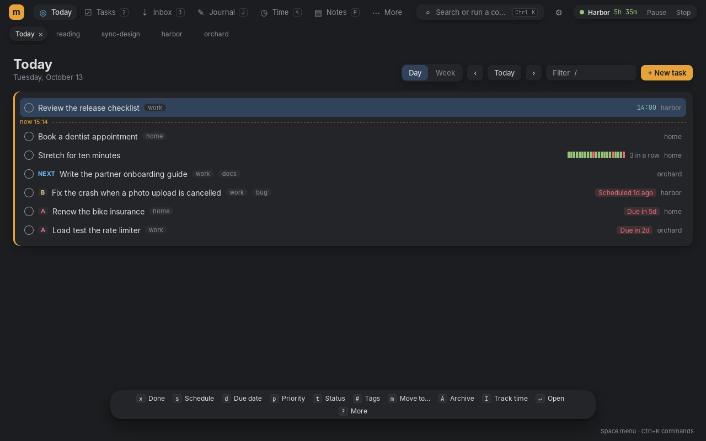
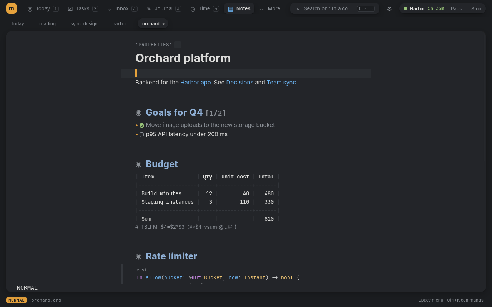
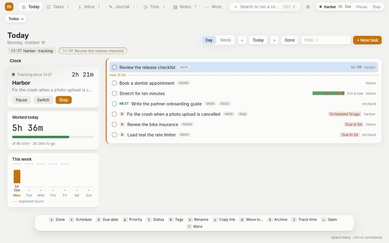
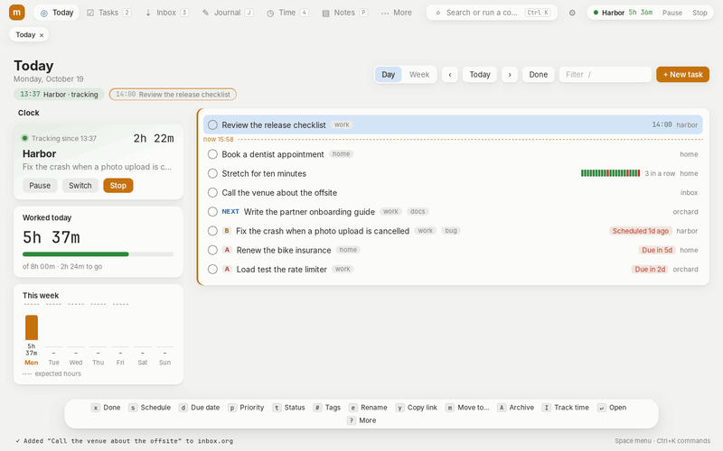
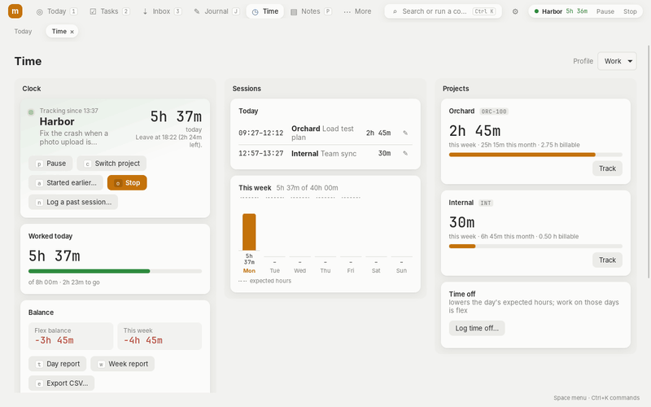
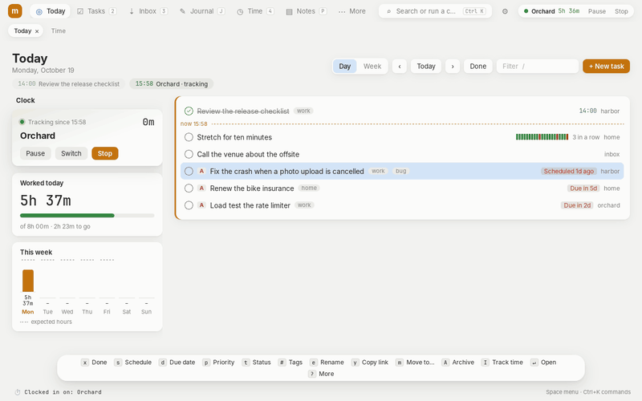
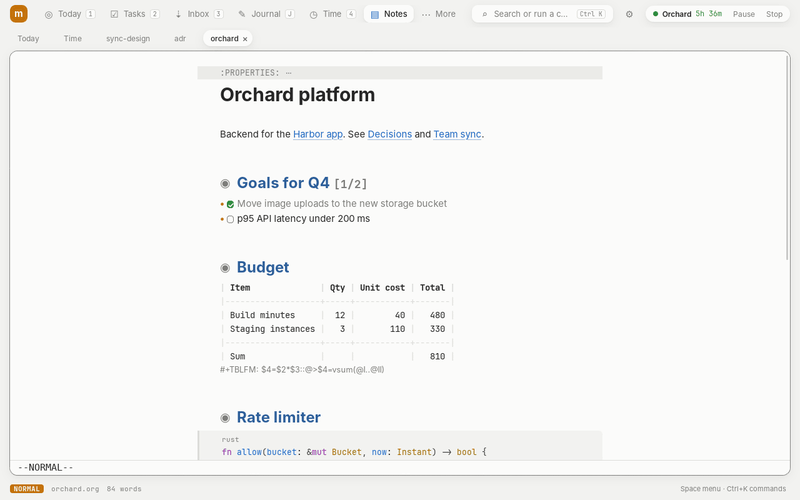
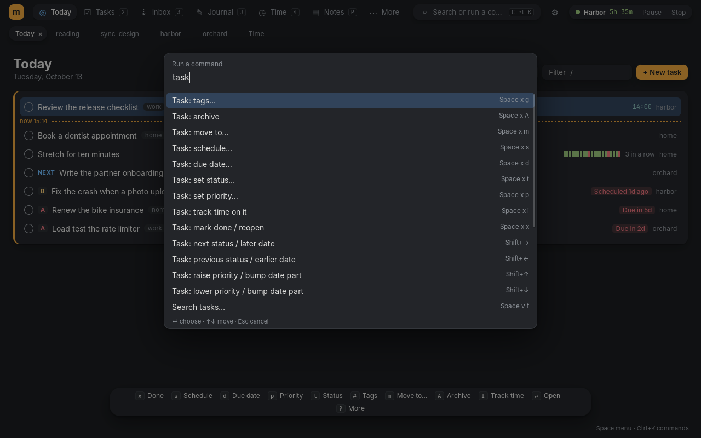
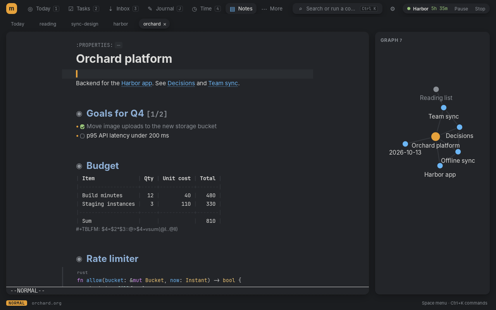
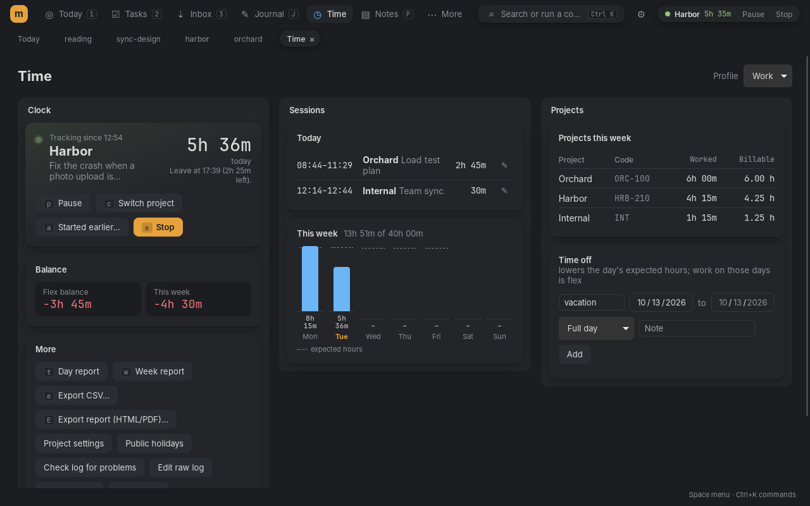

# Margin

Notes, tasks, a journal and time tracking in one fast desktop app (Linux,
macOS, Windows). Notes are plain org files, so they stay readable anywhere;
the editor has vim keys.

- **Notes** — org documents that render like a page: links, backlinks,
  unlinked mentions and a local note graph, tables with formulas, code blocks, inline images, folding (`#+STARTUP: overview`, `content`, `fold`, `nofold` or `show2levels`..`show5levels` in a note starts it folded, and a heading's `:VISIBILITY:` property (`folded`, `children`, `content`, `all`) sets its own subtree unless the note says `showeverything`; the headings you fold are remembered per note across closing the tab and restarting, and win over `#+STARTUP:` once saved; the file is never changed).
- **Tasks** — Today and All tasks views, schedules, deadlines, priorities,
  tags, repeaters; capture from anywhere with a global shortcut.
- **Journal** — a daily note, one keypress away; `Space n [` / `Space n ]`
  step to the previous / next existing entry, `Space n t` lists
  entries from this day in earlier years and months. Set a `journal_template`
  (Settings) to give each new entry a skeleton, e.g. `* Plan`; `%t` expands
  to that day's date (prompts and `%?` are ignored). A file `journal/mon.org` … `sun.org` in the
  templates folder overrides it for that weekday. Set a word goal with
  `#+WORDGOAL: 1500` at the top of any org note, or `journal_word_goal`
  (Settings) for every journal day: the status bar then reads
  `812 / 1500 words` and turns accent-coloured once reached. `Space n k` carries
  over the previous entry's open items: unchecked `- [ ]` items and TODO
  subtrees (not done or `:ARCHIVE:`) move under `* Carried over from <date>`
  in today's entry; `Space n u` puts them back. `Space t R` asks Week,
  Month or Year. Week writes a
  `* Weekly review <2026-W43>` into today's entry: Inbox count (and parked someday/maybe tasks, when any), tasks closed
  this week (with `Estimates: 120% of plan` when they had an `:EFFORT:` and
  clocked time), a `Pushed:` line (up to three open tasks rescheduled 3+ times), hours per project, a `Ledger:` line per currency when the ledger has entries this or last week (spent vs last week, income, top `#category`; plus the budgets this month went over, skipped when the Ledger area is hidden), `:GOAL:` progress (when you have goals), overdue tasks and what's scheduled next week,
  then empty `** Went well` / `** To change` headings. Running it again
  replaces only the generated lines between `# review-begin` and
  `# review-end` (edits there are overwritten; the rest is kept), also on a
  later day of the same week, in the entry that already holds the block.
  Month writes a `* Monthly review 2026-11` the same way, between
  `# review-begin month` and `# review-end month` (so it sits beside a weekly
  one): tasks closed this month (count and the top 5 categories), hours per
  project against the hours expected so far (less leave), the `Ledger:` lines
  against last month and the budgets the month went over, and `:GOAL:`
  progress; re-running it later in the month replaces the block in whichever
  entry of the month holds it.
  Year writes a `* Yearly review 2026` likewise (`# review-begin year`):
  the month's parts over the year so far, plus `Ledger:` lines against last
  year (spent, income, top expense `#category`), the busiest and quietest
  week by clocked time (only whole weeks of the year that are over, counted
  from your Week start setting), notes edited this year (by last change, so
  a note counts once) and each open habit's current and best streak.
  `Space n j` logs a daily metric (Settings > Daily metrics: mood, energy,
  sleep…) as `:MOOD: 4` in the entry's top property drawer; `Space n M` shows
  them over the last 30 / 90 / 365 days (`r` switches): a sparkline per metric
  with latest, mean, range and days logged, its mean on workdays with at least
  the expected hours clocked vs shorter ones (days off left out), and a day
  table with hours clocked, where `Enter` opens that day's entry.
- **Time** — a timeclock with breaks, projects, flex balance and reports, in
  the window or the tray.
  `Space t T` shows one day's timeline: clocked sessions, tasks closed and
  notes edited, in time order. Enter opens a task or note (or edits a
  session); the first row copies the day as a Markdown list.
  `Space t A` (or *Estimates vs actuals…* in the Time view) compares
  `:EFFORT:` with clocked time on tasks closed in the last 7, 30 or 90 days:
  per project and in total, the 5 largest overruns (Enter opens one) and a
  planning factor (clocked / estimated) to apply to new estimates. Tasks with
  an estimate but no clocked time are left out of the ratio. The effort
  picker uses the same data: with 3+ timed tasks in the task's project (else
  overall) it shows how your estimates run and what each preset would
  become (`1h -> ~1h 24m`); the value you pick is unchanged.
  `Space t H` (or *When do I work?* in the Time view) is a weekday x hour
  heatmap of clocked time over the last 4 or 12 weeks or this month (`r`
  switches), optionally for one project: each cell is the average minutes
  clocked in that hour on that weekday (breaks left out, sessions over midnight
  split), with the peak hour, the share after 17:00 and the total. `h/j/k/l`
  move between cells, and the sessions behind the selected cell are listed below.
  `Space t Y` (or *Activity calendar* in the Time view) is a year of clocked
  hours as a GitHub-style grid (weeks as columns, starting on `week_start`; 5 shades by
  quartile), with the total, active days, the longest streak and the current
  one (streaks carry over New Year). `h/l` move a week, `j/k` a day, `[`/`]`
  change year; the selected day's hours show below, and `Enter` opens that
  day's timeline. `r` (or `m`) switches what is counted: clocked hours, tasks
  closed (their `CLOSED:` stamp), notes edited (by last-modified time, so a
  note only counts on its latest edit) or habits done (once per habit a day).
- **Window title** shows the active tab (`• note — Margin` when unsaved), so
  the taskbar and window switcher tell Margin windows apart.
- **Stays in sync** with Emacs, git or any sync tool editing the same files,
  and updates itself from GitHub releases.
  The running version shows in Settings under About ("About Margin" in the palette opens it there).





## Features

**Capture a task** — `Ctrl+N` (or "New task" in the `Ctrl+K` palette) asks for a title and
a date; from anywhere, the global quick-capture shortcut does the same. In the dialog a date,
`#tags` and `!A`/`!B`/`!C` typed at the end of the title are picked up (`Call Anna fri 14:00 #work !A`)
and shown as chips; the fields below win when you fill them in too.



**Triage Today** — select a task and press `+` for a higher priority, `x` for done, `>` to
push it a day, or `s` to schedule it. `Y` copies the shown list as Markdown checkboxes
(grouped by day in the week view, timed tasks with their time or range), handy for a standup or message.



**Time clock** — pause, resume and switch projects; the note you type goes into the work diary.



**Link abbreviations** — `#+LINK: gh https://github.com/me/repo/issues/%s` in a note makes `[[gh:123]]` open that URL (`%s` is the tag, `%h` its URL-encoding; without either the tag is appended). Peek and HTML/Markdown export expand them too; `file`, `id`, `http`, `https` and `mailto` can't be redefined.

**Citations** — with the *Bibliography (.bib)* setting pointing at a BibTeX file (or a note's own `#+BIBLIOGRAPHY: refs.bib` lines, see [Bibliography](#bibliography)), org-cite citations such as `[cite:@smith20;@lee21]` or `[cite/t:see @smith20 p. 3]` show as an author-year chip (`Smith 2020; Lee 2021`) off the cursor line. Hovering the chip shows the full entries, and keys missing from the file get a red wavy underline. Typing `@` inside `[cite:…]` completes keys from the file, and `Shift+Enter` (or `Space l p`) on a citation peeks at its entry. With no bibliography set, citations stay plain text. A `#+PRINT_BIBLIOGRAPHY:` line shows the note's cited entries under it, in order of first citation (unknown keys as `[key?]`); it is only displayed, never written into the file.

**Links and backlinks** — `Space n b` shows the notes linking here, `Space n g` the local
graph, and `Enter` on a link follows it. `Shift+Enter` (or `Space l p`) on a link peeks at its target instead:
the linked note or heading shows read-only in a side panel, `Enter` there opens it, `Esc` closes it (a note with unsaved edits peeks from its buffer, not the disk). `Space n O` lists notes with no links in or out
(journal and inbox left out), most recently changed first. `Space n L` lists broken links: `[[id:]]` links to an
unknown ID, `[[file:]]` links to a missing file or to a `::*Heading` / `::#custom-id` the file lacks,
and same-file `[[*Heading]]` / `[[#custom-id]]` links; `Enter` opens the note at the link. `Space n W` checks the
web links (`[[https://…]]`, with or without a description) in every note outside the trash, 6 at a time: dead ones (an HTTP error,
a timeout, an unknown host) are listed first, then moved ones (a permanent 301/308 redirect, with the new URL). `Enter`
opens the note at the link, and `Ctrl+R` on a moved link rewrites it to the new URL through the text replace preview
(old copies in `.trash`, undone like a text replace). It only runs when asked and only contacts the linked hosts; over
200 links it asks first, `Esc` stops it, and results are kept for the session so a rerun only checks new links. `Space n T` browses notes by tag:
pick a tag from `#+FILETAGS:` or a non-task heading's own tags (with counts, any case), then
the note or heading to open. `Ctrl+R` on a tag there (or *Notes: rename or merge a tag…* in the
palette) renames it everywhere: heading tags (tasks too), `#+FILETAGS:` and `tag:` terms in saved
views and open task-search tabs; typing an existing tag merges the two. It shows the count first, copies every note it changes
to `.trash/tag-rename-<time>/` before writing, and skips (and lists) notes with unsaved edits.
`Space n S` replaces text in all notes: type the text (literal, one line) and its replacement, and a
preview lists every line it changes (`[old → new]`, with the note and line), all ticked; `Enter` on a line
unticks it, *Match case* toggles case sensitivity (on by default), *Whole word* skips matches inside longer words (off by default), *Link targets and IDs* is skipped by default (a link's `[[target` and `:ID:`/`:CUSTOM_ID:` lines stay as they are; link descriptions are replaced), and *Replace N lines* writes the ticked ones,
the same way: old copies to `.trash/tag-rename-<time>/`, notes with unsaved edits skipped, and a line changed
since the preview left alone (listed). Over 297 matching lines the preview lists the first 297 (read-only) and offers *Replace all N lines in M notes*, with the same undo copies; that applies to every matching line on disk at the time (still skipping notes with unsaved edits).
*Tags: undo a rename or text replace (notes put back)…* puts those notes back, except ones edited since (listed, left alone); the
renamed versions go to `.trash/tag-rename-undo-<time>/`, and saved views keep the new name. `Space n C` lists recently changed notes (journal included), newest
first, with how long ago each changed. `Space n Z` lists notes untouched for a year (oldest first);
`Space n *` opens a random note, older ones likelier (journal, inbox, trash and archives are skipped;
sync tools that touch files make notes look fresh).

**People** — tag a heading or task `:@anna:` or write `@anna` in a note. `Space n @` picks a
person (from the `@` tags, or type any name) and lists the tasks waiting on them (see **Waiting for**), their open tasks (tagged, inheriting the
tag, or naming `@anna` in the title) and then every other line mentioning `@anna` (any case;
email addresses don't count, journal included), then their ledger entries; `Enter` jumps there.
The picker lists people longest out of touch first, with how long ago you last had contact ("41 d
ago"), and the person view opens with "Last mentioned 41 days ago (journal 2026-09-19)". Last
contact is the latest of: a journal day mentioning them (its date), another note mentioning them
(when the file last changed), a done task tagged or naming them (its `CLOSED` date) and a ledger
payment to them.

Birthdays: give the person's heading (tagged with exactly one `@name` of its own) or their note
(`#+FILETAGS: :@anna:`) a `:BIRTHDAY: 1984-03-12` property, or `--03-12` without the year. Today and
the agenda then show "Anna · Turns 42" on the day and a heads-up "Turns 42 in 3d" a few days before
(`birthday_lead_days`, default 3; 0 = only on the day), and a reminder notification comes once a day
then. A Feb 29 birthday falls on Feb 28 in other years. These lines are read-only: they are no task,
`Enter` opens the person view, and nothing is written to your files. An `:ANNIVERSARY: 2021-06-12`
on the same heading or note works the same way: "Anna · Anniversary: 5 years" (or just "Anniversary"
without the year), with the same heads-up and reminder. Like birthdays it needs exactly one `@name`
tag, so put a couple's anniversary on one of them (a heading tagged `:@anna:@ed:` doesn't count). The
month calendar shows both on their day (🎂 / 💍), apart from the task counts.



**Flashcards** — tag a heading `:drill:` and it becomes a card: the title is the question, its
own text (below any planning line and drawers, subheadings excluded) the answer. `Space n d`
reviews the due cards across all notes: `Space`/`Enter` shows the answer, then `1`–`4` grades it
(again / hard / good / easy; "again" comes back later in the session). Scheduling is a simple
SM-2 variant stored in the card's drawer (`:DRILL_DUE:`, `:DRILL_INTERVAL:` in days,
`:DRILL_EASE:`), so it stays plain text; cards under `:ARCHIVE:` are skipped and `Space n u`
undoes the last grade.

**Vim editing** — the editor has vim keys: search, `ciw`, `o`, `dd`, `u`, `:w`.



## Install

Download the latest build from
[Releases](https://github.com/albin02forsberg/margin/releases/latest):

- **Linux** — `.AppImage` (updates itself; `chmod +x` and run), or `.deb` / `.rpm`
- **Arch Linux** — `margin-bin-<version>-1-x86_64.pkg.tar.zst`:
  `sudo pacman -U margin-bin-*.pkg.tar.zst`. Margin tells you when a release is out but
  doesn't install it itself; install the new package the same way. The release's `PKGBUILD`
  builds the same package with `makepkg -si` (it repackages the `.deb`). Not on the AUR yet.
- **macOS** (10.15+) — `.dmg` (universal). Ad-hoc signed, not notarized: the first time,
  right-click Margin → Open. If macOS still refuses, run
  `xattr -dr com.apple.quarantine /Applications/Margin.app`.
- **Windows** — `-setup.exe`. Not signed yet: SmartScreen → More info → Run anyway.

**Nightly:** the [`nightly`](https://github.com/albin02forsberg/margin/releases/tag/nightly)
prerelease is rebuilt from `main` once a day when it has changed (AppImage/.deb, .dmg,
`-setup.exe`). Untested. Tick **Settings → Nightly updates** to have an installed copy update
to them; unticking waits for the next stable release newer than your nightly.

**What changed:** every release lists its features and fixes since the previous release in its
notes; the nightly lists what is new since the previous nightly.

## Code signing policy

Release installers are built only by this repository's GitHub Actions
([release.yml](.github/workflows/release.yml)) from a tagged commit on `main`;
nothing is built or signed on a personal machine. Releases are drafted by CI
and published either by the maintainer, Albin Forsberg, or by the repository's
release agent under a gate he set: CI green, the nightly built clean for the
same commit, at most one release per 3 days, and a `no-release` label that
stops it ([releaser.md](.claude/agents/releaser.md)).

Opt-in nightly builds ([nightly.yml](.github/workflows/nightly.yml)) are built
and published by CI from `main` without that per-build approval.
Update bundles are signed with the project's updater key so installed copies
only accept builds from this pipeline. macOS builds are ad-hoc signed. Windows
signing via [SignPath Foundation](https://signpath.org) is planned (#13); once
enabled, free code signing will be provided by SignPath.io, certificate by
SignPath Foundation.

Margin sends nothing anywhere except update checks to GitHub Releases (and,
if your time-data folder is a git repo with a remote, backup pushes to it).

## Build from source

Needs Node 22.18 or newer (`.nvmrc` pins 24, as CI does; `npm test` runs
TypeScript tests through Node's built-in type stripping) and a Rust toolchain.

```bash
npm install
npm run tauri dev      # run
npm run tauri build    # release bundle for the current OS
cd src-tauri && cargo test
```

## Tests

`npm test` and `cargo test` cover the parsers and engines. `npm run test:e2e`
builds a debug binary (identifier `dev.albin.margin.e2e`, so it never touches
your running copy or settings) and drives the real app through
[tauri-driver](https://v2.tauri.app/develop/tests/webdriver/) against fixture
notes in a temp dir. It needs Linux with `tauri-driver` (`cargo install
tauri-driver --locked`) and `WebKitWebDriver` (`webkit2gtk-driver` on
Debian/Ubuntu); use `xvfb-run -a npm run test:e2e` without a display. CI runs it
in the `e2e` job.

Coverage: `npm run coverage` prints a per-file table for `src/lib` (unit tests
only; Svelte components are covered by e2e), and `cargo llvm-cov` (`cargo
install cargo-llvm-cov`, `rustup component add llvm-tools-preview`) does the
same for the Rust crate. CI's `coverage` job writes both tables to the job
summary and uploads the lcov files as the `coverage-lcov` artifact.

The same job runs a ratchet (`npm run coverage:ratchet`): it fails when total or
per-file line coverage (and TS branch coverage) drops more than 0.5 points below
`coverage-baseline.json`. Code with nothing to unit-test (tray, Wayland idle,
entry point, editor DOM setup) is listed with a reason in
`coverage-exclude.json`. To check locally, run `npm run coverage` and, in
`src-tauri`, `cargo llvm-cov --lcov --output-path ../lcov-rust.info`; after
adding tests, raise the baseline with `npm run coverage:ratchet -- --write`
(or from the CI artifact, since the numbers differ slightly per OS).

The README screenshots and GIFs come from the same setup: `npm run screenshots`
(same requirements, plus `ffmpeg`) starts the app on a made-up demo dataset and
writes `docs/screenshots/*.png` (dark) and `docs/gifs/*.gif` (light); or run the
**Screenshots** workflow (Actions → Run workflow) and download its artifact,
already shrunk. Shrink local PNGs before committing, e.g.
`magick mogrify -dither None -colors 256 -strip docs/screenshots/*.png`.
`SCREENSHOTS_ONLY=graph,today` saves just those shots. To show a feature in a PR
without growing `main`, run the workflow with `only=<shots>` and `pr=<number>`: it
pushes them to the `media` branch (`pr-<n>/`, never merged) and adds a `## Preview`
section to the PR (`scripts/pr-media.ts`).
`node scripts/media-size.ts` checks the cap (each file under 1.5 MB, all of them
under 10 MB); replace the files rather than adding new ones, and keep GIFs out of
feature PRs.

CI runs the checks and tests on every push and PR. To release, bump the
version in `src-tauri/tauri.conf.json`, then push a tag (`git tag v0.2.0 &&
git push --tags`): installers for all three OSes land in a draft GitHub release.
Publishing it makes installed copies offer the update on their next start
(or `Space f u`). Release builds are signed for the updater with the
`TAURI_SIGNING_PRIVATE_KEY` and `TAURI_SIGNING_PRIVATE_KEY_PASSWORD` repo secrets.
`/autopilot` also releases on its own through the `releaser` agent when its gate
passes (see above); add the `no-release` label to any open issue to pause that.
`scripts/autopilot-forever.sh` shows a live dashboard (`scripts/autopilot-ui.mjs`):
`d` opens what needs your decision, `n` queues a task for the agents (a title and
optional details, filed as a normal issue that goes through triage and review),
`j`/`k` select an Up next row or open PR and `o` opens it in the browser, `p` pauses
(no new run starts until you press `p` again or remove `~/.cache/margin-autopilot/PAUSE`;
a running one finishes, and the header says paused), `s` shows stats for the last 7 days
(sparklines of PRs merged per hour and per day, issues filed and closed per day, and the
median time from PR open to merge), `?` lists all keys. Agent rows show
the issue or PR each agent works on, and the main CI line counts PRs merged in the last hour and day.
Terminals 120 columns or wider get two columns; short ones drop Recent and the totals
before Up next, and the dashboard never draws past the bottom row (`j`/`k` only reach rows on screen).

## Staying in sync

Everything stays in sync on its own: notes save shortly after you stop typing,
and any change to the notes or time folders — from the app, Emacs or a sync
tool — refreshes open tabs, task lists, links, reports and the timer. If a file
changes underneath unsaved edits, non-overlapping changes are merged; real
conflicts are flagged (`:w` keeps yours, `Space f r` reloads). A save never
overwrites a change made elsewhere that the app hasn't seen yet: it is merged
or flagged the same way first. Closing a flagged tab asks whether to keep
editing, save yours over the disk version, or discard yours. Quitting (tray Quit,
Cmd+Q on macOS, or closing the window when it doesn't hide to the tray) and
installing an update save everything first and ask the same for each flagged tab;
keep editing cancels. A note deleted or
moved away outside the app keeps its text in the open tab, flagged "deleted on
disk" and not autosaved (`:w` recreates it), and drops out of the recent notes.

Backups commit the time-data folder (and the notes folder, if it is a git
repo) after each change; `Space n V` browses and restores a note's earlier versions from those commits. With a remote, the time-data repo also pulls
(`git fetch` + rebase) before it pushes, every 5 minutes and when the window
gets focus, so two machines sharing one remote see each other's time. The
time log, time off and the per-day activity files merge by keeping both machines'
lines (`merge=union` lines in the time-data repo's `.gitattributes`, added if
missing). The active profile (`active-profile.txt`) is per machine: it is
git-ignored and never synced. After a
pull the time log is put back in time order and both files drop exact duplicate
lines. If both machines were clocked in at once, both clock-ins are kept and
Time → Check log (`Space t D`) flags the overlapping sessions so you can fix one. A
conflict elsewhere (e.g. `projects.toml`) is never left half-merged (local changes are committed before the
pull, never stashed): the rebase is aborted, your local commits
stay unpushed, and the top bar's backup warning names the conflicting files.
The notes repo is only pushed, never pulled. The top bar's backup warning tracks each repo
separately, so one repo succeeding never hides the other's failure.

## Getting around

New here? The first start asks for your notes folder, time-tracking folder and
hands-on tutorial note (`Space ?` reopens it; an empty Today or Tasks view points at it too). Changing folders or dropping the current
profile clocks out first, and warns where old files stay (nothing is moved).

- **Ctrl+K** — command palette: every action, with its shortcut. Commands you ran from it recently
  are listed first (marked "recent"; this machine only).
- **Space** (vim normal mode, or in any list view) — the same actions as a menu.
- **Ctrl+=** / **Ctrl+-** (**Cmd** on macOS), or **Ctrl+mouse wheel** / touchpad pinch — zoom the whole UI
  in / out; reset with **Ctrl/Cmd+0** or `Space v 0`. The zoom level is remembered across restarts.
- Top bar: **Today** (Ctrl+1), **Tasks** (Ctrl+2), **Inbox** (Ctrl+3, with a badge counting
  its open top-level entries; done and archived ones don't count),
  **Journal** (Ctrl+J), **Time** (Ctrl+4), **Notes** (Ctrl+P, pinned notes (`Space n p`) then recent ones first), your saved
  searches, the Ctrl+K search, Settings and the running clock (Pause / Stop / Start).
  Toggle it with Ctrl+\\ or `Space v s`. **Zen mode** (`Space v z`, or "View: zen mode" in Ctrl+K) hides the
  top bar and status bar for distraction-free writing until you toggle it again (or press Esc outside
  the editor); it is not remembered across restarts. With *Zen mode goes fullscreen* (Settings → Reminders & desktop,
  `zen_fullscreen = true`) it also makes the window fullscreen until you leave zen. In a narrow window it keeps only the icons (under 760 px)
  and the links/graph panel opens over the note (under 1000 px; Esc or a click on the note closes it).
  Switching views fades the new one in and slides the bar's highlight; the system's
  "reduce motion" setting turns both off.
- On startup Margin reopens the tabs you had open last time (after Today), each note at the
  line you left, with the same tab active; notes that are gone are skipped. Only paths and
  lines are remembered, never note content. Turn it off with `restore_tabs = false` in settings.

| | |
|---|---|
| Ctrl+N | New task (title, when, due, priority, tags, file) |
| Super+Shift+N | Quick capture from anywhere, even with the window hidden (`capture_shortcut` in settings) |
| Ctrl+P | Open a note — or type a title to create one |
| Ctrl+Shift+N | New note |
| Space s o | Occur: list the lines of this note matching a search (same syntax, or `/regex/`) with their heading path; Enter jumps to one |
| Space s r | Related notes (by meaning): the notes closest to this one in the semantic index (needs **Semantic index of my notes**), each with its best-matching heading; Enter jumps to that section |
| Ctrl+Shift+F | Search all notes as you type (lines with every word, in any order; `"quote"` a phrase, `-word` or `-"phrase"` to exclude, `in:folder` or `in:parent/child` to search one folder, `re:ABC-\d+` or `re:"TODO\s+\w+"` for a regex that must match, `case:match` to make the whole query case-sensitive; a bad regex shows as the only row). Start with `~` to search by meaning instead (`~ how we price renewals`): the sections closest to it in the semantic index, with note › heading and similarity; needs **Semantic index of my notes** |
| Ctrl+L | Insert a link to another note or to any heading (a heading without an `:ID:` links as `[[file:note.org::*Heading]]`, or `[[*Heading]]` in the same note; a one-line selection becomes the link text; pasting a URL over a selection links it too) |
| `[[` / `@` / `:` / `#+` (insert mode) | Complete as you type: `[[` + part of a title offers notes and headings and inserts the same link as Ctrl+L, `@` after a space offers known people, and `:` after a heading's title offers existing tags. `#+` at the start of a line offers org keywords (`#+title:`, `#+filetags:`, `#+TOC:` …) and block skeletons (`#+begin_src`, `#+begin_quote`, `#+BEGIN: clocktable` … with their end line, cursor inside), then each dynamic block's options (`:block` → `today`, `thisweek` …), the `#+begin_src` languages and header arguments (`:tangle` …); `:` at the start of a line in a `:PROPERTIES:` drawer offers property keys (`EFFORT`, `CUSTOM_ID` …). Enter or Tab accepts, arrows move, Esc closes the popup (and stays in insert mode). New notes are still created with Ctrl+L |
| `Space m m` / `Space '` / `Space m d` | Bookmark the cursor under a name / jump to a bookmark / delete one. A bookmark remembers the heading above the cursor, so it still lands right after edits above it; when the heading is gone it falls back to the saved line and shows dimmed as stale (it is kept, also when the note is gone). Kept on this machine only, and follow a renamed or moved note or a renamed heading (undoing the rename puts the bookmark back) |
| Ctrl+S / `:w` | Save (also saves automatically) |
| Ctrl+Shift+T / `Space b u` | Reopen the last closed tab, at the line you left (up to 20) |
| `Space b h` / `Space b l` | Navigate back / forward over jumps (links, headings, opening a note), to the note and line you left (this session only) |
| Middle-click a tab / `Space b o` / `Space b D` | Close that tab / close the other tabs / close all tabs (each goes on the reopen stack, which keeps the last 20; tabs with unresolved conflicts stay open). Hover a tab for its file path |
| Drag a tab / `Space b <` / `Space b >` | Reorder tabs (the active tab stays active; the order is restored with the session) |
| `Space w v` | **Split view**: open a second note in a pane on the right, the previous tab first. Click a pane to work in it; the status bar, the Space menu and `:w` follow the focused pane, and both notes autosave. A note shows in one pane at a time (picking the other pane's tab focuses that pane), and closing either pane's tab closes the split. `Space w w` focuses the other pane, `Space w c` saves and closes the split (both notes stay open as tabs). Below 1000 px wide only the left pane shows; opening the right pane's tab then closes the split, and `Space w v` opens the note as a normal tab instead. With `restore_tabs` the split comes back on the next start (not when the window is narrow) |
| `Space w W` | **Workspaces**, like Emacs perspectives: Palette → *Workspace: save open tabs and split as…* keeps the open notes (at their lines), views and searches under a name; `Space w W` saves the current workspace's tabs, closes all tabs (unsaved-edit prompts apply) and opens the picked set after Today, skipping notes that are gone. *Workspace: delete…* removes one. Stored in the app's local storage, works with `restore_tabs` off too; renaming or moving a note updates the saved tabs |
| Palette → Show what's new | After Margin updates itself it opens the release notes once; this re-opens the notes of the last update (read-only tab) |
| Palette → Report a bug | Opens a new GitHub issue in your browser, prefilled with Margin's version, your OS, the update channel and the last error message (no note content or settings); edit it and submit there |



If the shortcut doesn't fire (common on Wayland), bind `margin --capture` to a
key in your desktop's settings instead: it opens the same form in the running app.

`margin path/to/note.org` (or `note.org:42` for a line) opens that note in the running app,
or starts Margin with it. Only files under the notes, data or config folders open; others
show a toast.

## Tasks (Today / Tasks views)

`j`/`k` move, `x` done, `s` schedule, `d` due date, `p` priority, `t` status,
`#` tags, `E` effort, `e` rename, `y` copy a link to the task, `m` move to another file/heading, `M` copy there (the copy drops `:ID:`s), `A` archive, `I` track time,
`Enter` open, `<`/`>` reschedule a day, `+`/`-` priority, `n` new task, `u` undo,
`v` day/week, `h`/`l` previous/next, `.` today, `D` (or click the heading) go to a date, `/` filter, `?` all keys.
Click the checkbox to complete a task.
`Space x k` in a note turns the checklist at the cursor (or the selected lines) into task headings one level below the heading above: `- [ ]` becomes `TODO`, `- [X]` `DONE`; nested items stay as body text. One undo step. `Space x K` does the reverse for sibling task headings (selection, or the run around the cursor): keywords become `[ ]`/`[X]`, body is indented under the item; SCHEDULED/DEADLINE/CLOSED and `:ID:` are dropped, and it refuses when child headings or other drawers would be lost.
`e` (or `Space x e` in a note) renames the task and updates the one-line links to it, `[[*Old]]` in its note and
`[[file:note.org::*Old]]` in other notes (descriptions and path style kept), in one undo step (`u`, or `Space n u` in a note).
Links stay as they are when the old title isn't unique in its note, or the new one is empty, contains `[`/`]` or is another heading's title.
When time was clocked on the old title, it also offers to rename those time-log sessions (their clock-in task and clock-out note, in the task's project when its category is one),
so the clocked time and `spent:` keep counting; the log is backed up after, undo doesn't revert it, and the work diary keeps the old text.
`z` (or `Space x z` in a note) adds a note to the task, as org's agenda `z` does:
`- Note taken on [2026-10-20 Tue 14:30] \\` plus your text, below the planning line and drawers, newest first.
`E` (or `Space x E` in a note) sets an effort estimate, org's `:EFFORT:` property
(`0:15` … `4:00`, or type `1:30`, `2h`, `45min`; written as `H:MM` so Emacs reads it).
Tasks show it as a badge (`1h 30m`), and each day in Today shows the total of its open
tasks (`~5h 30m planned`, each task counted once) against the day's expected hours from the
Time calendar, less leave (`~5h 30m / 7h 30m planned`, highlighted when overbooked or planned on a day off). Removing it drops the property drawer
only when nothing else was in it.
**Go to Month calendar** (`Space v k`) shows a month as a grid of full weeks (Monday first, or `week_start`): each day's open scheduled tasks and
appointments (repeaters included), deadlines (`2 due`), the first titles and the planned effort (`~3h`), tinted when it
overbooks the day's expected hours. `h`/`j`/`k`/`l` or the arrows move, `[`/`]` change month, `t` jumps to today, and
`Enter` (or a click) opens that day in Today.
`w` in Today (or the **Plan** button) shows the day as an hour grid (08:00–18:00, widened to fit): each task with a time
(`SCHEDULED: <… 14:00>`) is a block from its start to the stamp's own end (`14:00-15:30`), else start plus its effort
(30 minutes without one). Overlapping tasks sit side by side, highlighted, free working time is labelled
(`1h 30m free 10:00–11:30`, from now on today) and a line marks the current time; untimed tasks stay in the list below.
With a scheduled or due block selected, `J`/`K` move it 15 minutes later / earlier and `L`/`H` lengthen / shorten it by
15 minutes (written as a range, `14:00-15:15`), each one undoable edit of its stamp that keeps the day and repeater; a
repeating task moves only on its own date.
`P` (or a click on a free gap) time-blocks: pick the gap (when there are several), then one of the day's untimed open
tasks (scheduled, due or overdue) or an undated task with a next-action keyword (`NEXT`, `DOING`; Settings
**Next-action keywords**). Ones whose effort fits the gap come first, longer ones are dimmed but allowed. The task gets
`SCHEDULED` at the gap start, as a range to start plus its effort when it has one (`10:00-10:45`), keeping its repeater
and deadline; `u` undoes it.
Time clocked on a task shows in that badge against its estimate (`1:10 / 2:00`, in the warning colour once it runs over;
just `1:10` without an estimate), on Today, Tasks and the Done log. It counts time-log sessions named like the heading
(case and surrounding spaces ignored; the clock-out note, else the task clocked in on, including the running clock,
breaks left out), on the task's category when that is a Time project and on any project otherwise.
Tracking time from a task (`I`, `Space x i`) offers its title first as what you're working on, so the time adds up there. The same works from an open note: the heading at the cursor is offered (nothing above the first heading).
`Space x S` lists stuck projects, as org's `org-stuck-projects`: open tasks with open subtasks of which none is scheduled,
has a deadline or carries a next-action keyword (**Next-action keywords**, `stuck_next_keywords`, default `NEXT` and `DOING`).
Plain headings such as `* Inbox` never count, and of nested stuck projects only the innermost is listed; Enter jumps to it.
`Space x G` lists goals: headings with their own `:GOAL:` tag, each with the tasks below it done (`3/4 done (75%)`; a `CANCELLED`
task drops out, nested goals count for both) and the days left to its target, `:TARGET: 2026-12-31` (or an org timestamp like `<2026-12-31 Thu>`) in its drawer or else its
`DEADLINE:` (overdue or unreadable targets show in red) and the time clocked on it and its tasks (`3h 20m clocked`). Give a goal an
`:ID:` and tasks elsewhere that link to it (`[[id:…]]` in their title or text) count too. Add `:START: 2026-10-01` and the goal reads
`on track`, or `at risk` (red) when the tasks done trail the share of time elapsed up to the target by more than 10 points (no chip
without a valid start before the target, or without tasks). Soonest target first; `:ARCHIVE:` goals are hidden; Enter jumps to it.
Task dependencies, as org's `:ORDERED:` and org-depend's `:BLOCKER:`: under a heading with `:ORDERED: t` in its drawer a
subtask is blocked while an earlier sibling task is still open (nested orderings and the blocked task's own subtasks too),
and a task with `:BLOCKER: [[id:…]]` (one or more `id:` links or bare IDs, in any file) is blocked while any of those tasks is open.
Today and Tasks hide blocked tasks, so only the next actionable one shows; finishing it brings up the next. Blocked tasks
scheduled or due today or earlier stay, dimmed, so no deadline goes missing. `B` (or the **Blocked** button) shows them all
with a `blocked` chip; `blocked:yes` / `blocked:no` searches for them. Unknown IDs, done tasks and blocker cycles block nothing. Hovering the chip names the task it waits on; `W` opens that task.
`Space x B` in a note picks an open task that the heading at the cursor waits for and adds it to its `:BLOCKER:`
(the picked task gets an `:ID:` if it has none; one `Space n u` undoes both; one already listed changes nothing and says so),
`Space x b` picks one of its blockers and removes it, and `Space x O` turns `:ORDERED:` on or off. Both do nothing (and say so) when the cursor is above the first heading. Marking a blocked task done from the editor (`Space x x`, `Space x t`, `S-→`) asks first, like the agenda.
**Waiting for** (GTD): `Space x W` on a task sets it to `WAIT`, asks whom it waits on (an `@name`, any text, or nobody)
and an optional follow-up date, and writes `:WAITING_ON:` and `:WAITING_SINCE: [date]` (plain org properties). The
follow-up becomes the task's `SCHEDULED:` date (Esc keeps the current one), so the task comes back in Today then; one
`Space n u` undoes it all. Running it again on a waiting task changes whom it waits on and keeps the date. `Space x w`
(or "Tasks: waiting for" in the palette) lists open `WAIT` tasks grouped by whom they wait on, longest first, with
"waiting 9 days" ("age unknown" without `:WAITING_SINCE:`) and the follow-up date, flagged once it is due. Moving a task
off `WAIT` in Margin removes both properties; a keyword changed in Emacs leaves them, which is harmless. A `WAITING`
keyword works too; without either, `Space x W` says so.
**Someday/maybe** (GTD, Things' Someday): a task tagged `:someday:` (any case; on the task, an ancestor heading or
`#+filetags:` to park a whole file) is parked: hidden from Today, Tasks, stuck projects and the inbox count, but not deleted, the morning plan and the weekly review's overdue/next-week lists, but not deleted.
"Task: park as someday/maybe / activate again" in the palette toggles the tag on the task at the cursor; "Someday/maybe
review" opens them as a task list (`tag:someday`), where `s` schedules, `#` removes the tag to activate one and `A` archives.
The weekly review counts them. Reminders still fire for a parked task that has a deadline or scheduled time.
Subtrees archived in place with an `:ARCHIVE:` tag (Emacs's `C-c C-x a`) are left out of Today, Tasks, reminders and the calendar feed, as in org's agenda; they stay in the note and in search.
A time range (`<2026-10-16 Fri 10:00-11:00>`) shows as `10:00-11:00`; a date
range (`<2026-10-19 Mon>--<2026-10-21 Wed>`) shows on each of its days with a
`(2/3)` counter, as in org's agenda.

Tasks has a **List / Board** switch (`v`). The board has a column per open
keyword (`todo_keywords`, so a `DOING` column appears if you configure one)
and a Done column; `H`/`L` move the selected card to the column left/right,
`x` moves it to Done (the Done column shows tasks closed this week, from anywhere).

Marking a task done stamps `CLOSED: [date time]` on its planning line, like
org's `org-log-done 'time`; reopening it removes the stamp. Turn this off with
**Record when tasks are done** (`log_done = false`); the board's Done column
then only shows what you finished from the board in this session.

Moving a task's scheduled day (`later`/`earlier`, **Move to…**, move-overdue, the shutdown,
**Schedule** or the MCP `set_task_properties` tool) logs it in the task's `:LOGBOOK:` like
org's `org-log-reschedule`: `- Rescheduled from "[2026-10-01 Thu]" on [2026-10-02 Fri 14:30]`
(the drawer is created when missing). Setting it for the first time, clearing it or changing
only the time logs nothing, and neither does editing the timestamp by hand (Shift+Arrow in
the editor). Turn this off with **Record reschedules** (`log_reschedule = false`).
A task rescheduled 3 or more times shows a `pushed Nx` chip in Today and Tasks.

`T` in Today (or the palette's **Today: move overdue scheduled tasks to…**) moves every
open task scheduled before today (the "Scheduled 3d ago" ones) to one day you pick, keeping
each task's time and repeater; deadlines, habits and done tasks are left alone. One `u` undoes the whole move.

`Space t q` (**Today: evening shutdown**) walks today's open scheduled, due and overdue tasks one
at a time, one key each: `x` done, `t` tomorrow, `w` next week (Monday), `s` pick a date, `n` or
space leave it, `Esc` stops (what you already did stays). Moves keep time and repeater; each step is
its own undo (`Space n u`). At the end it shows `Done 2, moved 1 · 6h 30m clocked of 8h 00m` and
can add that line to today's journal. Tasks rescheduled 3+ times (the `pushed Nx` chip) also get `p` park
(adds `:someday:`), `b` break down (asks for a subtask title and adds it as the last `TODO` child, then the walk continues) and `d` drop (marks `CANCELLED`/`CANCELED`, when that done keyword exists), here and in plan the day.

`Space t g` (**Today: plan the day**) is its morning twin: it walks overdue tasks, then tasks
scheduled or due in the next 3 days, then open `[#A]`/`[#B]` tasks with no date (blocked tasks,
habits and what is already scheduled today are left out), one key each: `t` today, `m` tomorrow,
`s` pick a date, `n` or space leave it, `Esc` stops. Each choice sets `SCHEDULED` (a deadline stays
as it is) and is its own undo. It ends with `Planned 2 for today · 3h 30m estimated of 8h 00m`
(the `:EFFORT:` of today's open tasks against your expected hours; once 3 estimated tasks of the last 90 days
have been clocked and you run 5% or more off, it adds `(~4h 54m at your usual 140%)`), which can go into today's journal.

`Space v p` (**Inbox: process**) empties the Inbox the same way: it walks the open top-level
entries (the ones the badge counts) oldest first, one key each: `t` schedule today, `m` tomorrow,
`s` pick a date (a plain note becomes a `TODO` first), `r` refile (the **Move to…** picker), `g` tags,
`p` park (adds `:someday:`), `d` drop (`CANCELLED` when that keyword exists, else archive), `n` or space
leave it, `Esc` stops. Each step is its own undo; cancelling a picker stays on the entry. It ends
with `Processed 4: 2 scheduled, 1 refiled, 1 dropped`, which can go into today's journal.

`*` in Today or Tasks marks the selected task (and moves down), like org agenda's marks;
the header shows how many are marked and `Esc` clears them. While tasks are marked, `x`
(done), `>`/`<` (reschedule), `+`/`-` (priority), `A` (archive), the board's `H`/`L`, and
`s`/`d` (schedule / due date), `#` (tags) and `m` (move) apply to all of them at once, and one
`u` undoes the whole batch. `s`, `d`, `#` and `m` ask once: `#` offers `+ tag` (add to every
marked task, or type `+name`) and `- tag` (remove from every one); `m` leaves the marked tasks
out of its targets, also files into a file that holds marked tasks (in source order),
refuses a target inside a marked subtree, and moves a marked child with its marked
parent. Cancelling the prompt changes nothing and keeps the marks. The other keys still act on the selected task.

`c` (or the **Done** button) in Today adds a **Done** group under each day:
the tasks closed that day and when, like org agenda's log mode. In the week
view that is a log of the week's work. It reads the `CLOSED:` stamps, so it
needs **Record when tasks are done**.

Today warns about a deadline ("Due in 5d") 14 days ahead. A warning cookie
sets a deadline's own period, as in org: `DEADLINE: <2026-10-30 Fri -3d>`
warns 3 days ahead, `-2w` two weeks, `-0d` only on the day. Type it after the
date (`fri -3d`, `fri +1w -2d`) to set one; rescheduling without one keeps it (and any repeater).
On SCHEDULED the same cookie is org's delay: `fri -3d` hides the task until 3
days after its date (first occurrence only).

Today has a **Clock** column next to the agenda: the running clock (project,
task, time since you clocked in, Pause / Switch / Stop or Start), **Worked
today** against your daily target (`expected_daily_hours`, less any time off)
and this week's hours as bars. On a narrow window it moves below the agenda.
Under the title, a strip of chips shows the day's timed items (time and title;
past and done ones dimmed) and the running clock; click one to select its row.

Completing a repeating task logs `- State "DONE" from "TODO" [date time]`
under it and sets `:LAST_REPEAT:`, as org does. Give it `:STYLE: habit` in its
properties and Today (and Tasks) shows a 21-day consistency bar and how many
completions in a row were on time, like org-habit. Add
`:RESET_CHECK_BOXES: t` and completing it also unticks the checkboxes in its
own text (a `[n/m]` cookie in the heading is left as is); `:RESET_SUBTASKS: t`
likewise reopens its done sub-headings (dropping their `CLOSED`), except ones
with a repeater of their own. Past due days follow the
repeater: `+` steps back from the scheduled date, `++` stays on its grid, `.+`
counts from each completion. With a max (`.+2d/3d`) the days between min and
max show amber (due, not yet overdue), after it red:

```org
* TODO Run
SCHEDULED: <2026-10-02 Fri .+1d>
:PROPERTIES:
:STYLE: habit
:END:
```

**Habits overview** (`Space x H`) lists every open habit over the last 30 days (`r` switches to 90):
the consistency bar, completions per week, the current and best streak, and the on-time rate
(completions on time ÷ due occurrences in the window, a currently overdue one counting as missed).
Weakest habits come first; click one to open its heading.

### Saved searches

"Search tasks…" (`Space v f`) lists the open tasks matching a query, with the
same keys. Terms are space-separated and must all match; `-` negates one:

| | |
|---|---|
| `todo:NEXT` | Status; a done status (`todo:DONE`) searches done tasks too |
| `tag:work`, `-tag:home` | Has / hasn't the tag (its own, a parent heading's or the file's `#+FILETAGS:`; inherited tags show dimmed) |
| `pri:A` | Priority |
| `file:inbox` | File name contains |
| `due:today`, `due:<=+7d`, `scheduled:<=fri` | Date compared with `<` `<=` `>` `>=` (none: on that day); any date input works |
| `due:none`, `scheduled:any` | Has no / has a date |
| `effort:<=30`, `effort:>1h`, `effort:none` | The `:EFFORT:` estimate (minutes, `0:30`, `1h`) compared with `<` `<=` `>` `>=`; `none` / `any` for unestimated / estimated (unestimated tasks never match a comparison) |
| `spent:>=1:00`, `spent:none`, `over:yes` | Time clocked on the task, compared the same way (`none` / `any`: never / ever clocked); `over:yes` / `over:no` whether an estimated task ran over its estimate |
| `blocked:yes`, `blocked:no` | Waits on an earlier sibling under `:ORDERED:` or an open `:BLOCKER:` task |
| `closed:>=-7d`, `closed:today` | Done on that date (its `CLOSED:` stamp); searches done tasks too, so `closed:>=-7d` is a "Done this week" view |
| other words, `"a phrase"` | Title contains |

Values can be quoted too: `file:"my notes"`, `-tag:"x y"`.

`<` and `>` are strict: `due:<+7d` leaves out day 7, so `<=` is usually what
you want.

"Save this search as a view…" (`Space v v`, from a search tab) adds it to the
top bar (views that don't fit fold into its **More** button); it's kept in `config.toml`. The settings page's "Saved views" group adds,
renames, edits, reorders and removes them (saving rewrites the `[[views]]` tables,
so comments inside them aren't kept); or edit the file:

```toml
[[views]]
name = "Work this week"
query = "tag:work due:<=+7d"
```

Saving a search that already has a view offers to rename that view instead of adding another.
A search tab is titled by its view's name, or by its query once no view has it.

### Capture templates

`Space c` (or "Capture with template…" in Ctrl+K) picks a template, asks its
fields and files the entry, then opens it with the cursor at `%?`. Undo with `u`
in the task views. Edit them in the settings page's "Capture templates" group
(one-character keys, each its own; saving rewrites the `[[templates]]` tables, so
comments inside them aren't kept), or in `config.toml`:

```toml
[[templates]]
key = "m"
name = "Meeting notes"
file = "meetings.org"   # under the notes folder; strftime ok; default: inbox
heading = "Meetings"    # optional: file under this heading, created if missing
body = "* %^{Title} :meeting:\n%U\n- %?"
```

`datetree = true` (`#+datetree: t` in a template file, or the Date tree box in
settings) files each capture under today in an org datetree, below `heading` if set,
so a single-file log stays browsable by year:

```org
* 2026
** 2026-11 November
*** 2026-11-11 Wednesday
**** the captured entry
```

Missing levels are created in date order among their siblings; existing ones are
found by their leading date (trees made in Emacs work) and never moved.

`%t`/`%T` date / date+time (`<2026-10-02 Fri 14:30>`), `%u`/`%U` the inactive
`[…]` forms, `%^{Prompt}` asks (repeat a name to reuse the answer), `%^t` / `%^T`
ask for a date / date+time with the date picker (`fri`, `+3d`, `12-24 14:00`, a repeater
like `+1w`; `<2026-10-02 Fri>`), `%^g` for tags with the tag picker (`:a:b:`, nothing if
none; each is asked once and reused), `%i` the
selected text (extra lines indented like its line), `%a` a link back to where you
were (the heading at the cursor in the open note, by its `:ID:` if it has one, else
`[[file:note.org::*Heading][Heading]]`; the note itself above its first heading; capturing
never adds an ID to that note), `%f` that note's file name (`%a`/`%f` are empty with no
note open, e.g. quick capture from the tray), `%?` cursor, `%%` a literal `%`.
`%{Launch}` / `%{Launch-2w}` / `%{Launch+3d}` insert the date answered for `Launch`,
shifted by N `d`/`w`/`m`/`y` (month ends clamp: Jan 31 + 1m is Feb 28), so one capture can
build a dated tree like `DEADLINE: %{Launch-2w}`. `Launch` is asked once with the date picker,
also when it appears as `%^{Launch}` (which still inserts the raw answer, e.g. `+1w`; write
`%{Launch}` where you want the date). An unreadable answer leaves `%{…}` as typed.
The reserved prompt `%^{clip-link}` isn't asked: it becomes the clipboard URL as
`[[url][page title]]` (a bare `[[url]]` if the title can't be fetched; if the clipboard
isn't an http(s) URL it asks for one). New configs include a "Reading list" template
(`r`); with your own templates add it yourself (config is never rewritten):

```toml
[[templates]]
key = "r"
name = "Reading list"
heading = "Reading"
body = "* TODO Read %^{clip-link} :read:\n%U\n%?"
```

Or keep each template as a file in `notes/templates/` (`templates_dir` in
settings); they're listed after the settings ones and left out of the agenda,
tasks and search:

```org
#+title: Meeting notes
#+key: m
#+file: meetings.org
#+heading: Meetings
* %^{Title} :meeting:
%U
- %?
```

All `#+` lines are optional: the key defaults to the file name's first letter,
the name to the file name, the target to the inbox. The rest is the body.

Quick capture (Super+Shift+N) asks "Task" or a template when you have any; a
template captured with the window hidden is filed without opening it.

**Note templates.** Each `.org` file in `notes/templates/notes/` is a skeleton
for whole new notes (a project, a book, a person). With at least one there,
New note (Space n n, Ctrl+Shift+N) first asks which, with "Empty note" first,
then the title and the template's `%^{prompts}`. The body goes under the note's
`#+title`, expanded like a capture template, and the cursor lands at the end of
the `%?` line. `#+title:` in the template file names it in the list.

```org
#+title: Project
* Goal: %^{Goal}
* Next actions
- %?
* Log
```

### Feeds

"Fetch feeds" in Ctrl+K reads your RSS and Atom feeds and files each new item
as a reading-list task, like the `r` template, with the item's id in a
`:FEED_ID:` property:

```org
* Reading
** TODO Read [[https://blog.example/post][Post title]] :read:
:PROPERTIES:
:FEED_ID: https://blog.example/post
:END:
[2026-10-31 Sat 09:05]
```

Every item is filed once. Fetching again, or deleting the entry or the heading,
never brings it back: the ids already filed are kept per feed URL in
`feeds_seen.json` in the time-tracking folder. A feed you just added files only
its latest 20 items. Items without an http(s) link are skipped, and the same link
from two feeds is filed once. A feed that fails (HTTP error, not a feed, 10 s
timeout) is named in the message and the others still run. Only the first 2 MB
of each feed is read. Nothing is fetched until you run the command, unless you
set `feeds_auto_hours` (e.g. 6; 0 = off, the default): Margin then fetches in the
background that often while it runs (checked once a minute, the time of the last
fetch is kept in `feeds_last.txt`), never while a dialog or picker is open or a note it files to is open in a tab (it waits), not as an undo step, and
only says something when there are new items or an error. Edit the
list in the settings page's "Feeds" group (its "Import OPML" field takes the
absolute path of an OPML export from another reader and adds the feeds not
listed yet, nested folders included; press Save to keep them), or in `config.toml`:

```toml
[[feeds]]
name = "Rust blog"
url = "https://blog.rust-lang.org/feed.xml"
file = "reading.org"   # optional: under the notes folder; strftime ok; default: inbox
heading = "Reading"    # optional, the default; created if missing
```

## Editing notes

Vim keys everywhere. `:set number` / `:set relativenumber` (`nu` / `rnu`) show line numbers and `:set nowrap` turns off line wrapping and `:set noignorecase` / `:set nosmartcase` (`ic` / `scs`, both on by default) make `/` search case-sensitive, in every editor until you quit (`no` prefix turns an option off, `!` toggles it, `?` shows it; several at once: `:set nu rnu`). `:setlocal` / `:setl` sets `nu`, `rnu` or `wrap` for the current note only (it stays with the note across tabs and panes), `:setglobal` / `:setg` for every note without an override, and `:set` does both. Ex commands: `:w`, `:wa` (all tabs), `:q` / `:x` / `:wq` (save and close the tab), `:q!` (close without saving), `:bn` / `:bp` (next / previous tab, like `gt` / `gT`), `:bd` (close tab; `:bd name` closes that one, matched exactly by title, file name or number; `:bd #` the previously shown tab), `:ls` (pick an open tab), `:b #` / `:e #` / `Ctrl-^` (the previously shown tab), `:b name` / `:b 2` (switch to an open tab by title, file name or number), `:qa` / `:qa!` (close every tab, `!` without saving), `:wqa` / `:xa` (save all, close all), `:e name` (open a note by file name, path or title; creates it if none matches), `:e!` (reload from disk), `:sp` / `:vs name` (open a note in split view; no name: pick one), `:new` / `:vnew title` (new note in the split), `:only` (close the split), `:close` (close the focused pane), `:sav name` (save and rename the note; links to it are fixed), `:help` (the tutorial), `:noh`, `:s`, `:g`, `:sort`. `g;` / `g,` walk back / forward through where you last edited (vim's change list, per editor), `gv` reselects the last visual selection. Key mappings work as in vim: `:map`, `:nmap`, `:imap`, `:vmap`, the `noremap` variants (`:nnoremap ; :`, `:inoremap jk <Esc>`) and `:unmap` / `:nunmap` / `:iunmap` / `:vunmap`. To keep them like a vimrc, put the ex commands in the **Vim init commands** setting (`vim_init` in config.toml), one per line. Lines starting with `"` are comments. They run when the first editor opens and again whenever you change the setting (the previous run's mappings are removed first). A failing line shows its line number in the status bar and the other lines still run. A normal-mode mapping that starts with `<Space>` is skipped, because Space is the leader key. On top of that:

| | |
|---|---|
| Tab / Shift+Tab | Fold heading / fold everything |
| Space v n | Narrow the editor to the heading at the cursor (its subtree), like `org-narrow-to-subtree`; again widens. The status bar shows it and counts words in the heading only ("N words in heading"); only the view changes, saving keeps the whole note. Following a link to text outside the narrow widens it |
| Space v o | Outline side panel for the current note: its headings with TODO keyword, `[2/5]` cookie and tags; the heading holding the cursor is highlighted, click one to jump there. Filter box and a "Hide done" toggle (drops done headings with their subtrees); open or closed is remembered |
| Alt+Enter | New heading, or next list item |
| Alt+Shift+Enter | New task heading |
| Alt+H / Alt+L (+Shift) | Promote / demote heading (with children) |
| Alt+J / Alt+K | Move heading, list item (with nested lines; renumbers) or table row down / up |
| Space x o | Sort the child headings of the heading at the cursor (the top-level headings when the cursor is above the first one) by title, priority, status, scheduled or deadline date, ascending or descending; subtrees move whole, headings without the key go last, `u` undoes |
| Shift+← / → | Change task status, or move a date by a day |
| Shift+↑ / ↓ | Change priority, or the date part under the cursor |
| Enter, gf, Ctrl+click | Follow a link (relative `file:` links like `../other/note.org` resolve from the note's folder; `[[*Heading]]`, `[[#custom-id]]`, `[[file:a.org::*Heading]]`, `::12` (line) and `::text` jump to the match; a `*Heading` search ignores your todo keywords and `[2/5]` cookies, as org does). On a footnote `[fn:1]` it jumps to the definition and back. A bare `[[Goals]]` (no scheme, slash or extension) jumps within the note to a `<<Goals>>` anchor, a `#+NAME: Goals` line or a heading titled Goals, else opens the file. A radio target `<<<Term>>>` makes every whole-word mention of "Term" in the same note (any case, outside code blocks and links) a link to it, as in org; the file isn't changed. Ctrl+O returns |
| click `[ ]` | Toggle a checkbox |
| Space x … | Task commands for the heading at the cursor |
| Space x C | Clone the task at the cursor N times with shifted dates (org's `org-clone-subtree-with-time-shift`): asks how many copies and the step (`+1d`, `+1w`, `+1m`, `+1y`), and puts the copies right after it, copy k with every active `<…>` timestamp moved k steps (months count from the original date, so Jan 31 gives Feb 28/29, then Mar 31). Copies come back as TODO without `CLOSED:`, `:ID:`, `:LOGBOOK:` or `CLOCK:` lines; `u` undoes |
| Space x B | Blocked by…: pick an open task the heading at the cursor waits for; appends an `[[id:…][title]]` link to its `:BLOCKER:` (adding an `:ID:` to the picked task when needed); `u` / Space n u undoes both. A task already listed changes nothing ("Already blocked by …") |
| Space x b | Remove blocker…: pick one of the `:BLOCKER:` entries of the heading at the cursor and drop it (the property goes when none are left; the task it named keeps its `:ID:`); Space n u undoes |
| Space x O | Toggle `:ORDERED: t` on the heading at the cursor (its subtasks then get done in order) |
| Space x G | Goals: `:GOAL:` headings with tasks done below them and days to their `:TARGET:` (or deadline); Enter jumps to one |
| Space x W | Waiting on someone: set the task at the cursor to `WAIT` with whom (`:WAITING_ON:`), since when and an optional follow-up date (see **Waiting for**) |
| Space x w | Waiting for: open `WAIT` tasks by whom they wait on, with how long and the follow-up date; Enter jumps to one |
| Space x S | Stuck projects: open tasks with open subtasks but nothing scheduled, due or NEXT below them; Enter jumps to one |
| Space x a | Archive every done task of the note to `<note>.org_archive` (top-most done subtrees, in order; repeaters and `:ARCHIVE:` subtrees stay); `u` / Space n u undoes both files |
| Space n b | Notes linking here, plus unlinked mentions of this note's title (**Link** turns one into an `[[id:]]` link; Space n u undoes) |
| Space n L | Broken links in notes (journal, inbox and trash not scanned; links inside src/example/export blocks ignored): unknown `[[id:]]`, missing `[[file:]]` targets, headings or `CUSTOM_ID`s; Enter opens the note at the link |
| Space n W | Check the web links in notes: dead and moved (301/308) URLs; Enter opens the note at the link, Ctrl+R rewrites a moved one (preview first); Esc stops the check |
| Space n g | Graph of notes within two links of this one; click a note to open it |
| Shift+Enter / Space l p | Peek at the link at the cursor: its note or heading shows read-only beside the editor (a drawer under 1000 px); Enter opens it, Esc closes. On a `[cite:@key]` it shows the bibliography entry |
| Space n r | Rename this note (same folder, `.org` added if missing); `[[file:]]` links to it in other notes are updated after a backup, `[[id:]]` links need nothing |
| Space n p | Pin or unpin this note: pinned notes come first in Ctrl+P (marked ★, in pin order); pins are kept per machine and follow renames and moves |
| Space n P | Open one of the pinned notes |
| Space n I | Import Kindle `My Clippings.txt` / Readwise CSV highlights, one note per book under `Reading/`; a re-import only appends new highlights (see [Importing highlights](#importing-highlights)) |
| Space n E | Publish the notes tagged `:publish:` as a static HTML site in `publish_dir` (see Export) |
| Space n c | Duplicate this note (unsaved edits included) into a new note beside it; its properties and `:ID:`s are not copied, so `[[id:]]` links stay unambiguous |
| Space n m | Move this note to another folder under the notes folder (pick one, or type a path like `archive/2026` to create it; not `.trash`, the attachments folder or the images folder). `[[file:]]` links to it are updated and its own relative links (attachments too) re-based, after a backup |
| Space n N | Meeting note: pick one of today's events from `activity_calendar` (or "Ad-hoc meeting…", which asks for a title; "Other day…" asks for a day such as `+1`, `fri` or `2026-11-12` and lists that day's events, an ad-hoc one getting that day at the current time) and open `meetings/YYYY-MM-DD <title>.org`, created with the event's time, its attendees as `@handles` (so **People** finds them; an address becomes its local part, spaces `_`) and empty `* Notes` / `* Action items` headings. A note that already exists for that day and title is opened as it is; a newly created one for today then offers to clock in (project picker, the meeting title as the task; Esc skips, and nothing is asked while a timer is running) |
| Space n v | Merge this note into another: pick a note; after a confirm (it says how many links follow) this note is appended to it as a top-level section titled with this note's title: its headings move one level down, its file `:ID:` and properties go on the section (so `[[id:]]` links keep working; an `:ID:` the target already has gets a fresh one), its `#+filetags` join the target's and file settings (`#+startup`, `#+options`, `#+author`…) are dropped. `[[file:]]` links to it point at the target (bare ones at the new section, `::*Heading` ones keep their heading), pins and bookmarks follow, and the note moves to `<notes>/.trash/` (Space n R restores it). All or nothing, after a backup |
| Space n D | Delete this note: after a confirm (it says how many notes link to it) the file moves to `<notes>/.trash/`, keeping its subfolder; nothing is deleted for good and links to it are left as they are |
| Space n R | Restore a note from `<notes>/.trash/`: pick it (newest first) and it moves back to its original place and opens; refused if a note of that name already exists |
| Space n f | Show this file in the system file manager (any open file: a note, `config.toml`, the time log) |
| Space n V | Note history: the last 100 git commits that touched this note (renames followed), with when and +/− lines; pick one to see its diff against the editor, then `r`/`Enter` restores it as a normal edit (`u` undoes, nothing is written behind your back) or `c` copies its text. Needs the notes folder in a git repo |
| Space n y | Copy this file's full path to the clipboard |
| Space n w | Copy an `[[id:…][Heading]]` link to the heading at the cursor (adds an `:ID:` to it if missing) |
| Space n x | Extract the heading at the cursor into a new note in the same folder, like `org-roam-extract-subtree`: its text and children move there (children become top-level headings), titled after the heading without keyword, priority, tags or `[n/m]` cookie; the heading stays with its dates and drawers (an `:ID:` keeps resolving) and gets an `[[id:]]` link to the note. Space n u puts the text back (the new note stays) |
| Space n q | Lock the heading at the cursor: its body (sub-headings, dates and drawers included) is encrypted on disk with a passphrase (argon2id + ChaCha20-Poly1305) and the heading gets `:crypt:`; the note shows a folded "locked" line (a heading tagged `:crypt:` whose body isn't locked shows "not locked · Space n q"), and search, export, AI and the semantic index skip it. A lost passphrase can't be recovered. Before the first lock of a note, a copy of it as it was is kept on this computer only (`crypt-backup/` in the app's local data folder, never synced); text a git backup already committed stays in that history. To change a locked body, edit it in Space n Q's tab and save |
| Space n Q | Read or edit the locked heading at the cursor: the decrypted text opens in its own tab, never in the note itself, so autosave and backups can't write it. `:w` / Ctrl+S there encrypts the edited text back into the heading, which the tab follows while you edit the note around it (nothing is written if the note changed on disk, the heading was deleted or no longer holds the text the tab opened with); nothing else saves it, and closing it with unsaved edits asks first. The passphrase stays in memory until it goes unused for `idle_threshold_minutes` or the window hides to the tray; then the decrypted tabs close too, unsaved edits included (also on `idle_threshold_minutes` without input, and when the note's tab is closed; `0` turns idle re-lock off) |
| Palette → Notes: find :crypt: headings that aren't locked | Lists every heading tagged `:crypt:` (its own tag, not inherited) whose body is still plain text, across all notes and the journal (trash left out), e.g. tagged in Emacs or by hand; Enter opens the note at the heading, where Space n q locks it |
| Space n K | Change the passphrase of the locked heading at the cursor: asks for the new one twice (and the current one when it isn't cached), re-encrypts the body in one atomic write; a wrong current passphrase leaves the note untouched |
| Palette → Note: remove the encryption from the locked heading | Decrypt the locked heading at the cursor back into the note as plain text and drop its `:crypt:` tag (like `org-decrypt-entry`), after a confirm: the text is readable on disk, in sync and in git backups again. A wrong passphrase or a note changed on disk writes nothing; its decrypted tab (Space n Q) closes |
| Space n a | AI chat with the local model, about this note if you like ([Drafts from a local model](#drafts-from-a-local-model)) |



Dates accept `today`, `tomorrow`, `fri`, `+3d`, `-1w`, `12-24`,
`2026-12-24 14:00`; the input shows what it understood. A repeater after the
date (and time) makes the task repeat, as in org: `fri +1w` (every week),
`mon 09:00 ++1w` (every week, catching up), `today .+1d` (a day after each
completion), `.+2d/3d` for habits. Setting a new date without one keeps the old repeater.
A warning cookie last, as in `fri -3d` or `fri 14:00 +1w -2d`, warns that long before a
deadline (the first word `-3d` is still "3 days ago").
The `s`/`d` prompts offer *Every day* / *Every week* picks (the New task dialog an *Every week* chip). On a repeating task the prompts also offer *Stop repeating* (`norepeat`, alone or after a date like `fri norepeat`): the repeater goes, the date, time and warning cookie stay.

## Writing in org

Set `spellcheck = true` (Settings, Editor) to underline misspelled words in org notes with the system spell checker. On Linux the webview needs a system checker (hunspell/enchant) installed; Margin turns on WebKitGTK's checker for you, and toggling the setting applies without a restart. On Linux, `spellcheck_languages = ["sv_SE", "en_US"]` (one per line in Settings) picks the dictionaries instead of the system locale; each needs its hunspell dictionary installed.

Margin follows the OS light/dark setting. `theme = "light"` or `"dark"` (Settings, Editor) overrides it, applied without a restart (`Space v d` cycles system / light / dark; diagrams re-render too; exports stay light; the native window frame follows it too). `look = "retro"` (Settings, Editor) switches to the built-in retro look: flat, square corners, 1px borders, monospace everywhere, no animations, with a terminal-style dark and a classic grey light palette that still follow the theme (empty is the default look). It works by setting a `data-look` attribute on the window root. `layout` (Settings, Editor) does the same for placement: it sets `data-layout` on the root, so CSS can move the top bar, tabs and side panels. Besides the default there are two built-in layouts: `compact` tightens the spacing everywhere, and `rail` turns the top bar into a column on the left (views stacked, search, settings and the clock at its foot).

**Your own look:** drop a CSS file into `looks/` beside `config.toml` (the folder Settings shows for config.toml, e.g. `~/.config/dev.albin.margin/looks/paper.css` on Linux)
and pick `paper` under Look in Settings (or set `look = "paper"`). Margin adds the file after its own styles, sets
`data-look="paper"` on the root and re-reads the file whenever it changes, so edits show up live. A file named like a
built-in look (`classic`, `retro`) is ignored, and a look whose file is missing falls back to classic. A look restyles
and can move panels (below). The easiest route is to override the design tokens: colours `--bg`, `--fg`, `--panel`,
`--border`, `--dim`, `--active`, `--sel`, `--accent`, `--link`, `--todo`, `--done`, `--date`, `--code`, `--kw`,
headings `--h1` to `--h6`, surfaces `--card`, `--canvas`, fonts `--sans`, `--mono`, `--editor-font`, sizes `--fs-xs` to
`--fs-title`, spacing `--s1` to `--s6`, corners `--radius`, `--radius-sm`, `--r` and shadows `--soft`, `--lift`, `--pshadow`
(all in `src/lib/theme.css`):

```css
/* looks/paper.css */
:root[data-look] { --accent: #b5442c; --radius: 2px; --r: 4px; --sans: Georgia, serif; }
:root[data-look][data-theme="light"] { --bg: #f7f1e3; --panel: #efe6d2; --card: #f7f1e3; }
```

Use `:root[data-look]` (not plain `:root`) so your values win over the built-in light palette.

**Themes:** a look file can bring its layout along. Start it with a `/* layout: rail */` comment (any layout name;
`/* layout: */` means the default), then pick it with **View: pick a theme** in the palette (`Ctrl+K`): that saves both
`look` and `layout` to config.toml. Choosing it under **Settings → Editor → Look** fills in **Layout** the same way, saved
with the card. After that `layout` is a normal setting, so changing it in Settings sticks. Picking a built-in look or a
file without the comment leaves the layout as it is.

A look can also move the shell's regions. Each one carries a `data-region` attribute (`nav` for the top bar, `body`
around tabs, editor and status bar, `tabs`, `main`, `side` for the outline, graph, chat, peek and backlinks panels, and
`status`), and these variables place them: `--layout-shell: row` turns the top bar into a left rail,
`--layout-main: row-reverse` puts the side panels left of the editor (in windows under 1000 px wide their drawer then
opens from the left too), and `--layout-nav-order`, `--layout-tabs-order` and
`--layout-status-order` (`order`, default `0`) reorder them, e.g. `--layout-tabs-order: 1` puts the tabs below the editor:

```css
:root[data-look] { --layout-main: row-reverse; --layout-tabs-order: 1; }
:root[data-look] [data-region="side"] { margin: 0 0 var(--s3) var(--s4); }
```

Notes render like a document: markup (stars, link brackets, `*bold*` markers,
checkbox brackets, block delimiters) is hidden except on the line you're on, so
the file stays plain org text. Prose uses a proportional font; tables, code and
dates stay monospace (`Space v m` switches everything to monospace). Table rows
never wrap: a table wider than the text column extends into the margin on both sides (centred on the text) and the
editor scrolls sideways. The status
bar counts the note's words (`38 of 412 words` while text is selected);
markup does not count: punctuation-only tokens, and in org files planning lines,
drawers, `#+KEY:` names and heading `:tags:`.

While the cursor is in a table, a toolbar under the editor has buttons for every
table edit: insert / delete / move rows and columns, sort, separator, align and
recalculate (hover a button for its key). `Space i t` (Insert table…) opens a
size picker: click a cell of the grid, or type columns and rows, with or without
a header row.

Cells copied from a spreadsheet (tab-separated text) paste as an aligned org
table with a header separator (Ctrl/Cmd+V outside a table; `u` undoes it; vim's
`p` pastes plain text). When the clipboard holds both the cells' text and an
image of them, the table wins. `Space T c` turns selected lines of CSV, TSV or
`;`-separated values into a table, and `Space T y` copies the table at the
cursor as CSV.

| | |
|---|---|
| Tab / Shift+Tab in a table | Align and move to the next / previous cell (adds rows at the end) |
| Enter in a table (insert mode) | Same column, next row |
| Alt+H/J/K/L in a table | Move column / row |
| Alt+Shift+H/L, Alt+Shift+J/K | Delete / insert column, insert / delete row |
| `\|-` then Tab | Expands into a separator line |
| `<s`, `<q`, `<e`, `<v`, `<c`, `<C` + Tab | Code, quote, example, verse, center, comment block (`<l` / `<h` / `<a` export latex / html / ascii, `<el` emacs-lisp code) |
| `<key` + Tab | Your own snippet (see [Snippets](#snippets)) |
| Ctrl+Shift+O | Go to a heading in this note |
| Space n H | Go to a heading in any note (type to filter by note and outline path) |
| Space i … | Insert table, code block, quote, link, date, rule, footnote (`Space i f` adds the next `[fn:N]` and types its definition under a `* Footnotes` heading at the end); `Space i D` stamps the current time as an inactive `[2026-10-12 Mon 09:05]` (`Space i d` takes the full date syntax: `fri 14:00-15:30`, `fri +1w` repeat, `fri -3d` warning) |
| Space i U | Insert the URL on the clipboard (or one you type) as `[[url][Page title]]`, like org-cliplink: fetches the page's `<title>` (http/https only, first 64 KB, 5 s timeout); on any failure inserts `[[url]]` and says why. Only this command touches the network, a plain paste never does |
| Space i T | Insert a transclusion: `#+TRANSCLUDE: [[file:other.org::*Heading]]` (or `[[id:…]]`, a whole note) for a picked heading or note. The target's body shows read-only and dimmed under the line (nested ones up to 3 deep, a cycle or missing target shows why) and refreshes when the source changes; click it, or `gf` on the line, to jump there. The file keeps only the directive, which Emacs' org-transclusion reads too. Targets can also be `::#custom-id` or `::12` (from line 12, 1-based, to the end of its subtree). After the link, `:lines 2-5` (or `2-`, `-5`) shows only those lines and `:only-contents` is accepted. Margin always leaves the headline out, so `:lines` counts from the first body line; Emacs counts from the headline when it includes one. Exports (html, md, pdf, clipboard, linked) include the transcluded text in place of the line, in full (the 200-line cut is only for the editor preview) |
| Ctrl/Cmd+Enter or Space i r in a `#+begin_src sh` block | Run it, like org-babel, and write the output under it as `#+RESULTS:` with `: ` lines (replacing the previous results, including an org-written example/src/export block, `:RESULTS:` drawer, table or file link; `u` undoes it). Off by default: only languages listed under **Run code blocks** (`babel_languages = ["sh"]` in config.toml; `sh` and `shell` both run `sh -c`) ever run. It runs in the notes folder with no input, stdout then stderr, the first 64 KB kept, and is stopped (with everything it started) after 10 s. Before the first run of a block's code, and again whenever that code changes, it shows the code and asks. Nothing runs on open, sync or paste. Not available on Windows |
| `#+NAME:`, `:var` and `#+CALL:` | Blocks feed each other, like org-babel. `#+NAME: totals` above a block names it, and its output is written as `#+RESULTS: totals`. `#+begin_src sh :var n=totals who="me" k=3` sets shell variables before the code runs: a quoted value or number as written, any other value is the text of that name's results (a named block's `#+RESULTS:`, `#+RESULTS: name`, or a table/result under `#+NAME:`). Values are single-quoted, so quotes and `$()` in them stay text. A named block without results yet runs first (one level deep, asking like any block). Ctrl/Cmd+Enter on a `#+CALL: totals(n=5)` line runs that block with those arguments and writes `#+RESULTS:` under the call line. An unknown name, a cycle or a bad variable name shows in the status bar and nothing runs |
| Palette: Notes: tangle code blocks to files | Like org-babel-tangle: every `#+begin_src LANG :tangle path` block of the open note (unsaved edits included) is written to that file, relative to the note's folder; blocks with the same target are joined in order with a blank line between them. `:tangle yes` names the file after the note (`setup.org` + `sh` → `setup.sh`), `:tangle no` or no `:tangle` skips the block, `:shebang "#!/bin/sh"` heads the file and makes it executable, `:mkdirp yes` creates missing folders. Targets must stay inside the notes folder (absolute paths, `..` and symlinks out are refused). An existing file whose content would change is listed for confirmation first and kept as `<file>.bak` |
| Space i b / i / ~ / + | Bold, italic, code, strike-through the selection or the word at the cursor (again removes it); Ctrl/Cmd+B and Ctrl/Cmd+I in insert mode |
| Space T … | Table: rows, columns (`T H` inserts one to the left), separator, sort, align, `T f` formulas, `T c` CSV/TSV → table, `T y` copy as CSV |
| `[/]` or `[%]` in a heading | Progress cookie, updated when you tick checkboxes or finish child tasks |
| Enter / Alt+Enter in a `1.` list | Next item; the items below are renumbered (Space x r renumbers after vim edits like `dd` / `p`) |

Image links (`[[file:pic.png]]`, `[[https://…/pic.jpg]]`) show the image inline.

Drop files onto a note, or paste an image (saved as `pasted-YYYYMMDD-HHMMSS.png`),
and Margin copies them into your notes folder and inserts a relative `[[file:…]]`
link, so notes stay portable. Images (png, jpg, gif, webp, svg) go to an `images/`
folder next to the note, shared by all notes in that folder, like in Emacs org
(`[[file:images/pic.png]]`); other files go to `attachments/<note name>/` in your
notes folder. Same-named files get `-1`, `-2` suffixes (nothing is overwritten); set
`images_dir` (empty = images go to the attachments folder too) or `attachments_dir`
to use other folders. Images already under `attachments/` stay where they are.
**Clean up unused attachments…** in the palette lists files in those folders no note
links to and moves the ones you pick to `attachments/.trash/` or `images/.trash/`
(nothing is deleted).

Code blocks (`#+begin_src python` …) are syntax highlighted for any language
CodeMirror knows (python, rust, js/ts, sh, sql, go, java, c, html, css, yaml, …).

A `#+begin_src mermaid` block shows its [Mermaid](https://mermaid.js.org) diagram
(flowcharts, sequence diagrams, Gantt charts, …) under the block, live as you type, in the
light or dark palette that matches the system. Folding the block (`Tab` on its first line) leaves just the diagram.
A syntax error shows as a short message under the block instead. Mermaid is bundled (nothing is fetched)
and loads only once a note has a diagram; mermaid blocks never run, and a Markdown import
turns ```` ```mermaid ```` fences into such blocks. HTML and PDF export and rich-text copy (`Space e C`) embed
the diagram as an SVG (light palette, on a white card); a diagram that doesn't render, or that comes from a
`#+TRANSCLUDE:` or from another note reached by `Space e a` without appearing in the open note, keeps its source as
a code block. Markdown export keeps the ```` ```mermaid ```` fence.

### Snippets

Boilerplate you type often (meeting notes, a bug report, a 1:1 agenda) can be a
snippet: type `<key` alone on a line and press Tab, or pick one with **Insert
snippet…** in the command palette. Add them under **Settings → Snippets**, or in
`config.toml`:

```toml
[[snippets]]
key = "mtg"
text = """
* Meeting %u
- %?"""
```

`%t` / `%T` insert today's date / date and time (`<2026-10-12 Mon 09:05>`), `%u` /
`%U` the inactive `[…]` ones, `%^{Name}` asks for a value when the snippet expands
(Esc cancels; the same name is asked once), `%?` places the cursor (else it ends up after the
text), `%%` is a literal `%`. Lines after the first get the indent of the line you
typed the key on. Your keys win over the built-in blocks (`<s`, `<q`, …). When no
key matches, Tab folds the heading as usual.

### Tag colors

Give tag chips in the agenda, the outline panel and the editor headings a color in `config.toml`
(`#rrggbb`, exact tag name; quote tags with `@` or other non-bare characters):

```toml
[tag_colors]
work = "#3b82f6"
"@home" = "#16a34a"
```

### Table formulas

Put formulas on a `#+TBLFM:` line under the table, separated by `::` — or type
`=expr` (whole column) or `:=expr` (just this cell) into a cell and press Tab.
They recalculate as you Tab/Enter through the table, on `Space T r`, or with Tab
on the `#+TBLFM` line.

```org
| Item   | Qty | Price | Total |
|--------+-----+-------+-------|
| Coffee |   3 |   2.5 |   7.5 |
| Paper  |  10 |   0.2 |     2 |
|--------+-----+-------+-------|
| Sum    |  13 |       |  9.50 |
#+TBLFM: $4=$2*$3::@>$4=vsum(@I..@II);%.2f::@>$2=vsum(@I..@II)
```

References: `$3` column, `@2` row, `@2$3` field, relative `@-1` / `$+1`, `@<` /
`@>` first / last row, `@I` / `@II` separator lines, ranges `@2..@-1` or
`@2$1..@4$3`. Operators `+ - * / ^`; functions `vsum vmean vmin vmax vcount
vmedian abs round floor ceil sqrt exp ln`; format with `;%.2f` or `;%d`.

**Formulas…** in the table toolbar (or `Space T f`, "Table: edit formulas…") opens
a dialog that lists the table's formulas (cell `=expr` ones included) with any
error next to each, and lets you edit or delete them. To add one, pick a target
(a whole column, one cell, the last row for a total, or type any field like
`@II$3`), a function or a plain expression, and an optional format; the dialog
shows the formula, why it would fail (an unknown function, a range without
`vsum()`, a reference outside the table…) and a live preview of the
recalculated table. **Save & recalculate** writes the `#+TBLFM:` line.

## Time tracking



The Time view shows what you're tracking, today's sessions (click ✎ to edit),
today's hours against the daily target (`expected_daily_hours`), the week's hours against expected,
flex balance with the report buttons, and a card per project worked this week (hours this week and month,
billable hours, its share of the week, and **Track** to start the clock on it).
`expected_daily_hours` counts Monday to Friday; for a 4-day week or short Fridays set
`weekday_hours` (Settings → Time), Monday to Sunday, e.g. `weekday_hours = [8, 8, 8, 8, 6, 0, 0]`
(empty = `expected_daily_hours` on weekdays). Flex, "when to leave", the week chart and the
"day done" reminder all use that day's hours; red days stay 0. `public_holidays` (`"se"`, the default,
or `"none"`) picks which public holidays count as 0 hours, and `extra_days_off` (dates like `"2026-12-24"`,
one per line in Settings → Time) adds your own; the holidays report lists them too. Changing either
also changes the flex of past days. `week_start` (Settings → Time: `monday`, the default, `sunday` or
`saturday`) sets where the week report, the dashboard week and its flex start; `weekday_hours` stays Monday first. Keys:
`i` start, `p` pause, `r` resume, `c` switch project, `o` stop, `e` export CSV (import template: `Project` = export code, `Duration` in decimal hours, `1,5`; zero-hour rows are left out; a missing folder is created; a bare file name goes into the export folder; otherwise the path must be an absolute `.csv` path outside the app's data and config folders),
`Space t s` / `Space t m` week / month report (month = the calendar month of the picked date, empty = this month), `E` export a report as HTML/PDF, `O` stopped earlier, `S` edit a session, `L` log time off.
Space t … has every timeclock command (same letters as the old Emacs menu).
`Space t u` updates the clock reports in the open note: each `#+BEGIN: clocktable :block thismonth` … `#+END:`
block gets an org table of worked hours per project and task (the session description) with a total row.
`:block` is `today`, `yesterday`, `thisweek`/`lastweek` (from `week_start`, Mon-Sun by default), `thismonth`/`lastmonth`, `thisyear`/`lastyear`, a year `2026`, a month `2026-10` or a day `2026-10-22`; `:project Acme` (or `"Big Co"`)
limits it to one project. `:by tag` lists hours per tag instead (`#+BEGIN: clocktable :block thisweek :by tag`): a session
gets the tags (own, parent and `#+filetags:`) of the task heading titled like its description (in that project when the
heading's category is a project), untagged time is `(untagged)`, and a session with several tags counts toward each,
so the Share column can add up to more than 100% while the total counts it once. `Space t G` toggles the same table (as `* Hours by tag`) on an open weekly or monthly report. Only the text between the two lines changes, as one edit (`u` undoes it). Blocks with other
options (Emacs's `:scope`, `:maxlevel`, …) are left alone. Emacs fills a plain `:block thismonth` block from the
file's `CLOCK:` lines instead of Margin's time log, so the two can show different numbers.
The same command fills task lists: `#+BEGIN: tasks :query "tag:work due:<7d"` … `#+END:` gets one line per matching
open task, like `- TODO [#A] [[file:projects/acme.org::*Ship it][Ship it]] (DEADLINE 2026-10-30, effort 1:30)`, with the
link relative to the note. `:query` uses the saved views' grammar (`[[views]]`, quote `\"` inside it); `:limit 5` caps the
list (default 20) and `:sort priority|date|title` orders it (default priority, like the views). The lines are plain list
items: tick the task itself, not the line, and run `Space t u` again to refresh. No match writes `(no matches)`; a bad
query or option leaves the block alone and says why.
It also fills property tables (like org's column view): `#+BEGIN: columnview :query "tag:book" :cols "ITEM STATUS RATING" :sort -RATING`
… `#+END:` gets an org table with one row per matching heading, task or not (so `* Dune :book:` with a `:RATING:` drawer
counts). `ITEM` links to the heading (its `:ID:` if it has one); `TODO`, `TAGS`, `SCHEDULED`, `DEADLINE`, `EFFORT` and
`CLOCKSUM` (time clocked on it) come from the heading, any other column is a property (case doesn't matter, a missing
one is an empty cell). `:sort COL` (`-COL` descending) compares numbers and durations as numbers, else text, empty cells
last; `:limit` caps the rows (default 50, at most 500); `:cols` defaults to `ITEM`. `|` in a value is written `\vert{}`.
Archived headings are skipped. Emacs-only options (`:id`, `:hlines`, …) leave the block alone.
`Space t j` (or `j` in the Time view) clocks in on the last stopped session's project and task again (Emacs's org-clock-in-last); on a break use `Space t r`.
`Space t !` interrupts the running clock (a call, a colleague): pick the interruption's project (Enter takes "Interruption", added to your projects on first use) and it clocks in on that. However you then stop the interruption, a prompt offers to resume the previous project and task (Enter accepts). Interrupt again during one and they resume in order. The list lives in memory only, so a restart or a profile switch drops it.
`Space t a` ("I started earlier") and `Space t O` ("I stopped earlier", for when you forgot to stop) take minutes ago (`25`) or a time (`14:05`). A start can't move before the previous session's end.

`Space t n` (or `n` in the Time view) logs a finished session after the fact: pick a day (Today, Yesterday, the last days by name, or type `fri`, `-2d`, `2026-10-12`; a weekday name means its most recent past occurrence), a start and end (`09:00`), a project and a note. It must not overlap logged time, reach into the future or cross midnight.
`Space t w` says when to leave today: the time today's expected hours (less time
off, flex ignored) are reached at the current pace, e.g. `Leave at 16:42 (2h 18m left)`.
The Time view shows the same line under today's total. A clock still running past
midnight counts toward today only from midnight (a finished session stays on the day it started).

Time → Log time off… (or `Space t l`, from anywhere) logs vacation, sick leave or anything else
the way you switch project: pick the kind (with its export code; type a new one + Ctrl+↵),
the first and last day (No date or Esc: just that day), then a full day, a few hours a day,
or (sick) the rest of the day after what you worked, and an optional note. The Time view lists
all of it, with ✕ to remove an entry. It lowers those days' expected hours like a public holiday does, so
work on a vacation day counts as flex; weekends and red days in a range are skipped.
It's kept in `leave.jsonl` next to the time log, shows hatched in the week chart
and in the day and week reports, and goes into the CSV export as one row per kind
and working day (its export code, the note or kind, the hours it credits). The export
message counts the time off rows it wrote and names covered days that wrote none and why
(a weekend or red day, or nothing left to credit after a full day's work).
Time → Project settings (`Space t P`) opens a Projects page. It starts with a card per
project (shown, or tracked this month): hours this week and this month, billable hours,
its share of the week, **Track** to start the clock on it, and its open tasks, which are
the tasks whose org category is the project's name (a file's category is its name, so
`acme.org` holds Acme's tasks; `#+CATEGORY:` overrides it). Below the cards it lists every project
with its export code, billable-hour rounding, round-up, an optional hour budget a
week or a month, and whether it's offered when you start tracking; change any of them
and press Save (or Enter) on that row. A project with a budget shows "12.5 / 20 h this
month" and a bar on its cards (here and in the Time view), which turns the warning
colour once it's over. An optional hourly rate and currency (`rate = 95.5`,
`currency = "EUR"` in `projects.toml`) shows what this month's billable hours earned
on the project's card, and the week and month reports (`Space t s` / `Space t m`, also
the HTML/PDF export) get Rate and Earned columns plus an "Earned" total per currency
(different currencies are never added up). Projects without a rate look as before.
Rounding carries each session's remainder into the next one of the same project, so
rounded totals stay close to the real ones. An optional customer (the Customer column,
`customer = "Globex"` in `projects.toml`, any case) makes all of that customer's
projects share one carry-over; "Time: show rounding carry-over" shows what is carried now (signed hours per
customer or project); the CSV export and reports keep their format.
`Space t I` (Time: invoice for project…) picks a project with a rate and a month and
writes the note `invoices/<project>-<YYYY-MM>.org`: a `#+NAME: invoice` table of the
month's billable hours per task (rounded like the month report, so the totals match),
the rate, each amount and a total in the project's currency (an "Exact (unrounded)" row shows the clocked time when rounding changed it). Running it again replaces
only that table, so text you add around it stays; export it with `Space e p` / `e h`.
Below it, Time off sets each kind's export code (kept in `leave.toml`, apart from
the projects, so time off is never offered when you start tracking; no code means
the kind's name is exported).
If `projects.toml`, the time log or the diary can't be read or parsed (say, after
a bad hand edit), commands that would rewrite it show an error and leave the
file alone instead of starting over from empty. CSV and HTML/PDF exports fail with the
parse error rather than writing project names as export codes, the Projects page and
the project picker show the error instead of an empty list, and Time → Check log
(also run after saving `projects.toml`) lists the error.

The tray icon shows what you're tracking and for how long, and has start,
break, resume, switch and stop, Resume <project> / <task> to clock back in on the last stopped session, plus Quick capture… and Open Today. Closing the window while a timer runs hides it
to the tray (`close_to_tray = false` in settings to quit instead).

Coming back after 10 minutes idle (or asleep) with a timer running asks whether
to keep that time, discard it (clocked out when you left, back in when you
returned) or discard it and stop. `idle_threshold_minutes` sets the time, 0
turns it off. On Wayland this uses the compositor's idle notifications
(KDE Plasma 6, Sway/wlroots, GNOME 46+), and the threshold applies after a restart;
elsewhere only sleep and suspend are noticed.

Focus breaks (pomodoro): set `focus_minutes` (e.g. 50; 0 = off, the default) and,
after that long on one running session, a notification suggests a
`focus_break_minutes` break (5 by default). The top-bar clock counts down
("break in 12m", then "break due"); Pause there takes the break and Resume
starts a new block, as do clocking in on another project and discarding idle
time. It nudges once per block and works with `reminders` off.

Forgotten timers: set `max_session_hours` (e.g. 4; 0 = off, the default) and,
once one running session passes it, a notification asks "Still working on
Acme? Clock has run 4h 12m" and the top-bar clock turns red. It never stops
the clock. It notifies once per session (also across restarts) and works with
`reminders` off; a pause and resume or switching project starts a new session.

Estimates, live: turn on `effort_nudge` (Settings > Time, off by default) and,
when the time clocked on the running clock's task (all its sessions, as in the
estimates report) reaches the task's `:EFFORT:`, a notification says "Write
report: 2h 00m estimate reached (2h 05m clocked)". It notifies once per task and
estimate (also across restarts), again if you raise the estimate, and works with
`reminders` off. The task is the heading with that title, in the clock's project
when there is one; with two equally likely headings it stays quiet.

### Suggested time from ActivityWatch

If you run [ActivityWatch](https://activitywatch.net/), set
`activitywatch_url = "http://localhost:5600"` and the Time view lists
**Suggested** sessions for the day: stretches of computer use (gaps under 5
minutes joined, AFK and already logged time left out, at least 15 minutes),
with the top apps and window titles and a project guessed from its name
appearing in them. With the browser extension (aw-watcher-web) installed, time
in a browser shows as the page's site and path (`github.com/you/repo`) instead
of its title, which also helps the project guess; private tabs are left out.
Likewise, with an editor watcher (aw-watcher-vscode, the JetBrains plugin or any
other `app.editor.activity` one), editor time shows as `repo · file` (names
only, never full paths), so a repo named like a project is guessed even when
the window title doesn't name it. An open task is guessed too, when its title
(as words, so a branch like `feat/fix-crash-on-save` in a terminal or editor
title, or the branch an editor watcher reports, counts) or an id in it (`#123`,
`ABC-123`) shows up longest; it becomes
the default diary note, gives the project when its org category is one, and
goes into the AI draft. A block at least half spent in a call is marked
**Meeting** and its note starts as `Meeting: <window title>` (no AI draft);
`activity_meetings` holds the regexes over app names, titles and URLs (Zoom,
Teams, Google Meet, Slack huddles and Webex by default; `[]` turns it off).
A call in the background while you type elsewhere isn't noticed, unless you turn
on **Mark calls from mic and camera use** (`activity_media_signal = true`, off by
default; macOS and Linux, the microphone part on macOS 14+): every 5 seconds Margin
notes only *whether* a microphone or camera is in use, never audio, video or which
app, in `activity/media/` next to the activity log (same retention), and a block
at least half spent with one in use is marked **Meeting** (`Meeting: Call` unless a
meeting pattern or calendar event names it). Hovering the **Meeting** badge
says what marked it: a calendar event, a meeting rule, or the mic/camera. It works with ActivityWatch or the
built-in watcher; it only marks blocks found from window activity (time away
from the keyboard still isn't suggested), and a mic or camera in use for 8 hours
or more (a virtual camera) is ignored. On Linux, the camera counts when an app has a `/dev/video*` device open, the microphone when an ALSA capture device is running or `pactl` lists a recording stream (Bluetooth headsets). Set
`activity_calendar` to a local `.ics` file (an export of your work calendar),
or to the calendar's private `https://` (or `webcal://`) ICS address, fetched at
most every 5 minutes and never shown in error messages,
and an event covering at least half a block names it, and gives the project
when its title or attendees name one. Daily, weekly, monthly (by date,
or like "second Monday" / "last Friday") and yearly repeats (with exceptions)
are understood;
times with a time zone are read as this computer's time, all-day events are
ignored. A bad `activity_meetings` pattern or an unreadable calendar is shown as a
warning above the suggestions; the rest still appear.
**Accept** confirms the project and an optional diary note and adds the session
to the log at its place in the day. Pick another project than the guessed one
and Margin learns it: a rule for the block's top title (a site, or an editor's
repo) goes into `activity_rules.toml` in the profile's data folder
(`[[rule]]` with a `pattern` regex and a `project`; edit or delete as you like,
or delete them under **Learned activity rules** in Settings, which greys out rules
for a project that's gone), and rules win over the name guess next time. A rule or `activity_exclude`
pattern that isn't a valid regex is skipped and named under Suggested. ✎ lets you change its start and end first;
✕ hides it, and anything overlapping it, for good (kept in
`activity_dismissed.json` in the profile's data folder for 30 days). `h`/`l`
step through days. Only local addresses are accepted, and `activity_exclude`
(regexes over app names, window titles and URLs; password managers and private
browsing by default) keeps windows and pages out of suggestions. Off by default.

**Without ActivityWatch:** turn on the built-in activity watcher in Settings →
Integrations (`activity_watcher = true`, off by default). Every 5 seconds Margin
notes the active app and window title (titles cut to 300 characters) in
`activity/YYYY-MM-DD.jsonl` in the time-tracking folder, skipping
`activity_exclude` matches before anything is written and any time after 3
minutes without input. The log stays on this computer and is never uploaded; days
older than `activity_retention_days` (30) are deleted. Suggestions use it when
`activitywatch_url` is empty or ActivityWatch isn't running (no browser tab or
editor detail, only window titles). Works on X11, Windows and macOS (turning it
on there first explains what is recorded and asks for the Screen Recording
permission, which macOS requires for window titles), and under
Wayland on KDE, Hyprland, Sway, River and other wlroots compositors. Turning it
off stops recording and keeps the log.

**GNOME on Wayland** gives apps no way to see the focused window, so Margin
ships a small Shell extension (GNOME 45+, source in `packaging/gnome-extension/`).
With the watcher on, Settings → Integrations offers **Install the extension**,
which copies it to `~/.local/share/gnome-shell/extensions/active-window@margin.albin.dev/`;
log out and in once, then turn on "Margin active window" in the Extensions app
(or `gnome-extensions enable active-window@margin.albin.dev`). It answers
`org.margin.ActiveWindow.Get` on the session bus with the focused window's class
and title and does nothing else. Without it only XWayland windows are seen.

### Drafts from a local model

Margin can draft diary and journal notes with a small model running on your own
machine through [Ollama](https://ollama.com), so it stays free and nothing
leaves your computer. Install Ollama, run `ollama pull llama3.2:3b` (any 1–3B
model works; `qwen2.5:3b` is another good one), then pick **Ollama** with
**AI drafts: choose model…** (`Space f a`) and enter the model name (or set
`ai_backend = "ollama"` and `ai_model = "llama3.2:3b"` in settings). `ai_url`
defaults to `http://localhost:11434`; only local addresses are accepted. Off
while `ai_model` is empty (the default).

The same picker lists models Margin will download and run itself, without
Ollama (`ai_backend = "embedded"`): Qwen2.5 3B Instruct (the default, ~2.1 GB,
Qwen Research licence: non-commercial use only) and Qwen2.5 1.5B Instruct
(~1.1 GB, Apache-2.0). Nothing is bundled: choosing one that isn't here shows
its size, RAM need and licence and asks before downloading it into the app's
local data folder (not your notes or `data_dir`, so backups don't commit it),
with a progress bar in the status line. Downloads are checked against a pinned
checksum and resume where they stopped; the same picker cancels a download and
deletes models. Margin runs them with llama.cpp on the CPU (Metal on Apple
Silicon; x86 needs AVX2): the model loads on the first draft and is unloaded
after 5 minutes without one; *Drafting… cancel* in the status line stops a
running draft; it won't load when free memory is below the
model's RAM need. Release builds include this; building from source needs
`--features embedded-ai` (with cmake, a C++ compiler and libclang), otherwise
use Ollama.

- **Accept** on a suggestion offers to draft the diary note from that block's
  project, apps and titles; it lands in the note prompt for you to edit.
- `Space n s` (Journal: draft summary of today) drafts a few bullet points from
  today's sessions and, with ActivityWatch on, the top window titles, and adds
  them under `* Summary` in today's journal. `Space n u` undoes it.

Both show exactly what the model gets and send nothing until you confirm.
`activity_exclude` titles are never included.

**AI chat** (`Space n a`) opens a chat panel with the same model. With a note
open, *Include <note>* (on by default) sends that note's text, unsaved edits
included, along with your messages; untick it to chat without it. The model
gets about 4 KB: with a selection, the selection; with a longer note, the
section around the cursor (or the lines around it if no section fits), and
the checkbox says which. Long chats
drop their oldest turns, and answers stop at about 512 tokens. Answers appear
as they're written; *Drafting… cancel* in the status line stops one (with
either backend) and keeps what came so far. **Insert** under an answer puts it at the cursor
(replacing the selection) in the open note; **Copy** copies it. The chat lives only in memory: **Clear** empties it,
and it's gone when Margin quits.

*Use my notes* (off by default) lets the chat answer from all your notes: the
notes whose title, headings or text match the words of your question, plus the
notes linked to or from them and from the open note (one hop in the graph), are
sent as short excerpts (the matching section, about 3.5 KB in all), and the model
is told to answer only from them. The notes it got are listed under the answer;
click one to open it at that line, and *No note matched* means nothing was sent.
Matching is by keyword, not meaning, so use the words your notes use. As with
everything else here, the model runs on this machine (`ai_url` must be localhost).

**Semantic index of my notes** (`ai_semantic`, off by default) prepares
matching by meaning: Margin keeps a vector of every note section, made by Ollama's
embedding model **Embedding model** (`ai_embed_model`, default `nomic-embed-text`;
run `ollama pull nomic-embed-text` first) or by a small built-in one
(Multilingual E5 Small, 132 MB, MIT licence, about 100 languages), which needs no
Ollama model: pick **Built-in: Multilingual E5 Small** in **Embedding model**
(`multilingual-e5-small-q8`), so Ollama can still answer the chat; when drafts use
a built-in model the index always uses it. With the built-in one Settings shows a **Download** link under the switch, and nothing is
downloaded until you click it (a pinned file, checked by its SHA-256; a paused
download resumes). The vectors are kept up to date in the background as notes
change, a batch of sections at a time (Settings shows how many are still to go). Only changed sections are sent again, notes
in **Notes the AI never sees** are left out, and the index is kept in Margin's
local data folder (never in the notes or the time-tracking folder) and in memory
while Margin runs, written to disk at most every 30 seconds while it builds. Under the
switch, Settings shows its size and why it can't be built (Ollama not running,
the model not pulled or not downloaded yet), and **Rebuild** starts it
over; changing the model rebuilds it too. With the index ready, **Use my notes**
also embeds your question and adds the sections closest in meaning, so a note
without your words can still be found; if Ollama or the index is unavailable the
chat quietly matches by keyword as before. **Search all notes** (Ctrl+Shift+F)
searches the index directly when the query starts with `~`, and says why when it
can't (switched off, index still building, Ollama not running), and **Related notes**
(Space s r) lists the notes closest in meaning to the open one, straight from the
index with no call to Ollama.

When the question asks about your tasks or projects (*task*, *todo*, *deadline*…),
your day or week (*today*, *week*, *agenda*, *meeting*…) or your time (*hours*,
*time*, *worked*…), *Use my notes* also sends the open tasks, the next 7 days of
the agenda or the last 7 days of the time log with per-project totals; they're
listed as *Tasks*, *Agenda* and *Time log* under the answer. Window titles and
other activity are never sent. **Settings → AI chat** has a switch for each kind
of source (`ai_source_notes`, `ai_source_tasks`, `ai_source_time`; they apply
while *Use my notes* is ticked) and **Notes the AI never sees** (`ai_exclude`):
any note whose path in the notes folder contains one of these (any case, e.g.
`private/`, `/private/` or `diary`; `\` works as `/` too) is never sent, not as a match, a linked note, the open
note (the chat says so instead of offering it) or for its tasks.

With Ollama, **Let the model look things up itself** (`ai_tools`, off by default; shown
when the backend is Ollama) also gives the model read-only tools while *Use my notes*
is on: with *Send matching notes*, search the notes, open one by title, and list the
notes linked to or from one; with *Send open tasks and the agenda*, list the tasks (by
state or project tag) and read the agenda for any range of days; with *Send the time
log*, read the time tracked over any range with per-project totals. So "What's due
Friday?" works even when no keyword gives it away. It may call them a few times before
it answers, and each call shows as a line above the answer (*searched notes: rollout*,
*opened Launch*, *listed open tasks*, *read the agenda 2026-11-02..2026-11-08*).
Excluded notes stay out of reach, their tasks included. The model has to support tool calls
(e.g. `llama3.2` or `qwen3`); if it doesn't, the chat says so in one line and answers
from the matching notes as usual.

### Claude and other MCP clients

`margin --mcp` runs a small [MCP](https://modelcontextprotocol.io) server on
stdin/stdout, so Claude Code or Claude Desktop can look things up in your notes. It doesn't start
the app (or need it running) and is read-only unless you turn on editing (below). **Settings → AI chat** shows the line to
register it with Claude Code, `claude mcp add margin -- "<path to Margin's binary>" --mcp`, with
the path filled in (the AppImage itself on Linux) and a Copy button; for Claude Desktop add a server with that command and the argument
`--mcp`. It works on Windows too, where Claude starts it with pipes. Tools:

- `search_notes` (query, limit): lines containing every word (`-word` excludes, `in:folder` narrows, `re:pattern` must match, `case:match` is case-sensitive; a bad pattern is an error result).
- `read_note` (path or title): a note's text, cut at 100 KB; paths outside the notes folder are refused.
- `list_notes`, `neighbors` (notes linked to or from one, and the lines linking to it).
- `list_tasks` (state, project): open tasks, or those in a state (`DONE` too); project matches a category or tag.
- `time_report` (from, to; default this week) and `list_projects` for the active profile's time log.
- `clock_status`: whether you're clocked in, since when, the project, task and any break, and today's hours.
- `read_journal` (date: `2026-10-01`, `-1`, …; default today): that day's file in the daily folder.
- `agenda` (from, to: dates or `-1`, `+3`, …; default today and the next 7 days, at most 62): overdue
  tasks first, then per day the scheduled and deadline tasks, events and habits, with time, state,
  priority, effort, project, whether a task is blocked, and its `path:line`. Done tasks are left out.
- `related_notes` (path or title, k; default 10): with semantic search on (`ai_semantic`), the notes
  closest in meaning to one note, from the index the app keeps (no embedding call, and the index is
  only read): path, title, heading, line and first text of each one's best section, and the
  similarity. It's an error while the index is empty or was built for another model; open Margin to index.
- `search_by_meaning` (query, k; default 10): with semantic search on and an Ollama embedding model, the
  note sections closest in meaning to the query, from the same index, answered the same way (the
  query is embedded with `ai_embed_model` through Ollama). With the built-in embedder it isn't
  offered, so the MCP server never loads the 132 MB model; search by meaning in the app (`~`) instead.

It also offers three prompts, which Claude clients show as ready-made commands: `daily_plan` (agenda,
clock status and yesterday's journal, then a plan for today), `weekly_review` (time report, done,
open and stuck tasks, then a summary to append to the journal) and `inbox_triage` (suggested
states, dates, priorities and tags for open tasks, applied only after you agree). They only change
notes through the write tools below, so with editing off they suggest the changes instead.

It reads `config.toml` and the notes fresh on each call, skips the templates folder, and
`ai_exclude` applies: excluded notes and their tasks are never listed, and reading one is refused.

**Let Claude (MCP) edit notes** (`mcp_write`, Settings → AI chat, off by default) adds tools
that change notes the way the app does:

- `create_note` (title, body, folder): a new org-roam note in the notes folder or a subfolder of it.
- `append_to_note` (path or title, text, heading): org text at the end, or under the first heading
  with that title (created if missing).
- `add_task` (path or title, task, state, heading): a `TODO` (or STATE) heading, placed the same way.
- `set_task_state` (path or title, heading or line, state): changes one heading's keyword, stamping
  `CLOSED:` as the app does with `log_done`; a title that matches several headings is refused with
  their lines.
- `set_task_properties` (path or title, heading or line, scheduled, deadline, priority, tags,
  add_tags, effort): schedules a heading or sets its deadline, priority, tags or effort. Dates take
  the same input as the app's date prompt (`2026-11-03 9:00`, `tomorrow`, `+3d`, `fri`, `+1w`
  repeaters), and an existing repeater and warning are kept. `tags` replaces the tags, `add_tags`
  adds to them, and `""` clears a field. Only the fields given change, and a bad value writes nothing.
- `append_to_journal` (text, date, heading): org text in that day's journal file, placed like
  `append_to_note`; a missing day file is created first, with the `journal_template`, as the app does.

Each edit reads the file fresh and is refused if it changed in between (or since the text passed
as `expect`), so it never overwrites an edit from the app; the app reloads the note, or offers its
merge when it's open with unsaved changes. Excluded notes and paths outside the notes folder are
never written.

It can also clock you in and out of the active profile's time log:

- `clock_in` (project, task): clocks in, clocking out of a running clock first (as the app does);
  a new project is added.
- `clock_out` (note): clocks out, with the note as the session's task.

Both take the same lock as the app (a `.timelog.lock` file in the profile's data folder, ignored by
the backup), so a clock-in from Claude can't be lost while the app rewrites the log, and the app
shows it right away. No backup runs for them; the app's next one includes the change.

### Command line (scripts, launchers, status bars)

One-shot commands for a terminal, Raycast/Alfred/rofi, a git hook or a tmux/polybar/sketchybar
status bar. Like `--mcp` they don't start the app or need it running; a running app picks the
change up from disk. Each prints one line and exits; on an error the message goes to stderr and
the exit code is 1. Text after the flag needn't be quoted.

```sh
margin --add Buy milk            # "* TODO Buy milk" at the end of the inbox (created if missing)
margin --journal Shipped the CLI # appended to today's journal file (created with journal_template)
margin --clock Acme Fix login    # clock in on project Acme (any case) with task "Fix login"
margin --clock-out Wrote tests   # clock out, the note as the session's task
margin --status                  # "Acme: Fix login 1h12m (today 3h40m)", nothing when clocked out
```

`--clock` only takes a project the active profile already has (an unknown one is an error listing
them) and clocks out of a running clock first. The writes use the same locks and changed-on-disk
checks as the MCP tools. `cli_write` in `config.toml` (on by default; **Let the command line write** in
Settings → AI chat) turns the writing commands off, leaving `--status`. On Windows, a release build
prints nothing in an interactive `cmd` window (it's a GUI program); piped output, which is what
status bars read, works.

## Ledger

**Ledger: add an entry…** (`Space f l`) asks for one line, `[date] amount [currency] text`,
e.g. `12.50 lunch @anna #food`: a plain amount is an expense, `+1200 invoice #work` income,
`12,50` works too (no thousands separators), the date defaults to today and the currency to
**Settings → Ledger → Default currency** (`ledger_currency`, `EUR`). Without a `#category`, an entry takes the one of the latest entry with the same `@payee` (else the same text); `#-` keeps it uncategorised. It is filed at the end of
its month's `* 2026-10` heading (added when missing) in `ledger.org` (`ledger_file`, in the notes
folder) as a list line you can also write by hand or in Emacs:

```org
* 2026-10
- 2026-10-25 -12.50 EUR lunch @anna #food [[id:…]]
```

The first `#tag` is the category, the first `@name` the payee, and a `[[link]]` ties the entry to
a project or task. Dates stay without `<…>` so entries never show in the agenda; lines in any
other shape are left alone. `Space n u` undoes the last entry.

**Go to Ledger** (`Space v l`, once the ledger file exists) shows a month: income, expenses and net
per currency (amounts in other currencies are totalled on their own, never converted), the totals
per `#category` (entries without one as *uncategorised*) and per `@payee`, then the month's entries;
click one to open the ledger at its line. The filter box above the entries (text, `#category` or `@payee`; `#-` is uncategorised) narrows them and shows the count and sum per currency; clicking a category or payee row sets it, `Esc` clears. **Settings → Ledger → Monthly budgets** (`ledger_budgets`, one `food=400`
per line, in the default currency) adds a used / budget bar under that currency's totals for each listed `#category`
(any case, refunds count back; red when over). `h` / `l` or the arrows switch months. An entry counts in
the month of its own date, whichever heading it sits under. `y` (or the *Year* button) toggles a year view per
currency: income, expenses and net per month, a row per `#category` shaded by size, a total column and the year's
savings rate (net / income); `h` / `l` or `[` / `]` switch years and clicking a month opens it.

**Recurring entries.** Rent, subscriptions and salary go in **Settings → Ledger → Recurring entries**
(`ledger_recurring`, one per line): a start date, how often (`+1m`, `+2w`, `+1y`, `+7d`), then the entry as you'd
quick-add it, e.g. `2026-01-31 +1m 1200 rent @landlord #housing`. On start and once a day Margin adds what is due:
by default as *Review ledger import* entries in the inbox to accept like a bank import, or straight into the ledger
with **Review recurring entries first** (`ledger_review_recurring`) off. Months are counted from the start date, so
the 31st lands on the 30th or the 28th in shorter months and comes back after. Each rule remembers how far it has
been added (on this computer), so an added entry you delete or change is never added again; a new or edited rule
fills in the current month only, and an entry already in the ledger or the inbox (same date, amount and `@payee`,
or text without one) is skipped, also when another computer added it. Rules live in `config.toml`; the ledger file
is only appended to.

**Projects and people.** A project card (Projects view, `Space t P`) shows a *Ledger · cost … · income …* line
per currency, all time, from the entries whose `#tag` is the project's name (any case) or whose
`[[id:…]]` link points at a note or heading in that project's category (the rule the cards use for
tasks; a link to a deleted ID counts as unlinked). `Space n @` lists a person's ledger entries
(their `@payee`) after the tasks and mentions; `Enter` opens the ledger at that line.

**CSV export and bank import.** **Ledger: export entries as CSV…** (`Space e l`) writes a date
range as `date,amount,currency,category,payee,link,text` (a bare file name lands in `export_dir`;
never into the app's data or config folder). **Ledger: import a bank CSV into the inbox for
review…** reads a bank's CSV export and shows a preview with its guessed columns, e.g.
`date=1 amount=3 text=2 delimiter=; decimal=,` (1-based; `text=2+4` joins columns, `currency=5`
reads a currency column, else the default currency; `amount=3-4` for separate money-out and money-in columns; *Change columns…* to fix them; an imported mapping is remembered per header line and reused next time, marked "(remembered)"). Quoted fields,
a BOM, `;` or tab delimiters, comma decimals, `1 234,50`, `(12.50)` and `12.50-` (negative) and
day-first dates (`25.10.2026`, `25/10/26`) are understood (add `dates=mdy` or `dates=ymd` for month-first or year-first ones; a column like `10/25/2026` is guessed as month-first); files that aren't UTF-8 are read as
Latin-1. Nothing goes into the ledger yet: each new row becomes a `* TODO Review ledger import`
heading in the inbox, and rows already in the ledger or waiting in the inbox (same date, amount and
text, ignoring tags, payee and links) are skipped, so importing a file twice adds nothing. A new row whose text matches an earlier ledger entry with a `#category` gets that category (the latest one wins), like quick-add. Fix the text if you like, then
**Ledger: accept all import entries in the inbox** files every open proposal at once; **Ledger: accept import entry at cursor** files the entry under its month and removes the heading
(`Space n u` undoes both).

## Export

`Space e` exports the open note (including unsaved edits) as HTML (`e h`),
Markdown (`e m`) or PDF (`e p`), copies it (or just the selection) to the clipboard as
Markdown (`e c`) or as rich text for pasting into mail and documents (`e C`), and the time report for the last 7 days, this
month, last month or a custom range as HTML or PDF (`e t`, or `E` in the Time
view). Files go to `export_dir` (default `~/Desktop`); if one is already there you
choose Overwrite, Keep both (saves `name (2).html`) or Cancel. PDF writes the
HTML page and opens it in your browser with the print dialog up — choose "Save as
PDF" there. Subtrees tagged `:noexport:` or titled `COMMENT` are left out (also from the published site), as are property drawers, planning lines, comments and `#+` keywords other
than the title are left out; `id:` links become plain text. Images are embedded
in the HTML, so the page works on its own; bare URLs become links, and
`term :: text` lists and verse blocks keep their shape. Mermaid diagrams are embedded as SVG
(Markdown keeps the fence). Headings get anchors (their `:CUSTOM_ID:`, else a slug of the
title), as do `<<target>>`s and `#+NAME`s, so same-note links work in the exported page:
`[[*Heading]]`, `[[#custom-id]]` and a bare `[[Target]]` (a `<<target>>`, else `#+NAME`, else
heading) jump there; one pointing at nothing in the export becomes plain text. A radio
target `<<<Term>>>` becomes an anchor and every whole-word mention of "Term" (any case,
outside code and links) a link to it, as in the editor. A `#+TOC: headlines` line
(`#+TOC: headlines 2` stops at level 2; add `local`, as in `#+TOC: headlines local`, to list only
the subtree of the heading it sits under, depth counted from it) becomes a nested table of contents linking to the
exported headings (`:noexport:`/`COMMENT` subtrees left out, transcluded headings not listed;
nothing is written into the note). In the editor the same line shows the outline read-only
under it (click an entry to jump to the heading). Markdown
uses inline `<a id>` anchors so the links don't depend on the renderer's own heading slugs.

`e a` exports the note plus the notes it links to by `id:` (one hop, or two) as
HTML or Markdown pages in a folder `export_dir/<note>/`, where links between them
work, or as one PDF (`export_dir/<note> (linked).html`) with a page break between
notes and links jumping to the right section. Overwriting the folder moves pages
(`.html` / `.md`) from an earlier export that are no longer included into its
`old/` subfolder; other files in it stay.

`Space n E` publishes a static site, like org-publish: every note whose file tags
(`#+filetags:`) include `publish_tag` (default `publish`) becomes an HTML page in
`publish_dir`, with an `index.html` listing them (title, modified date, tags).
`file:` and `id:` links between published notes point at the sibling pages; local
files they link to (images, PDFs…) inside the notes folder are copied to `assets/`;
any other local link, such as an unpublished note, becomes plain text, so no local
path ends up in the site. The first run asks for the folder (it must be outside the
notes folder) and saves it as `publish_dir`. Margin lists what it wrote in
`.margin-publish` there: a re-run deletes only its own pages and assets that are no
longer published, leaves your other files alone, and refuses to overwrite a file it
didn't write. Mermaid diagrams stay code blocks in the site.

### Importing Markdown

**Notes: import a Markdown/Obsidian folder (preview first)…** asks for a folder (an absolute
path, e.g. an Obsidian vault; not one inside or containing the notes, data or config folder),
shows how many notes, links and files it would bring in, and on *Import* writes each `.md` file
as an org note under `imported/<folder name>/` in the notes folder, keeping the subfolders
(a second import goes to `imported/<name>-2/`, so nothing is ever overwritten; files that map to the same
note, such as `a.md` and `a.markdown`, become `a.org` and `a-2.org`; a failed import removes
everything it wrote). The source is
only read; hidden folders such as `.obsidian/` are skipped. Headings, lists and checkboxes,
`**bold**`/`*italic*`/`~~strike~~`/`` `code` ``, `Title`/`===` and `---` setext headings, `[^1]` footnotes (as `[fn:1]`), fenced code (as `#+BEGIN_SRC lang`), block quotes (`#+BEGIN_QUOTE`; an Obsidian `> [!note] Title` callout gets a bold `*Note: Title*` first line), tables,
`[text](url)` links and front-matter `title:`/`tags:` (as `#+title:`/`#+FILETAGS:`) are
converted; a lone leading `# Title` becomes the title. `[[Wiki links]]`, `[[Note|alias]]` and
links to `.md` files point to the imported note when it's in the same import (a folder in
the link, `[[work/Meeting]]`, picks that folder's note when several share the name; a bare
name takes the first in sorted order), else stay as
`[[Wiki links]]`; images and `![[embeds]]` are copied where pasted attachments go.

### Importing highlights

**Notes: import Kindle / Readwise highlights** (`Space n I`) asks for a Kindle
`My Clippings.txt` or a Readwise CSV export (`.csv`; columns found by name: Highlight, Book Title,
Book Author, Note, Location, Highlighted at), shows how many highlights each book would get and on
*Import* writes one note per book to `Reading/<title>.org` in the notes folder (`#+title:`,
`#+author:`; the same title by another author gets `<title>-2.org`). Each highlight is a heading
named after its first words, with `:LOCATION:`, `:ADDED:` (an inactive timestamp) and a
`:HIGHLIGHT_KEY:` (plus a `:NOTE_KEY:` when it has a note) in its property drawer, the quote in a `#+begin_quote` block and your Kindle note
or Readwise note below it (a Kindle note on a PDF, which only has page numbers, joins the highlight on the same page). Kindle bookmarks are skipped and a highlight that appears twice is
imported once. Importing again only appends highlights the note doesn't have yet (matched by
`:HIGHLIGHT_KEY:`), so you can re-import the whole clippings file after each reading session; what
is already in the note, your own edits included, is never changed. The source file is only read.
When you extend a highlight in the Kindle, the clippings file holds both versions; only the latest
(overlapping location, one text inside the other) is imported. Versions already in a note stay.
Kindle clippings in German, French, Spanish, Italian, Portuguese, Dutch and Swedish are read too
(notes attach to their highlight, bookmarks are skipped); dates in those languages are kept as written.

A Readwise CSV's `Tags` column becomes heading tags (`* Quote… :fav:deep:`). Choose *Import as
flashcards* in the preview to also tag the newly imported highlights `:drill:`, so they show up
as cards in the drill review; highlights already in a note are not retagged.

A note you add to a highlight in Kindle or Readwise after it was imported is appended on the next
import as its own `* Note: …` entry (once; notes already in the file are skipped).

## Reminders

Timed entries (`SCHEDULED: <… 14:00>`, deadlines with a time, appointments)
pop up a desktop notification 10 minutes before; date-only deadlines remind you
once a day from the day before (`deadline_warning_days`), or from their own
warning cookie (`-3d`) when they have one. Clicking one opens the task (Linux; elsewhere
notifications are display-only for now). Birthdays (see **People**) remind once on the day and
on their heads-up days. Settings: `reminders`, `remind_before_minutes`,
`deadline_warning_days`, `birthday_lead_days`.

To be reminded again later, snooze the last reminder from the palette
(Ctrl+K): "Reminders: snooze the last one for 10 min", "for 1 h" or "until
tomorrow 9:00". On Linux the notification itself has "Snooze 10 min" and
"Snooze 1 h" buttons. The task file is not touched; a snoozed reminder is
skipped if its task is done by then, and snoozes are kept in memory only, so
quitting the app drops them.

With the clock running, one more notification says "Today's hours are done." when
the day's expected hours are worked (not on a break, a day off or a rest-of-day leave);
it follows the `reminders` setting.

## Bibliography

Set `bibliography_file` (e.g. `"~/papers/refs.bib"`) to a BibTeX file and Margin
reads its entries (key, author, year, title, journal/booktitle/publisher and an
author-year label such as "Smith & Lee 2020") for citation features. The file is
only read, on each use; `@string` macros are not expanded.

A note can name its own BibTeX files with org-cite's `#+BIBLIOGRAPHY: refs.bib`
keyword, one file per line and repeatable. Relative paths are resolved against the
note's folder and `~` is expanded. Margin merges the files in order (the first file
wins when a key appears twice) and skips files it can't read. A note with no such
line uses `bibliography_file`. The editor picks up a changed keyword as you type it.

HTML, PDF, Markdown, linked and published exports (published sites use only
`bibliography_file`) render `[cite:@key]` as
`(Smith 2020)` (in HTML a link to the entry) and expand `#+PRINT_BIBLIOGRAPHY:`
into a numbered list of the cited entries, in order of first citation. Keys not in
the file show as `[key?]`; without a bibliography file citations export as written.

## Calendar

Set `calendar_file` (e.g. `"~/Sync/margin.ics"`) and Margin keeps an iCalendar
file of open tasks' schedules, deadlines and appointments up to date, with
repeaters. Subscribe to it from your calendar app (or a synced copy of it).
Timed entries show as one hour (or until the end of a time range such as
`<… 10:00-11:30>`); the rest are all-day. A date range `<a>--<b>` is one
multi-day event.

## Settings

Ctrl+, (`Space f c`) opens the settings page: folders (notes `~/notes`, time data
`~/timeclock`, export, journal, inbox, attachments, templates), expected daily
hours, idle prompt, profiles, reminders, quick-capture shortcut (re-registered on
save), task statuses, calendar feed, ActivityWatch and Ollama. The chips under the title show one
group, and the filter field (`/`, Escape clears it) keeps the settings whose name or hint matches;
both only hide fields, so Save still saves a group's hidden edits. Each group saves
on its own into `config.toml` (in the OS config dir), keeping your comments (also
the `# …` after a changed value) and everything else in the file. Editing the file
elsewhere (another editor, a sync tool) applies right away; unsaved edits on the
page are kept, with a notice if the file changed the same setting. "Reset to
default" under a changed setting removes its line from the file. Changing the folders or profiles clocks out a running
timer, like setup. The **Areas** group declutters Margin if you don't use some modules: untick Ledger, Habits,
Flashcards or Goals (`hidden_areas = ["ledger"]` in the file) and their commands leave the Ctrl+K palette and the
Space menu, and their open tabs close (and aren't reopened on startup); files and data stay as they are, and ticking it again brings everything back. Saved views and capture templates have their own groups (see [Saved searches](#saved-searches), [Capture templates](#capture-templates)); for anything else
`Space f C` (or "Edit config.toml" on the page) opens the file; saving it there reloads the settings and warns, like the page,
about a shortcut that won't register or files left in old folders. It's created with the defaults on first run;
an existing file that can't be read or parsed is left alone and the app keeps the
last good settings (the defaults if it never loaded) until it's fixed, saying so (with the error). If the
file is deleted while the app runs, the settings page offers "Recreate config.toml from the current
settings" and `Space f C` recreates it that way before opening it (values only; comments in the lost file are gone). Old Emacs timeclock data can be imported from
the Time view.
